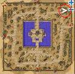
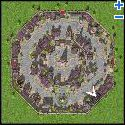

# Hair Styling/Dye Quests

## Hair Styling

<!-- Quest info -->
- **Level requirement:** 60
- **Item requirement:** 3 Counteragent, 3 Mixture, 100 Black Hair, 100 Golden Hair, 100 Daenggie, 100 Short Daenggie
- **Zeny requirement:** 99,800 Zeny
- **Quest reward:** Hairstyle Change

1. Find the "Hair Dresser" [NPC](NPC.md) inside the building in [Alberta](Alberta.md) near (135, 37). To change a hairstyle the following items are needed:

*  3 Counteragent
*  3 Mixture
*  100 Black Hair (Sohee)
*  100 Golden Hair (Marionette, Violy)
*  100 Daenggie (Munak)
*  100 Short Daenggie (Bongun)
*  99,800 Zeny

*Alternatively there are other hair dressers - i.e. the one near (33,141) - that change hair for ~198,000 zeny to a **random style**.*

2. After giving the NPC these items, the player can choose from the original (Non-Lighthalzen) hairstyles. To select a [Lighthalzen](Lighthalzen.md) style, visit the Stylist in the Item Shop in Lighthalzen (202,160, last floor), and bring the same items.
* Note: On Valkyrie, the Lighthalzen NPC also requires you to have the [Kafra Shop](Kafra_Shop.md) New Style Coupon.

## Hair Dying

To dye hair, talk to the NPC in the [Prontera](Prontera.md) Wedding shop. They will dye hair at the cost of a dyestuff item and 5,000 zeny.

There is another hair dyer located upstairs in the same building as the tool shop in [Lighthalzen](Lighthalzen.md).  That NPC will dye hair at the cost of a dyestuff item and 1,000 zeny.

## Dye Creation

<!-- Quest info -->
- **Level requirement:** None
- **Item requirement:** Herbs (Varies), Counteragent/Mixture (Varies), Empty Bottle (Varies)
- **Item reward:** 1 or more type of Dyestuffs

1.  Proceed to [Morroc](Morroc.md) with the Herbs, Counteragent/Mixture, and Empty Bottles.
1.  Enter the house in the top right corner, and talk to Java Dullihan.
1.  Select the **Make Dyestuffs** option.
1.  Next, choose which color dye is desired to create.
1.  Choose the Make Dyestuffs option again.

## Dye/Mixture/Counteragent Ingredients

*For a list of other NPC made items, go to [Item Mixing](Item_Mixing.md).*

| Dye Type | Ingredients | NPC and Location | Map Location |
| --- | --- | --- | --- |
| Scarlet Dyestuffs | 30 Red Herb 1 Counteragent 1 Empty Bottle 3,000 Zeny | Java Dullihan Inside Morroc (morocc_in 146,99) |  |
| Yellow Dyestuffs | 30 Yellow Herb 1 Counteragent 1 Empty Bottle 3,000 Zeny | Java Dullihan Inside Morroc (morocc_in 146,99) |  |
| White Dyestuffs | 30 White Herb 1 Counteragent 1 Empty Bottle 3,000 Zeny | Java Dullihan Inside Morroc (morocc_in 146,99) |  |
| Orange Dyestuffs | 20 Red Herb 20 Yellow Herb 1 Counteragent 1 Mixture 1 Empty Bottle 5,000 Zeny | Java Dullihan Inside Morroc (morocc_in 146,99) |  |
| Darkgreen Dyestuffs | 5 Blue Herb 20 Red Herb 20 Yellow Herb 1 Counteragent 1 Mixture 1 Empty Bottle 5,000 Zeny | Java Dullihan Inside Morroc (morocc_in 146,99) |  |
| Cobaltblue Dyestuffs | 20 Blue Herb 1 Counteragent 1 Empty Bottle 3,600 Zeny | Java Dullihan Inside Morroc (morocc_in 146,99) |  |
| Violet Dyestuffs | 10 Blue Herb 30 Red Herb 1 Counteragent 1 Mixture 1 Empty Bottle 5,000 Zeny | Java Dullihan Inside Morroc (morocc_in 146,99) |  |
| Black Dyestuffs | 30 Red Herb 30 Yellow Herb 30 Green Herb 5 Blue Herb 1 Counteragent 1 Mixture 1 Empty Bottle 7,000 Zeny | Java Dullihan Inside Morroc (morocc_in 146,99) |  |

| Item | Ingredients | NPC and Location | Map Location |
| --- | --- | --- | --- |
| Counteragent | 1 Detrimindexta 1 Alcohol 1 Empty Bottle 3,000 Zeny | Molgenstein Inside Geffen (geffen_in 141,140) |  |
| Mixture | 1 Karvodailnirol 1 Alcohol 1 Empty Bottle 4,000 Zeny | Molgenstein Inside Geffen (geffen_in 141,140) |  |

**Related pages:**

* [Items](Items.md)
* [Armor](Armor.md)
* [Headgear](Headgears.md)
* [Weapons](Weapons.md)
* [Weapon Materials](Weapon_Materials.md)
* [Garments](Garments.md)
* [Footgear](Footgear.md)
* [Accessories](Accessories.md)
* [Equipment Sets](Equipment_Sets.md)
* [Skill Equipment](Skill_Equipment.md)
* [Cards](Card_System.md)
* [Card Reference](Card_Reference.md)
* [Card Sets](Card_Sets.md)
* [Item Mixing](Item_Mixing.md)
* [Juice Ingredients](Juice_Ingredients.md)
* [Potion Ingredients](Potion_Ingredients.md)
* [Dye Ingredients](Dye_Ingredients.md)
* [Tame Ingredients](Tame_Ingredients.md)
* [Headgear Ingredients](Headgear_Ingredients.md)
* [Headgear Quests](Headgear_Quests.md)
* [Pet Equipment](Pet_Equipment.md)
* [Counteragent and Mixture Quest](Counteragent_and_Mixture_Quest.md)
* [Quest Items](Quest_Items.md)
* [Healing Items](Healing_Items.md)
* [Autocast](Autocast.md)

---
*Source: [iRO Wiki Classic](https://irowiki.org/classic/Hair_Styling/Dye_Quests) — GFDL 1.3+*
