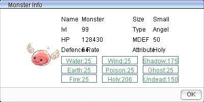

# Halloween Event (2013)

<!-- Quest info -->
- **Level requirement:** None?
- **Item requirement:** 30 Organic Pumpkins
- **Item reward:** Nifflheim Whisper Mask, Various items
- **External:** <http://www.playragnarok.com/news/eventdetail.aspx?id=303>

## Main Quest

1. Speak to **Suspicious coffin** in [Prontera](Prontera.md) (156, 134)
1. He will ask you to collect 30 **Organic Pumpkin** From **Organic Jakk**. The Jakks spawn on many fields and dungeons.
1. After collecting 30 pumpkins talk to **Blasphemous Alex** in [Nifflheim](Nifflheim.md) (181, 173)
1. On the first time you will be rewarded with a Nifflheim Whisper Mask with Defense 1.
    **NOTE: You can get warped to Nifflheim for 1,000z by talking to a Bathory in [Prontera](Prontera.md) at 107,60**(click on Bathory's shadow)

## Repeatable Quest

1. Returning to **Blasphemous Alex** with an additional 30 **Organic Pumpkin** will reward you with random materials or consumables.

Repeatable Rewards:
40 Immortal Heart
30 Witch Starsand
90 Empty Bottle
30 Alcohol
30 Karvodailnirol
5 Speed Potion
5 Chocolate
5 Guarana Candy
5 Yggdrasil Seed
90 Poison Spore
90 Stem
1 Old Blue Box
1 Old Card Album
50 Fabric

???

## Ghostbusters

<!-- Quest info -->
- **Level requirement:** 50
- **Party requirement:** None (Priests may want to bring a killing class)
- **Items required:** 1 Trap
- **Item reward:** Gozarian Mask
- **Window:** yes

1. Talk to the Signpost (67, 218) near West Prontera to start the quest.
1. Inside the Juno Library (yuno 342, 203), talk to NPCs Vanker, Spanglish, Sadmore or Stunts (yuno_in04 103, 4).
1. Continue talking to Vanker.  He will hire you on, then tell you to talk to Spanglish to get your gear.
1. Talk to Spanglish.  He will give you your gear then send you to the Lighthalzen Hotel (lighthalzen 159, 133) to speak with the manager.
1. Inside the hotel, speak with the Hotel Manager.
1. Head upstairs and talk to the Employee at the top of the stairs.
1. Go into the room at the end of the hallway (lhz_in02 238, 169).
1. Talk to the Ghost inside the room (lhz_in02 223, 145).  The ghost is on a small timer, so if it is not there wait a few seconds and it will appear.
1. You will attempt to catch the ghost, but it will escape and head into the hallway.
1. Click on the flowerpot along the right wall (244, 184) to flush out the ghost.  It will once again escape capture.
1. Talk to the Housekeeping NPC near the stairs.  He'll tell you that he saw the ghost go into the Couple's room (254, 212).
1. Inside the Couple's room, click on the dresser (285, 223) in the corner of the room.  The ghost will appear and escape.
1. Go back into the hallway and talk to the Housekeeping NPC.  He'll send you back down the hallway to the first room on the right.  As we are looking at the screen, this will be the first room on the left (231, 200).
1. Inside the room, click Under the Table (204, 199).  The ghost will again appear and escape.
1. Talk to Housekeeping again.  He'll tell you to go to the second room down the hall now (231, 182).
1. Inside the room, click Under the Bed (208, 173).  The ghost will again escape you.
1. Head back into the hallway and go up behind the stairs.  Click on the Ghost behind the statue.
1. If you choose to Zap it, the ghost will be exterminated and you will then be instructed to talk to the Hotel Manager downstairs.  If you choose to Trap it, you will catch the ghost.  Talk to the Employee at the top of the stairs before heading downstairs to talk to the Hotel Manager.
1. After talking to the Hotel Manager, head back to the Juno Library and talk to Vanker, Spanglish, Sadmore or Stunts.
1. They will now send you to the Prontera Castle to meet the next client.  (If you click on Spanglish again, you'll get some more dialogue about the Proton Packs)
1. Inside the Prontera Castle, talk to the Crusader (prt_castle 120, 65).  He'll tell you that he saw the ghost in the field West of Prontera.  At this point you should get a trap if you haven't already.
1. Go out the West gate to Prontera Field.  Head towards the bridge near (prt_fild05 187, 233). DO NOT attempt to cross or get too close to the bridge, as this will take away 50% to 75% of your HP and will warp you from the Whisper.  Note, this will not kill you, but it is possible to end up with 0 HP.
1. Spin your camera around until you can see the Whisper across the bridge.  Move your cursor on the whisper until get the dialogue animation then click on it so you can roll the trap across the bridge to capture it.
1. Head back to the Prontera Castle to talk to the Crusader.
1. The Crusader will thank you for catching the ghost (and get a little nervous about the bill).  Head back to the Juno Library to talk to the Ecto Exterminators.
1. Talk to any of the Ecto Exterminators.  You will hand them the trap and then get warped to a new room with the Exterminators to fight Gozer.
1. After a short delay (unable to talk to any NPC), talk to any of the NPCs to start the fight.   Each Player will be required to spawn a Destructor. Note: You can talk to the NPCs immediately and avoid fighting Destructor right after it has spawned. However, it is not so nice to other players. Very useful if you are a Full Support Priest however. Please note that the Destructor has 64 DEF and 50 MDEF.

  * 

1. After beating the Destructor, talk to any of the NPCs again.  At this time you will receive a Gozarian Mask with 2 Defense.  You will then be warped back to the Library.

---
**Categories:** [Quest Window Quests](categories/Quest_Window_Quests.md)
*Source: [iRO Wiki Classic](https://irowiki.org/classic/Halloween_Event_%282013%29) — GFDL 1.3+*
