# Headgear Ingredients

*For a list of other NPC made items, go to [Item Mixing](Item_Mixing.md).*

**Note: Some headgear have more than one NPC and/or a "Quest" to make them.  These are denoted by a link underneath the item name.**

| Headgear | Ingredients | NPC and Location | Map Location |
| --- | --- | --- | --- |
| Alarm Mask | 3000 Needle of Alarm 1 Mr. Scream | Muscle Man   Inside Al de Baran   (aldeba_in 88,180) | 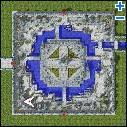 |
| Angel Wing Ears | 1 Angel Wing 1 Elven Ears 20,000 Zeny | Old Blacksmith   Juno   (yuno 241,52) | 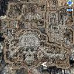 |
| Angry Solo Hat Not repeatable | Kills: 
20 Zerom  20 Requiem  30 High Orc  40 Arclouze  20 Green Maiden  50 Mao Guai  40 Firelock Soldier  20 The Paper
   [Quest](Headgear_Quests.md)   | (alberta 120, 206) Alonie Alberta | 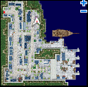 |
| Antlers | 20 Evil Horn | Cherokee   Inside Alberta   (alberta_in 122,53) |  |
| Ayam \[1\] | 7 Red Bijou 7 Green Bijou 7 Blue Bijou 7 Yellow Bijou 300 Shining Scale 1 Scarlet Dyestuffs 5 Cracked Diamond 50 Soft Silk | Han Garm  Inside Payon   (payon_in03 139,124) | 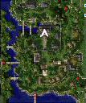 |
| Baby Pacifier | 1 Royal Jelly 1 Nursing Bottle 1 Pacifier 1 Nose Ring | Kid    Lighthalzen   (lighthalzen 360,313) | 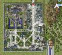 |
| Bao Bao | 1 Silk Ribbon 50 Heroic Emblem | Stylish Merchant    Alberta   (alberta 119,54) |  |
| Beanie | 1 Cap 500 Yarn | Hat Merchant   Lutie Tool Shop   (xmas_in 35,30) | 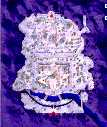 |
| Binoculars | 1 Geek Glasses 100 Steel 50,000 Zeny | Alchemist   Morroc Ruins   (moc ruins 118,176) | 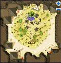 |
| Black Cat Ears | 1 Kitty Band 200 Fluff 1 Black Dyestuffs 10,000 Zeny | Neko Neko   Payon   (payon 116,131) | 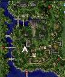 |
| Blue Fish | 1 Rotten Fish 300 Stinky Scale 50 Sushi 1 Fish Tail 100 Sticky Mucus 1 Claw of Desert Wolf | Educated Traveller   Morroc   (morocc 273,79) | 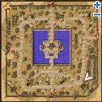 |
| Blue Hairband | 1 Bandana 1 Cobaltblue Dyestuffs 300 Anolian Skin | Hair Ornament Girl   Comodo   (comodo 228,159) | 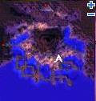 |
| Blush | 100 Alice's Apron | Vending Machine   Lutie Town   (xmas 114,296) | 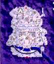 |
| Boy's Cap | 10 Tiger's Footskins | Grandpa   Inside Alberta   (alberta_in 28,145) | 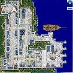 |
| Bride's Corolla | 1000 Maneater Blossom 1 Silk Ribbon | Orc Lady Inside Orc Village (gef_fil10 223, 203) | 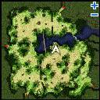 |
| Bride Mask \[1\] | 1 Four Leaf Clover 500 Log 10 Elastic Band 20 Skirt of Virgin 500 Fabric 2 Ancient Lips 100 Squid Ink | Chungwolmang Payon (payon 135,320) | 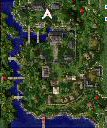 |
| Bulb Band | 1 Circlet \[1\] 20 Glass Bead | Hair Ornament Girl   Comodo   (comodo 228,159) |  |
| Bunny Band | 100 Feather 1 Pearl 1 Four Leaf Clover 1 Kitty Band | Kafra Employee   Alberta   (alberta 188,146) | 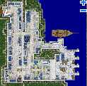 |
| Cake Hat | 10 Candy 5 Candy Cane 15 Well-Baked Cookie 20 Piece of Cake 10 Steel | Vending Machine   Lutie Town   (xmas 114,296) |  |
| Candle | 1 Bomb Wick 100 Royal Jelly 50 Matchstick | Vending Machine   Lutie Town   (xmas 114,296) |  |
| Catfoot Hairpin | Kills:   1,000 Kobold Archers     [Quest](Headgear_Quests.md)   | (gef_fild05 79, 149) Myu Geffen Field 5 | 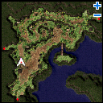 |
| Censor Bar | 1 Black Dyestuffs 100 Slick Paper 99 Sticky Mucus 100,000 Zeny | ?   Rachel   (rachel 91,273) | 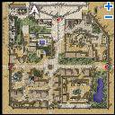 |
| Chef Hat | 120 Piece of Cake 450 Dragon Scale 1 White Dyestuffs 330 Feather | Vending Machine   Lutie Town   (xmas 114,296) |  |
| Cowboy Hat | 1 Western Grace 108 Claw of Desert Wolf 108 Soft Blade of Grass 4 Burning Horseshoe | Hat Merchant   Lutie Tool Shop   (xmas_in 35,30) |  |
| Crescent Hairpin | 1 Heart Hairpin 10 Steel | Stylish Merchant    Alberta   (alberta 119,54) |  |
| Cross Hat | 1 Rosary 500 Destroyed Armor | Hair Ornament Girl   Comodo   (comodo 228,159) |  |
| Crown of Ancient Queen | 1 Queen's Hair Ornament 1 [Emperium](War_of_Emperium.md) 3 Gold 20,000 Zeny | Nehris   Juno's Monster Museum   (yuno_in03 21,17) | 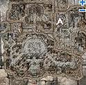 |
| Crown of Mistress | 1 Coronet 1 [Emperium](War_of_Emperium.md) 3 Gold 40,000 Zeny | Nehris   Juno's Monster Museum   (yuno_in03 21,17) |  |
| Crunch Toast | 50 Milk 50 Cheese 50 Piece of Cake 50 Old Frying Pan | Kasis   Juno   (yuno 222,116) | 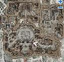 |
| Decorative Golden Bell | 1 Golden Bell 1 [Emperium](War_of_Emperium.md) 3 Gold 20,000 Zeny | Nehris   Juno's Monster Museum   (yuno_in03 21,17) |  |
| Decorative Mushroom | 300 Mushroom Spore | Ipore    Geffen   (geffen 67,87) | 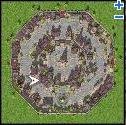 |
| Deviruchi Hat | 600 Little Evil Horn 40 Talon of Griffon | Young Man   Inside Payon   (payon_in01 55,12) | 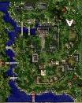 |
| Doctor Band | 1 Red Bandana 50 Iron 1 Cracked Diamond 3,500 Zeny | Trader   Inside Alde Baran   (aldeba_in 152,166) | 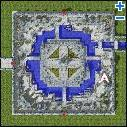 |
| Drooping Cat | 1 Claw of Desert Wolf 1 Black Dyestuffs 1 Circlet \[1\] 300 Black Cat Doll | Educated Traveller   Morroc   (morocc 273,79) |  |
| Ear Muffs | 1 Cursed Ruby 1 Headset 200 Feather 5,000 Zeny | Mystic Lady   Inside Payon   (payon_in01 17,10) | 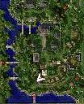 |
| Evil Wing Ears | 1 Evil Wing 1 Elven Ears 20,000 Zeny | Old Blacksmith   Juno   (yuno 241,52) |  |
| Fairy Flower \[1\] |  100 Transparent Celestial Robe 100 Soft Silk 1 Wedding Bouquet 1 Violet Dyestuffs 1 Bandana | (gonryun 149, 189) Yotang Kunlun | 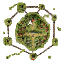 |
| Fashionable Glasses | 1 Jack be Dandy 1 Scarlet Dyestuffs | Stylish Merchant    Alberta   (alberta 119,54) |  |
| Feather Beret | 1 Beret 100 Soft Feather 1 White Dyestuffs | Sakjul   Rachel   (rachel 152,131) | 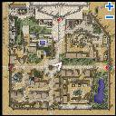 |
| Feather Bonnet | 1 Romantic Gent 300 Feather of Bird 500 Zeny | Trader   Inside Alde Baran   (aldeba_in 152,166) |  |
| Flower Hairpin | 1 Romantic Flower 10 Steel 20,000 Zeny | Argen    Geffen   (geffen 129,148) | 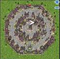 |
| Frog Hat | Items: 100 Spawn 100 Venom Canine 50 Scale Shell   Kills:   
50 Side Winders  50 Argiope
   [Quest](Headgear_Quests.md)   | (gef_fild07 108, 161) Roda Frog Geffen Field | 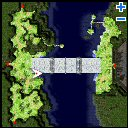 |
| Giant Band Aid | 1 Alcohol 500 Rotten Bandage | Argen    Geffen   (geffen 129,148) |  |
| Grief for Greed | 1 Circlet \[1\] 20 Steel 1 Gold 80 Feather 800 Sticky Mucus | Traveler    Comodo   (comodo 273,137) | 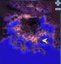 |
| Hahoe Mask | 1 Four Leaf Clover 500 Log 10 Elastic Band 20 Bookclip in Memory 100 Cactus Needle 100 Mane | Chungwolmang Payon (payon 135,320) |  |
| Hair Brush | Items: 1 Mixture 1 Scarlet Dyestuffs 50 Solid Shell 5 Elunium 1 [Axe \[4\]](Axe.md) | (comodo 236, 164) Hat Girl Comodo | 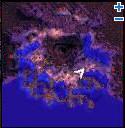 |
| Hat of the Sun God | 1 Amblem of the Sun God 40 Steel 2 Oridecon 10 Gold 50 Coal 1 Yellow Potion | Hat Store Girl    Alberta   (alberta 136,79) | 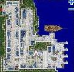 |
| Headset | 40 Steel 1 Coal 1 Alcohol 1 Oridecon 2,000 Zeny | Eric    Inside Geffen   (geffen_in 30,70) | 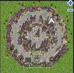 |
| Heart Hairpin | 1200 Coral Reef | Stylish Merchant    Alberta   (alberta 119,54) |  |
| Helm of Angel | 1 Angel Wing 1 Helm \[1\] 5 Fang of Hatii | Young Man   Inside Payon   (payon_in01 55,12) |  |
| Helmet of Orc Hero  [Quest](Headgear_Quests.md) | 10,000 Jellopy 11,000 Orcish Voucher 100 Heroic Emblem | Orc Hero    Orc Village   (in_orcs01 162,34) | 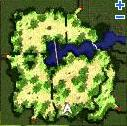 |
| Hot-blooded Headband | 300 Red Muffler 300 Burning Heart 1 White Dyestuffs 1 Bandana | Zhenbolt   Juno   (yuno 300,188) | 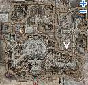 |
| Indian Headband | 1 Indian Fillet 1 Striped Hairband 10 PecoPeco Feather | Meruntei   Comodo   (comodo 237,217) | 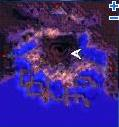 |
| Indifferent Solo Hat Not repeatable | Kills: 
20 Zerom  20 Requiem  30 High Orc  40 Arclouze  20 Green Maiden  50 Mao Guai  40 Firelock Soldier  20 The Paper
   [Quest](Headgear_Quests.md)   | ([Alberta](Alberta.md) 120, 206) Alonie Alberta |  |
| Kitsune Mask | 999 Nine Tails | Nine Tails    Payon Cave   (pay_dun03 48,84) | 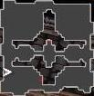 |
| Lazy Smokie | 1000 Acorn 100 Sea-otter Fur 10 Raccoon Leaf 1 Claw of Desert Wolf | Educated Traveller   Morroc   (morocc 273,79) |  |
| Mage Hat | 1 Wizard Hat 1 Elder Willow Card 400 Dragon Scale 50 Mould Powder 1 Yellow Potion | Hat Store Girl    Alberta   (alberta 136,79) |  |
| Magician Hat | 1 Wizard Hat 1200 Solid Shell 450 Ancient Lips 1 Yellow Potion | Hat Store Girl    Alberta   (alberta 136,79) |  |
| Magistrate Hat \[1\] | 7 Red Bijou 7 Green Bijou 7 Blue Bijou 7 Yellow Bijou 300 Shining Scale 1 Black Dyestuffs 5 Cracked Diamond 1 Hat \[1\] | Han Garm  Inside Payon   (payon_in03 139, 124) |  |
| Mine Hat | 1 Safety Helmet 1 Candle 1 Crystal Mirror 25 Steel | Traveler    Comodo   (comodo 273,137) |  |
| Model Training Hat (Byproduct: 1 arrow) | 1 [Book \[3\]](Book.md) 1 Apple of Archer | Nanhyang   Inside Payon   (payon_in03 9,193) | 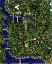 |
| Mr. Smile | 10 Jellopy 10 Fluff 10 Clover | Smile Assistance  Prontera   (prontera 157,187) | 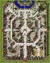 |
| Mystic Rose | 10 2Carat Diamond 3 Witherless Rose 1 White Dyestuffs 50,000 Zeny | Margaret Merry    Inside Lighthalzen   (lhz_in02 91,38) |  |
| Mythical Lion Mask \[1\] | 1 Four Leaf Clover 500 Log 10 Elastic Band 500 Horrendous Hair 2 Ancient Tooth 1 Orange Dyestuffs | Chungwolmang Payon (payon 135,320) |  |
| Opera Masque | 20 Iron 1 Singing Plant 5,000 Zeny * Some servers require Steel instead of Iron | Trader   Inside Alde Baran   (aldeba_in 152,166) |  |
| Opera Phantom Mask | 1 Opera Masque 50 Horrendous Hair 5,000 Zeny | Traveler    Comodo   (comodo 273,137) |  |
| Oxygen Mask | 5 Ora Ora | Boy    Inside Payon   (payon_in02 25,71) | 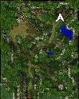 |
| Parcel Hat | 150 Fabric 1 Cobaltblue Dyestuffs 100 Resin | Traveler    Comodo   (comodo 273,137) |  |
| Party Hat | 1 Santa Hat 100 Slick Paper 100 Oil Paper | Hat Merchant   Lutie Tool Shop   (xmas_in 35,30) |  |
| Ph.D Hat | 1 Hinalle 1 Aloe 1 Illusion Flower 1 Ment | Teacher   Inside Prontera   (prt_in 38,107) | 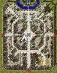 |
| Pretend Murdered | 4 Skirt of Virgin | Granny   Inside Payon   (payon_in01 99,71) | 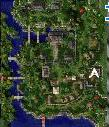 |
| Raccoon Hat | 1 Kitty Band 20 Dragon Scale 200 Tough Scalelike Stem 300 Sea-otter Fur | Vending Machine   Lutie Town   (xmas 114,296) |  |
| Rainbow Egg Shell | 1 Egg Shell 1 Cobaltblue Dyestuffs 50 Claw of Desert Wolf | Vending Machine   Lutie Town   (xmas 114,296) |  |
| Red Bonnet | 1 Green Lace 1 Scarlet Dyestuffs 1 Silk Ribbon 1 Sunday Hat 50,000 Zeny | Relaxed-Looking Lady    Lighthalzen   (lighthalzen 183,89) | 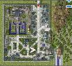 |
| Red Ribbon | 1 Big Ribbon 1 Ribbon \[1\] 1 Silk Ribbon | Nephia    Prontera   (prontera 164,233) | 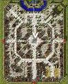 |
| Renown Detective's Cap \[1\] | 10 Magnifier 1887 Tassel 1 Bucket Hat \[1\] 1,887 Zeny | Strange Man    Lighthalzen   (lighthalzen 143,68) | 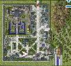 |
| Sakkat | 120 Trunk 10,000 Zeny | Trader   Inside Alde Baran   (aldeba_in 152,166) |  |
| Sea-Otter Hat | 1 Raccoon Hat 1 Smokie Leaf | Pretty Lindsay   Lutie Town   (xmas 183,266) | 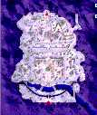 |
| Shafka \[1\] | 20 Nine Tails 10 Yarn 10 Soft Silk 20 Sea-otter Fur 1 Spool | Irina   Moscovia   (moscovia 211,93) | 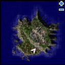 |
| Sunglasses \[1\] or Mini Glasses \[1\] or Takius \[1\] or Elven Ears \[1\] or Glasses \[1\] | 1 Slotted Advertissement   and the corresponding non-slotted version of the headgear   (70% success chance) | Spectacle Stanley   Alberta   (alberta 108,30) | 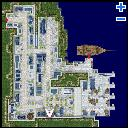 |
| Sunglasses \[1\]   [Quest](Headgear_Quests.md)  NOT IMPLEMENTED | 1 Sunglasses 400,000 Zeny | Maseph    Sograt Desert   (moc_fild09 209, 128) |   |
| Smokie Leaf | 600 Raccoon Leaf 1 Claw of Desert Wolf | Educated Traveller   Morroc   (morocc 273,79) |  |
| Sombrero | 1 Straw Hat 50 Cactus Needle 1 Guitar | Hat Merchant   Lutie Tool Shop   (xmas_in 35,30) |  |
| Spore Hat | 850 Poison Spore 300 Burnt Tree 1 Tongue | Vending Machine   Lutie Town   (xmas 114,296) |  |
| Statue Of Baby Angel \[1\] | Items: 500 Feather of Bird 1 Holy Water 10 Muscovite 1 Halo 1 Shining Stone | (alberta 151, 78) Bebete Alberta |  |
| Stop Post | 50 Trunk 1 Black Dyestuffs 91,100 Zeny | William   Morroc Ruins   (moc ruins 113,181) | 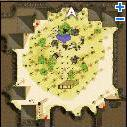 |
| Straw Hat | 1 Sakkat 300 Tough Vines 300 Piece of Bamboo | Hat Merchant   Lutie Tool Shop   (xmas_in 35,30) |  |
| Striped Hairband | 1500 Worn-out Prison Uniform | Hair Ornament Girl   Comodo   (comodo 228,159) |  |
| Sunday Hat | 1 Hat \[1\] 1 Cap \[1\] 250 Fabric 600 Soft Feather 1 Yellow Potion | Hat Store Girl    Alberta   (alberta 136,79) |  |
| Teddybear Hat | 1 Panda Hat 100 Needle Packet 100 Spool 300 Black Bear Skin | Fuzzy Fuzz   Lutie Town   (xmas 175,156) | 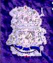 |
| Tulip Hairpin | 1 Mr. Smile 1 Scarlet Dyestuffs | Seth    Geffen   (geffen 83,189) | 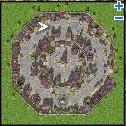 |
| Valkyrie Helm \[1\] | 1 Sage Worm Card 1 Argiope Card 1 Dryad Card 1 Wooden Golem Card 1 Bongun Card 1 Pirate Skel Card 1 Marduk Card 1 Hode Card 1 Elder Card 1 Nightmare Terror Card 1000 Rune of the Darkness 1000 Bloody Rune 10,000,000 Zeny | Ghenirhemin Hugel (hugel 147, 103) | 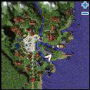 |
| Welding Mask | 50 Steel 2,000 Zeny | Blacksmith    Inside Geffen   (geffen_in 143,166) |  |
| Winter Hat | 999 Tiger Panty 1 Black Dyestuffs 1 Frozen Rose 50,000 Zeny | Metelle    Einbech   (einbech 70,222) |  |
| Wonder Nut Shell | 1 Nut Shell 500 Wing of Dragonfly | Vending Machine   Lutie Town   (xmas 114,296) |  |
| X Hairpin | 1 Stellar 400 Ectoplasm | Argen    Geffen   (geffen 129,148) |  |
| Zealotus Mask   [Quest](Headgear_Quests.md) | 369 Dark Crystal Fragment 1 Forbidden Red Candle 1 Cat's Eye 30 Worn-out Magic Scroll | Zealotus    Glast Heim Underprison   (gl_prison01 137,138) |  |

**Related pages:**

* [Items](Items.md)
* [Armor](Armor.md)
* [Headgear](Headgears.md)
* [Weapons](Weapons.md)
* [Weapon Materials](Weapon_Materials.md)
* [Garments](Garments.md)
* [Footgear](Footgear.md)
* [Accessories](Accessories.md)
* [Equipment Sets](Equipment_Sets.md)
* [Skill Equipment](Skill_Equipment.md)
* [Cards](Card_System.md)
* [Card Reference](Card_Reference.md)
* [Card Sets](Card_Sets.md)
* [Item Mixing](Item_Mixing.md)
* [Juice Ingredients](Juice_Ingredients.md)
* [Potion Ingredients](Potion_Ingredients.md)
* [Dye Ingredients](Dye_Ingredients.md)
* [Tame Ingredients](Tame_Ingredients.md)
* [Headgear Ingredients](Headgear_Ingredients.md)
* [Headgear Quests](Headgear_Quests.md)
* [Pet Equipment](Pet_Equipment.md)
* [Counteragent and Mixture Quest](Counteragent_and_Mixture_Quest.md)
* [Quest Items](Quest_Items.md)
* [Healing Items](Healing_Items.md)
* [Autocast](Autocast.md)

---
**Categories:** [Item Mixing](categories/Item_Mixing.md)
*Source: [iRO Wiki Classic](https://irowiki.org/classic/Headgear_Ingredients) — GFDL 1.3+*
