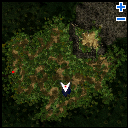

# Help Mikhail Quest

<!-- Quest info -->
- **Level requirement:** None
- **Item requirement:** 1 Medicine Bowl (buy it at [Al De Baran](Al_De_Baran.md))
- **Items required:** 1 Gusli
- **Zeny requirement:** 6,000z
- **Quests required:** [Finding The Moving Island Quest](Finding_The_Moving_Island_Quest.md)
- **Base EXP reward:** 1,000,000
- **Item reward:** 5 Honey Pancakes, 5 Jam Pancakes
- **Quest reward:** Ability to make pancakes

1. Go to the second floor of the house in [Moscovia](Moscovia.md) at ([Moscovia](Moscovia.md) 203, 96) and talk with Gallina (mosk_in 144, 279). Promise to search for her son, Mikhail.

2. Check the Fire Pot (mosk_in 205, 268) on the first floor, then talk with Gallina again. She mentions that the landlord of the inn is protective of Mikhail.

3. Talk with Anna (mosk_in 148, 274), choosing to ask ‘about the situation’.

4. Go to the inn in the center of Moscovia ([Moscovia](Moscovia.md) 229, 208) and ask the Landlord (mosk_in 135, 191) about Mikhail. Pay 5,000 Z to stay overnight in exchange for information about Mikhail. Ask the Landlord about Milhail again to learn that she guided Mikhail to the pub.

5. Go to the pub (which is part of the same building as the inn) and ask the Pub Owner (mosk_in 141, 212) about Mikhail. He mentions Victor.

6. Buy a drink from the bar for 1,000 Z, then talk with Victor (mosk_in 147, 202), who is hidden in the corner. He suggests that Mikhail might have headed to the swamp.

* **Note**: You must have completed the [Finding The Moving Island Quest](Finding_The_Moving_Island_Quest.md) to continue.

7. Travel to Whale Island and ask the Aged Stranger (mosk_fild01 86, 104) to take you to the forest by choosing to ‘venture into the unknown’.

8. Check the Bubbly Swamp (mosk_dun03 153, 90) in Dremuci Forest.

9. Check the Fire Pot (mosk_in 205, 268), choosing to ‘look it over’, then to ‘look inside the fire pot’. You find Mikhail and promise to get the paste for him.

10. Speak to Victor again, who says you will need to gather 10 Sticky Herbs and 1 Medicine Bowl for him to make the adhesive.  The Medicine Bowl can be bought from the Chemical Academy guild dealer in [Al De Baran](Al_De_Baran.md).

11. Return to Dremuci Forest and repeatedly check the Bubbly Swamp until you have collected 10 Sticky Herbs.
* Note: The swamp will sometimes yield kinds of herbs other than Sticky Herbs.

12. Talk with Victor again with 1 Medicine Bowl and 10 Sticky Herbs in your inventory to obtain the High Strength Adhesive.

11. Return to the Fire Pot and talk with Mikhail.

12. Talk with Gallina.
* You receive 1,000,000 base experience points.

13. Talk with Larissa on the first floor, who will reward you with 5 Honey Pancakes and 5 Jam Pancakes.

Larissa will now make pancakes for you whenever you desire if you provide the necessary ingredients:
  * 1 Old Frying Pan
  * 2 Milk
  * 2 White Potion
  * 1 Cheese
  * 1 Trunk
  * 1 Honey

---
**Categories:** [Base Experience Reward](categories/Base_Experience_Reward.md), [Moscovia Quests](categories/Moscovia_Quests.md)
*Source: [iRO Wiki Classic](https://irowiki.org/classic/Help_Mikhail_Quest) — GFDL 1.3+*
