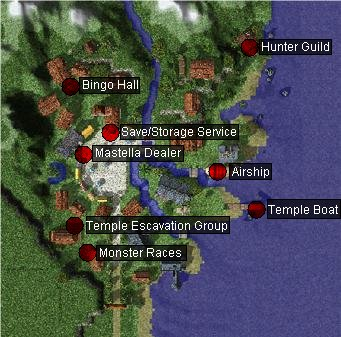

# Hugel

## About Hugel

Hugel is the Garden City. Located in the upper north east of the Swartzwald Republic, Hugel is home to the [Hunter](Hunter.md) guild. Off the dock is the Odin Temple dungeon. There are many things to do in Hugel, including Bingo and Monster Racing.

## Story

“No one asked anyone where they came from, what they did, and how they got here.” However, Hugel is now the eye of the storm. As pursuers who seek Odin Shrine’s relics, Gigantes, and Ymir’s Heart appeared, and the airship route opened, Hugel’s peace and isolation has come to the end. People in Hugel, especially ones who left their hometown for specific reasons, are now desperate to hide their secrets from the outsiders. So they started holding parties with others more often than used to be, in order to keep their secrets…

## Quest

Quests added with the Hugel update can be found [here](Quests.md).

## Guide

In the far north east of the Schwarzvald republic, lies a small rural coastal village by the name of Hugel.
Hugel is a quiet, yet festive fishing village, hosting a variety of games and activities for tourists, as well as hosts the [Hunter](Hunter.md) guild.

Because of its geographic location, the city of Hugel grew much different than the other Schwarzvald cities, being seperated by both Thanatos Tower and Abyss Lake. Because of increasing attacks on travelers, going by Airship is possibly the safest way to enter Hugel.

Adventurers visiting Hugel can enjoy many different things. If you have friends handy, the Bingo hall in the top left allows a group of 5 players to play, and every 10 minutes the monster races take place in the bottom left corner of town. Those interested in adventuring can take a short boat trip from the eastern docks to Angrboda island for 500z to where the remains of the great Odin's Temple stands.

Those wishing to class change to [Hunter](Hunter.md) may have found that the [Hunter](Hunter.md)'s guild has been moved to Hugel. You can find the guild building in the top right corner of town. Its rumored that the Hunters guild isn't the only one to make a relocation; the [Blacksmith](Blacksmith.md)s guild also recently moved to the forge in the southeast corner of [Einbroch](Einbroch.md) city.

Supplies and storage services can be located near the center square in town. Visitors will be able to purchase Hugel's unique crop of fruit, the Mastella Fruit. A Cool Event Corp NPC will handle storage and saving services in Hugel, as [Kafra](Kafra.md) is unable to staff such a far away place.

## Dungeons

* **Abyss Lake**

Travelers can find Abyss Lake in the northern part Schwartzvald Republic near Thanatos Tower. The only lake in the Republic is a natural wonder whose beauty has warmed the coldest of hearts and inspired hundreds of Bard songs. The shimmering lake surface, the surrounding green fields, and the foggy mist form an astonishing vision through all four seasons of the year. The lake's clear, pristine waters seem to run endlessly into the earth, ,and no one is sure of the water's actual depth. A quint island lies in the center of Abyss Lake, covered with dark, earthen rocks that appear purposefully arranged, almost as if to obscure something...

Although it is a beauteous spectacle, human visitors rarely come to Abyss Lake. The human inhabitants near Abyss Lake were all long since driven away by combined threat of strange creatures, believed to be guardians of nature summoned by the gods, and the dragons that have been summoned by Demon King Morroc. Even as people fled from Abyss Lake, Morroc's dragons grew more numerous and agressive, immediately attacking travelers and airships that dared to come near.

The Abyss Lake Dungeon consists of three floors, each floor becoming increasingly difficult. The final floor is a wide open space crowded with lots of monsters. Its recommended that if you wish to come to this place, that you have a sizable or very well coordinated party. On this final floor, the boss dragon Detale Deurus will appear to stop you from taking his treasures.

* **Thanatos Tower**

Aside from scarce historical documentation and spoken legends, very little is known about Thanatos Tower's Origin. The most widely accepted theory is that the tower was built to honor the legendary magic wielding swordsman Thanatos's victory over Demon King Morroc, an ancient demon that devistated the human world before the millennium war. According to the legends, Thanatos battled Demon King Morroc for 10 days and nights before he sealed it in the sothern Rune-Midgard desert.

Thanatos Tower is an awe inspiring sight today, but it was crumbling ruins when it was rediscovered by the [Rekenber Corporation](Rekenber_Corporation.md). Interested in extracting its secrets, [Rekenber Corporation](Rekenber_Corporation.md) planned to recontruct all thirteen of the tower's floors and conduct excavations that will continue the artifact research started by the great Save Varmunt.

So far, they have restored the tower's lowest floors and had opened them to the public, charging admission to tourists to fund their continuing renovation efforts.

But one day, a strange flash of lightning, bright enough to be seen in [Einbroch](Einbroch.md), recently struck the top of Thanatos Tower. There are differing accounts of what had happened, but the disaster left only a few survivors, all claiming that demons or angels attacked them. Despite this tragedy, the [Rekenber Corporation](Rekenber_Corporation.md) refuses to give up, and doggedly pursues its goals...

The Tower of Thanatos lies north east of [Juno](Juno.md). The most direct path to get to the tower would be to leave Juno from the south, go one map east, and 2 north. On the map here, left of center right across the gorge from the tower itself, will be a Rekenber representative who will assist you in getting to the tower.

* **Odin Temple**

*Long ago, there was a place where people had served God.*

*He created human beings and gave them everything.*

*So the people built a shrine and began to perform a religious service to appreciate him...*

The Odin Temple was built ages ago by an ancient civilization who worship the god of lightning. The temple was massive, almost spanning the size of the island. The people gave everything they could to make sure that the temple was perfect. However, their devotion and loyalty was all in vain.

Civil war broke out as the various leaders vied for the favor of Odin. Soon enough, destruction and death came as the warring factions nearly wiped each other out. The survivors slowly abandoned the island in search of a better future elsewhere.

Today, scholars and adventurers have made their way back into the island. The ghosts of the past as well as the present now stand guard to the greatest secrets of Odin.

**Related pages:**

* [Towns](Towns.md)
* [Rune-Midgarts Kingdom](Rune-Midgarts_Kingdom.md)
* [Alberta](Alberta.md)
* [Al De Baran](Al_De_Baran.md)
* [Archer Village](Archer_Village.md)
* [Comodo](Comodo.md)
* [Geffen](Geffen.md)
* [Izlude](Izlude.md)
* [Morroc](Morroc.md)
* [Payon](Payon.md)
* [Prontera](Prontera.md)
* [Umbala](Umbala.md)
* [Republic of Schwartzvald](Republic_of_Schwartzvald.md)
* [Einbech](Einbech.md)
* [Einbroch](Einbroch.md)
* [Hugel](Hugel.md)
* [Juno](Juno.md)
* [Lighthalzen](Lighthalzen.md)
* [Arunafeltz States](Arunafeltz_States.md)
* [Rachel](Rachel.md)
* [Veins](Veins.md)
* [Manuk](Manuk.md)
* [Amatsu](Amatsu.md)
* [Ayothaya](Ayothaya.md)
* [Kunlun](Kunlun.md)
* [Jawaii](Jawaii.md)
* [Louyang](Louyang.md)
* [Moscovia](Moscovia.md)
* [Nifflheim](Nifflheim.md)
* [Lutie](Lutie.md)

---
*Source: [iRO Wiki Classic](https://irowiki.org/classic/Hugel) — GFDL 1.3+*
