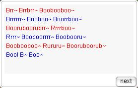

# Hugel Cow Milking

<!-- Quest info -->
- **Level requirement:** 50
- **Item requirement:** 1 Rapier \[2\], 3+ Concentration Potion (3 at a Time)
- **Base EXP reward:** 100,000 (Non-Repeatable)
- **Item reward:** 3 Fruit Mix (Dex +3) (Non-Repeatable)
- **Quest reward:** (Second-Time+ Rewards) 5 Milk -OR- 3 Honey -OR- 5 Orange Potion -OR- 5 Yellow Potion -OR- 1 Bundle of Food (Repeatable)

1. Walk past Kurupe in [Hugel](Hugel.md) (hugel 57 104) [Just above the monster races] and he'll tell you to look for Burupu and have him milk his Cow, Booboo.

2. Walk past Burupu at the field map south of Hugel (hu_fild06 217,270) [Walk straight down from the portal, he's on the right side of the upper black line on the minimap] and he'll talk about the desire to be a swordsmen. He'll ask you to bring him a Rapier \[2\] in return for milking the cow.

3. Burupu will back out of his words and tell you to follow Burupu's Instructions (hugel 72 101) which is near to the cow Booboo (hugel 68 99).

4. Before you start anything else, it is best to read the guide first. For sake of quick review during the quest, an image of Chapter One and Two will be provided below.

5. First, talk to Kurupe to begin the process of milking Booboo.

6. Each try requires 3 Concentration Potions. Failing to milk Booboo will require another 3 potions for the next try. At this point, having Sound Effects on is a REQUIREMENT to continue. After consuming 3 Concentration Potions, the magic brush will play music that symbolizes Booboo's mood.

* Theme of Lutie is the sound played when Booboo is in Love, brush it "1" time.
* Peaceful Forest is played when it is Neutrally Content, brush it "5" times.
* Curse 'n Pain might be the one played when it is Sad, brush it "10" times.
* Mucho Gusto is played when it is happy, brush it "3" times.
* Jazzy Funky Sweety is played when it is when angry, insert "No!".

7. If one fails to brush Booboo according to its mood, it is still possible to redo from Step 6. If successful, Booboo will then sing. An image is provided of the song above for quick comparison (The dialog box with the red and blue). Remember that caps is important and be sure not to type in any spaces or "~" (aka Tildes) the game only wants the specific word that was incorrect in the song. Again, if you don't succeed at this part, restart form Step 6.

The correct version of Booboo's Song

8. After you finish milking Booboo, talk to Kurupe to get your reward of 100,00 Base EXP and 3 Fruit Mix (Dex +3).

* Note: *The quest is repeatable for a different reward. If you wish to repeat*:

9. Speak to Kurupe and he shall tell you to inform Burupu of a day off. After talk to Burupu, speak to Kurupe again to begin the process of milking Booboo. Repeat Steps 6, 7, and 8 to claim your prize of the one of the following set of items: 5 Milk, 3 Honey, 5 Orange Potion, 5 Yellow Potion, 1 Bundle of Food.

---
**Categories:** [Base Experience Reward](categories/Base_Experience_Reward.md), [Hugel Quests](categories/Hugel_Quests.md), [Quests](categories/Quests.md)
*Source: [iRO Wiki Classic](https://irowiki.org/classic/Hugel_Cow_Milking) — GFDL 1.3+*
