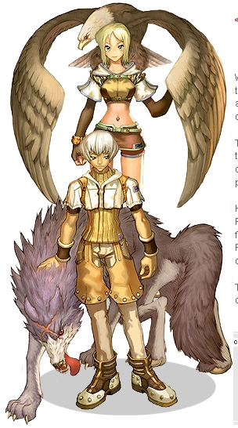

# Hunter

<!-- Job info -->
- **Job name:** Hunter
- **Job base:** Archer
- **Job type:** 2-1
- **Changes at:** [Hugel](Hugel.md)
- **Skills:** 18
- **Skill points:** 82
- **Quest skills:** 1
- **STR:** 4
- **AGI:** 6
- **VIT:** 2
- **INT:** 4
- **DEX:** 10
- **LUK:** 4

## Overview

Hunters are skillful at indirect combat. Their increased [ASPD](ASPD.md) with bows helps makes them superior to Archers in ranged combat. They are also able to lay mines and traps on the ground to hinder or catch mobs. These traps will cause various status effects ([Sandman](Sandman.md) inflicts the status [Sleep](Status_Effects.md), for example) or cause elemental damage (i.e. [Blast Mine](Blast_Mine.md), [Land Mine](Land_Mine.md)) to a target.

Additionally, they have a powerful subcharacter, the [Falcon](Falconry_Mastery.md). Falcons are highly effective at dealing consistent damage, as their damage ignores [DEF](DEF.md). Falcons give Hunters the ability to deal damage to multiple monster at once, by gathering enemies together and employing the Falcon with the skill [Blitz Beat](Blitz_Beat.md). If [Blitz Beat](Blitz_Beat.md) is not cast manually, however, the damage of [Blitz Beat](Blitz_Beat.md) done to each target is divided by the number of targets it hits at that instance, thus making ["auto-Blitz"](Blitz_Beat.md) an inefficient method of mobbing. Falcons also have the ability to reveal concealed enemies and destroy enemy traps.

Hunters were once considered overpowered in Ragnarok Online pre-Amatsu patch, while players were still getting the hang of 2-2 classes, since they were capable of [MVP](MVP.md)ing and seemingly only needed two stats: [AGI](Stats.md) and [DEX](Stats.md) to be successful at [MVP](MVP.md), [PvP](PvP~d29d2.md), and [PvM](PvM~a1fb2.md) aspects of the game. However, Hunters have their own weaknesses, namely the lack of VIT and STR, except in certain specialized builds.

## Jobchange Guide

*See [Hunter Job Change Guide](Hunter_Job_Change_Guide.md) for detailed information.*

Changing into a Hunter from an [Archer](Archer.md) requires the player to complete a number of tasks:
*  Item Collection
*  Written Test
*  Battle Test

After completing these tests, the player will be transformed into a Hunter.

## Builds

## [DEX](Stats.md)/[AGI](Stats.md) (PowerHouse)

*  STR: 1
*  AGI: 99 (Base)
*  VIT: 1
*  INT: 9
*  DEX: 140-150 (99 Base)
*  LUK: 1

These Hunters are powerful damage dealers, capable of dealing some of the highest amounts of Damage per Second in the game under the right conditions. They have little to no defense, however, so they're best used when in a party, shooting from behind. Great for [MvP](MVP.md)ing bosses without high [DEF](DEF.md). Some modifications of this build will take into account some [INT](Stats.md) and [LUK](Stats.md) for Falcon strikes. Recommended for those who do not wish to lay traps, or for those seeking a jack-of-all-trades build.

## Falconer

*  STR: 1
*  AGI: 90-99 (Base)
*  VIT: 10-20
*  INT: 1-40
*  DEX: 60-80 (Base)
*  LUK: 40-60+

Relying on the use of the Falcon to attack, these types of hunters can conserve SP while dealing good damage with the Falcon. One of their other advantages is that Falcons ignore [DEF](DEF.md), making them effective anti-tankers. They are slightly more difficult to level in the Archer stage due to their reduced [DEX](Stats.md). Recommended for those who enjoy seeing their Falcon fly.

## [DEX](Stats.md)/[INT](Stats.md) (WoE/Trapper build)

*  STR: 1+
*  AGI: 1-20-30+
*  VIT: 70-80+
*  INT: 50-70
*  DEX: 1-60-70
*  LUK: 1

Built for the singular purpose of laying traps, this hunter is made to survive. If the Hunter does not have [Enlarge Weight Limit](Enlarge_Weight_Limit.md) (purchased from the Kafra Shop), they should invest in [STR](Stats.md) for carrying potions and traps. This build is the most difficult to level of all, namely because of the lack of [AGI](Stats.md) and [DEX](Stats.md). These builds can be effective at mobbing using traps that deal more damage per enemies.

## Stats

*  [STR](Stats.md) affects weigh limit, however it is no longer efficient to invest points in STR for this reason, due to the Kafra Shop making [Enlarge Weight Limit](Enlarge_Weight_Limit.md) available to all classes. It also adds to Beast Strafing damage, and in very small amounts, bow [ATK](Stats.md). This is generally considered the least useful stat for hunters and is often left at 1.
*  [AGI](Stats.md) affects the speed at which they are able to attack and their [Flee](Stats.md) rate. This stat is important for most hunters and is generally considered their second or first most useful stat.
*  [VIT](Stats.md) mainly affects how much [HP](Max_HP.md) hunters have and their resistance to [Status Effects](Status_Effects.md). [WoE](War_of_Emperium.md) Hunters tend to get around 60 VIT.
*  [INT](Stats.md) affects how much SP hunters have, as well as the regen rate for SP. It also increases Falcon damage and the damage inflicted of damage traps.
*  [DEX](Stats.md) increases bow attack, [Hit](Stats.md) rate, and in very small amounts, [attack speed](ASPD.md).
*  [LUK](Stats.md) increases a [critical rate](Stats.md) as well as how often a Hunter's Falcon is released (attacks) during normal attacks.

## Equipment

## Headgear

*  Cap [1] - A basic 4 def, and cheap too. It is usually easy to find an overupgraded cap to put a card in for defensive or offensive purposes. A good combo would be the +9 Maestro Cap, with +2 INT and +150 SP.
*  Apple of Archer - Not recommended in PVP/WoE environment, but for MVP and leveling to reach a new dex bonus AoA is very useful. With it's +3 DEX on headgear, this is a must-have for all Hunters, even if it is not part of their build to reach a new DEX bonus. You never know when you may have ot use a different Armor/Accesory combo and have to use the AoA to reach the next dex bonus.
*  Poo Hat or Beret - Self-explanatory. 10% less from demi humans. If you don't need an AoA for your dex, Poo Hat or Beret is great for PVP and WoE.
*  Feather Beret -  1 def, 1 mdef, and 10% less from demi humans. a great choice for PvP and WoE.
*  Ghost Bandana - Agi + 2.. like the AoA except it helps you reach a higher ASPD. Not as useful as a carat/wise for leveling but if you do prefer having extra ASPD as opposed to SP in MVP/Leveling situations then this is a fine headgear to use
*  Binoculars - 1 DEF and 1 DEX, not bad but slotted sunnies are almost always better, unless you need the binocs to hit your dex bonus.
*  Sunglasses [1] - Nightmare card, Willow Card, and Elder Willow card are all good for Hunters (depending on your build). Marduk card is good too if you don't wanna worry about carrying green pots around (Hunter weight limit sucks).

## Footgear

Hunters can use boots. This is the highest DEF footgear and also does not weigh much, so it is usually a good idea to use slotted Boots for this part of your gear.

*  Matyr Card - 1 AGI and 10% more HP. A good basic gear to wear while leveling and in PVP/WoE.
*  Firelock Card - 10% HP/SP increase. Awesome card for everywhere. Make sure those boots are +9!
*  Male Thief Bug Card - +2 AGI. An oldschool card but still useful. Can help you hit that important ASPD bonus.
*  Crystal Pumps - Many Falcon-build hunters use Crystal Pumps to increase their LUK, for more Autoblitz chance and Crit.

## Armor

*  Mink Coat [1] - 6 def, weighs 230. A simple basic gear, same DEF as tights except no DEX and it weighs A LOT. Try to avoid this if possible, only to be used really for cards such as Ghostring which you wouldn't want to waste in a pair of tights.
*  Tights [1] - The best armor for a Hunter. 50 Weight, 6 def, and +1 dex. Often helps you reach your DEX bonus, or will allow you to take those binocs off.
*  Coat [1] - Use this or a Mantle [1] for elemental armors. Switching through 6 pairs of tights is annoying.

## Garment

Generally, Hunters will use a Muffler or if you have the funds, a Heavenly Maiden Robe for their Garment.

*  Whisper Card - Good for leveling. Hunters can reach a high amount of flee with all of their agi/flee increasing skills (Wind Walker, Falcon Eyes, Improve Concentration).
*  Dragontail Card - Probably the best choice for leveling and MVP, and even in PVP. Increases your Double Strafe Damage by 5%, also adds 10 flee and 1 AGI. The AGI may help you reach an ASPD bonus, and the flee always helps while leveling. An excellent card for those powerhouse builds that are all about dishing out loads of damage.
*  Raydric Card - Of course, the classic Immune Muffler should be a part of your gear, for every aspect of the game.

## Shield

Hunters are limited to wearing guards. You cannot attack with a bow while your guard is equipped, because bows are two handed weapons. You can, however, do any Trap or Falcon skill (such as Blitz Beat or Detect) while wearing your guard. Basically only useful for Trapper/Falconer builds.

## Accessory

Nimble Brooches and Gloves are the best accessories to use as a hunter. Usually, with 99 DEX, you can use two nimble brooches to reach 150 DEX on a Hunter. If you prefer to use 140 DEX while leveling, flash rosaries are a very good choice. Of course, if you can afford it (and it works in your build), [Bow Thimble [1]](http://db.irowiki.org/classic/item-info/2671/) may be a good choice.

## Weapon

*  Composite Bow [4] - Every Hunter should use composite bows for dealing damage. 2x2x Race/Element is the best, of course.
*  Bow [4] - You usually use a Bow [4] to inflict status effects on your enemies. Status bows are amazing in PVP. Hunters have very high attack speed and also can cause status effects from a range, which is a huge advantage in many situations in WoE and PVP.
*  Burning/Earth/Frozen/Gust Bow [1]- a nice replacement for 2:2 composites[4], carded with correct elemental modifier card and arrow set and against correct element monsters.

## Arrows

Arrows are VERY important to Hunters. The fact that a Hunter can use a carded weapon with an elemental arrow without having to trouble a Sage for an Endow is a huge advantage in every aspect of the game, especially leveling.

*  PVP/WoE - In PVP/WoE, it is best to carry Stone Arrows for the basic attacking arrow. These will destroy those wearing Zephyrus (Dokebi Card) armor to counter a Wizard's Jupitel Thunder, or any other Wind/Water type skill. It also bypasses the Immune (Raydric Carded garment) that your enemy may have equipped. Status arrows, such as Mute Arrows and Curse Arrows are not hard to collect. They can be used in combination with a status bow to completely disable your enemy. For example, against a Lord Knight using a Quadruple Cursing bow with Cursed Arrows will allow you to keep your distance. You can also mix it up. You can use a Quadruple Stun Bow with Mute arrows to ward off those pesky wizards. Remember, since all status arrows are Neutral element you may want to use Cursed Water to continue bypassing the Immune effect. In PVP, a ghostring armor is very powerful against melee classes. However, Hunters have a huge advantage against those who keep their ghostring equipped. Hunters can easily change their weapon's element to Ghost Property by equipping Immaterial Arrows. A Hunter should always be prepared to help their party out by taking out Ghostring wearers with Immaterial Arrows.
*  Leveling - Self explanatory. Carry arrows that are strong against the monsters you are fighting. Leveling with status bows is not suggested, as it would be quite expensive to get an endow slave and go back to storage to restock on arrows.

## Class Data

## Skills

*See [Archer Skills](Archer.md) for first class skills.*

| Skill | Description | Levels | Type |
| --- | --- | --- | --- |
| [Ankle Snare](Ankle_Snare.md) | Use 1 Trap item to set a trap that will immobilize an enemy for a set duration. | 5 | Active |
| [Beast Bane](Beast_Bane.md) | Increases [ATK](Stats.md) against [Insect](Insect.md) and [Brute](Brute.md) race monsters. | 10 | Passive |
| [Blast Mine](Blast_Mine.md) | Set a trap that does [Wind](Wind.md) damage in a 3x3 area when triggered. | 5 | Offensive |
| [Blitz Beat](Blitz_Beat.md) | Your [Falcon](Falconry_Mastery.md) attacks an enemy and all surrounding foes within a 3x3 area. Can also go off passively. | 5 | Offensive |
| [Claymore Trap](Claymore_Trap.md) | Set a trap that will explode, causing [Fire](Fire.md) property damage in a 5x5 area. | 5 | Offensive |
| [Detect](Detect.md) | Command your Falcon to detect hidden enemies within a variable range. | 4 | Active |
| [Falconry Mastery](Falconry_Mastery.md) | Enables [Hunter](Hunter.md)s to rent and command a Falcon, an exclusive sub-character for the Hunter class. | 1 | Passive |
| [Flasher](Flasher.md) | Set a trap that will emit bright light that can [Blind](Status_Effects.md) enemies. | 5 | Active |
| [Freezing Trap](Freezing_Trap.md) | Do [Water](Water.md) damage and possibly [freeze](Status_Effects.md) an enemy when triggered. | 5 | Offensive |
| [Land Mine](Land_Mine.md) | A trap that explodes when triggered, inflicting [Earth](Earth.md) damage with a chance to [Stun](Status_Effects.md) an enemy. | 5 | Offensive |
| [Remove Trap](Remove_Trap.md) | Remove a trap laid by yourself, recovering the Trap item. | 1 | Active |
| [Sandman](Sandman.md) | Set a trap that can put enemies to [Sleep](Status_Effects.md) within a 5x5 area once triggered. | 5 | Active |
| [Shockwave Trap](Shockwave_Trap.md) | Set a trap to drain [SP](SP.md) from enemies when triggered. | 5 | Active |
| [Skid Trap](Skid_Trap.md) | Set a trap that will cause an enemy to slide in a certain direction once it is triggered. | 5 | Active |
| [Spring Trap](Spring_Trap.md) | Commands your Falcon to remove a set enemy or friendly trap from a distance. | 5 | Active |
| [Steel Crow](Steel_Crow.md) | Increase damage inflicted by your Falcon. | 10 | Passive |
| [Talkie Box](Talkie_Box.md) | Set a trap that will display a user-set text message to whoever steps on it. | 1 | Active |

## Quest Skills

| Skill | Description | Levels | Type | Job Level Requirement | Quest |
| --- | --- | --- | --- | --- | --- |
| [Phantasmic Arrow](Phantasmic_Arrow.md) | Shoot a magic arrow without requiring actual arrows and pushes the enemy 3 cells backward. | 1 | Offensive | 40 | [Phantasmic Arrow Quest](Hunter_Skill_Quest.md) |

## Soul Link

*[Hunter Spirit](Hunter_Spirit.md) enables use of*

| Skill | Description | Levels | Type |
| --- | --- | --- | --- |
| [Beast Charge](Beast_Charge.md) | An advanced form of [Double Strafing](Double_Strafe.md) modified to do additional damage against [Brute](Brute.md) or [Insect](Insect.md) race monsters. | 1 | Offensive |

## Job Bonuses

| **Stat\Amount** | **+1** | **+2** | **+3** | **+4** | **+5** | **+6** | **+7** | **+8** | **+9** | **+10** |
| --- | --- | --- | --- | --- | --- | --- | --- | --- | --- | --- |
| **STR** | 5 | 10 | 11 | 44 |   |   |   |   |   |   |
| **AGI** | 12 | 19 | 20 | 31 | 39 | 47 |   |   |   |   |
| **VIT** | 17 | 22 |   |   |   |   |   |   |   |   |
| **INT** | 2 | 34 | 41 | 46 |   |   |   |   |   |   |
| **DEX** | 1 | 4 | 8 | 14 | 21 | 27 | 33 | 38 | 43 | 49 |
| **LUK** | 7 | 15 | 29 | 42 |   |   |   |   |   |   |

## ASPD

## External Links

**Related pages:**

* [Hunter](Hunter.md)
* [Sniper](Sniper.md)
* [Skills](Skills.md)
* [Ankle Snare](Ankle_Snare.md)
* [Beast Bane](Beast_Bane.md)
* [Beast Charge](Beast_Charge.md)
* [Blitz Beat](Blitz_Beat.md)
* [Claymore Trap](Claymore_Trap.md)
* [Detect](Detect.md)
* [Falconry Mastery](Falconry_Mastery.md)
* [Flasher](Flasher.md)
* [Freezing Trap](Freezing_Trap.md)
* [Land Mine](Land_Mine.md)
* [Phantasmic Arrow](Phantasmic_Arrow.md)
* [Remove Trap](Remove_Trap.md)
* [Sandman](Sandman.md)
* [Shockwave Trap](Shockwave_Trap.md)
* [Skid Trap](Skid_Trap.md)
* [Spring Trap](Spring_Trap.md)
* [Steel Crow](Steel_Crow.md)
* [Talkie Box](Talkie_Box.md)
* [Falcon Eyes](Falcon_Eyes.md)
* [Falcon Assault](Falcon_Assault.md)
* [Focused Arrow Strike](Focused_Arrow_Strike.md)
* [Wind Walker](Wind_Walker.md)
* [Quests](Quests.md)
* [Hunter Job Change Guide](Hunter_Job_Change_Guide.md)
* [Hunter Skill Quest](Hunter_Skill_Quest.md)
* [Rebirth Walkthrough](Rebirth_Walkthrough.md)
* [Weapons](Weapons.md)
* [Bow](Bow.md)

**Related pages:**

* [Classes](Classes.md)
* [Novice](Novice.md)
* [High Novice](High_Novice.md)
* [Super Novice](Super_Novice.md)
* [Acolyte](Acolyte.md)
* [Archer](Archer.md)
* [High First Class](High_First_Class.md)
* [Mage](Mage.md)
* [Merchant](Merchant.md)
* [Swordman](Swordman.md)
* [Thief](Thief.md)
* [Priest](Priest.md)
* [Monk](Monk.md)
* [Hunter](Hunter.md)
* [Bard](Bard.md)
* [Dancer](Dancer.md)
* [Wizard](Wizard.md)
* [Sage](Sage.md)
* [Blacksmith](Blacksmith.md)
* [Alchemist](Alchemist.md)
* [Knight](Knight.md)
* [Crusader](Crusader.md)
* [Assassin](Assassin.md)
* [Rogue](Rogue.md)
* [Transcendent](Transcendent.md)
* [High Priest](High_Priest.md)
* [Champion](Champion.md)
* [Sniper](Sniper.md)
* [Minstrel](Minstrel.md)
* [Gypsy](Gypsy.md)
* [High Wizard](High_Wizard.md)
* [Scholar](Scholar.md)
* [Mastersmith](Mastersmith.md)
* [Biochemist](Biochemist.md)
* [Lord Knight](Lord_Knight.md)
* [Paladin](Paladin.md)
* [Assassin Cross](Assassin_Cross.md)
* [Stalker](Stalker.md)
* [Gunslinger](Gunslinger.md)
* [Ninja](Ninja.md)
* [TaeKwon Kid](TaeKwon_Kid.md)
* [TaeKwon Master](TaeKwon_Master.md)
* [Soul Linker](Soul_Linker.md)

---
**Categories:** [Classes](categories/Classes.md), [Hunter](categories/Hunter.md)
*Source: [iRO Wiki Classic](https://irowiki.org/classic/Hunter) — GFDL 1.3+*
