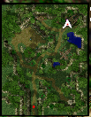

# Hunter Job Change Guide

<!-- Quest info -->
- **Level requirement:** None
- **Job level requirement:** 40
- **Class requirement:** Archer
- **Item requirement:** Varies (see table)
- **Quest reward:** Job change to [Hunter](Hunter.md)
- **Window:** yes

1. Go to the Hunter Guild on Payon Field 10 (pay_fild10 (148, 252)) (which is situated 2 maps east, and 1 south of Payon). Talk with the guildmaster, Sherin, and apply to become a [Hunter](Hunter.md).

Sherin tells you that candidates are required to pass three tests before they can become a hunter.

2. The first test is a personality assessment. The following are the answers to the test:

  1. Wander around alone and search for a place.
  1. Walk with a friend.
  1. Hunt at a nearby field.
  1. Go back to town.
  1. Would it be possible to get a heal, please?
  1. Open a chat room and wait.
  1. Tell the person about a good place to hunt.
  1. Guide them to their destination.
  1. Watch, then attack when asked for help.
  1. Try to find the owner.

3. Talk with the Guild Receptionist, "Demon Hunter", on the left, who tells you that the second test consists of gathering items to make arrows. Gather the items he requests, then talk with him again.

Demon Hunter will request one of the following sets of items, chosen randomly:

| Set | Items |
| --- | --- |
| 1 | 5 Claw of Desert Wolf 5 Trunk 3 White Herb |
| 2 | 9 Worm Peeling 9 Shell 9 Yellow Herb |
| 3 | 3 Dokebi Horn 3 Piece of Egg Shell 10 Fluff |
| 4 | 3 Venom Canine 5 Red Herb 3 Animal Skin |
| 5 | 3 Bill of Birds 5 Skel-bone 3 Green Herb |
| 6 | 3 Tooth of Bat 1 Sticky Mucus 1 Bear's Footskin |
| 7 | 2 Porcupine Quill 1 Yoyo Tail 1 Acorn |

4. Talk with Sherin again, who instructs you to meet another guild member in Payon to take the final test.

**Tip**: Bring enough healing items to recover all of your [HP](Max_HP.md) at least once for the final test.

5. Go to the building in [Payon](Payon.md) situated to the east of the central castle (payon (185, 233)). Enter the first room on your right, then talk with the guild member and ask to take the final test.

The guild member will give you 200 Silver Arrows and transfer you to a waiting room. Walk forward and the examiner will explain the test to you.

The test area is a maze populated with Porings, Zombies, Archer Skeletons, and Mummies, and scattered with puddles of water. You are required to complete three objectives in order and within 3 minutes to pass the test:

  1. Kill any 4 of the monsters labelled "Job Change Monster".
  1. Open the exit by activating a switch.
  1. Exit the maze.

All of the monsters will die once the required number of target monsters have been killed.

The six target monsters are comprised of:

  * 1 Poring, located in the north.
  * 3 Zombies, each located in the east, west, and center respectively.
  * 1 Archer Skeleton, located in the east.
  * 1 Mummy, located in the south-west.

The switch is located at the center of the maze, and can be activated by clicking it. The exit is located in the north.

**Tip**: You can activate the switch from a distance; you don't need to stand next to it.

You will fail the test if any of the following happens:

  * You kill any monster that is not labelled "Job Change Monster".
  * You walk in any of the puddles of water.
  * You fail to complete the objectives within the allocated time.
  * You are killed.

When you are ready to begin the test, enter the receptionist's chat room and wait until you are transferred to the test area.

6. You are awarded a Necklace of Wisdom as proof of passing the final test.

7. Return to the Hunter Guild. Give the Necklace of Wisdom to Sherin and she will make you a hunter.

**Tip**: Before leaving the area, exit the Hunter Guild and kill enough monsters to learn [Falconry Mastery](Falconry_Mastery.md), then return to the Hunter Guild and rent a falcon from the Falcon Breeder in the right wing of the building.

**Related pages:**

* [Hunter](Hunter.md)
* [Sniper](Sniper.md)
* [Skills](Skills.md)
* [Ankle Snare](Ankle_Snare.md)
* [Beast Bane](Beast_Bane.md)
* [Beast Charge](Beast_Charge.md)
* [Blitz Beat](Blitz_Beat.md)
* [Claymore Trap](Claymore_Trap.md)
* [Detect](Detect.md)
* [Falconry Mastery](Falconry_Mastery.md)
* [Flasher](Flasher.md)
* [Freezing Trap](Freezing_Trap.md)
* [Land Mine](Land_Mine.md)
* [Phantasmic Arrow](Phantasmic_Arrow.md)
* [Remove Trap](Remove_Trap.md)
* [Sandman](Sandman.md)
* [Shockwave Trap](Shockwave_Trap.md)
* [Skid Trap](Skid_Trap.md)
* [Spring Trap](Spring_Trap.md)
* [Steel Crow](Steel_Crow.md)
* [Talkie Box](Talkie_Box.md)
* [Falcon Eyes](Falcon_Eyes.md)
* [Falcon Assault](Falcon_Assault.md)
* [Focused Arrow Strike](Focused_Arrow_Strike.md)
* [Wind Walker](Wind_Walker.md)
* [Quests](Quests.md)
* [Hunter Job Change Guide](Hunter_Job_Change_Guide.md)
* [Hunter Skill Quest](Hunter_Skill_Quest.md)
* [Rebirth Walkthrough](Rebirth_Walkthrough.md)
* [Weapons](Weapons.md)
* [Bow](Bow.md)

---
**Categories:** [Archer](categories/Archer.md), [Hunter](categories/Hunter.md), [Job Change Guide](categories/Job_Change_Guide.md), [Quest Window Quests](categories/Quest_Window_Quests.md)
*Source: [iRO Wiki Classic](https://irowiki.org/classic/Hunter_Job_Change_Guide) — GFDL 1.3+*
