# IRO 7th Anniversary Event (2010/06/03) ~ (2010/07/01)

> **Note:** Not implemented on iRO Classic.

## Hugel Warpers

Warper [NPC](NPC.md)s are offering free warps to [Hugel](Hugel.md). They can be found in the following cities:
* [Prontera](Prontera.md) (180, 125)
* [Juno](Juno.md) (168, 178)
* [Payon](Payon.md) (179, 87)

There is also a warper [NPC](NPC.md) in [Hugel](Hugel.md) (115, 133) that provides free warps back to [Prontera](Prontera.md), [Juno](Juno.md), and [Payon](Payon.md).

## Rock, Paper, Scissors

For 10,000 [Zeny](Zeny.md), Troy in [Hugel](Hugel.md) (121, 117) will challenge you to 5 rounds of Rock, Paper, Scissors. Troy will count your wins and his wins (ties contribute to neither count). After 5 rounds, if Troy has won more rounds than you, you do not get any Prize Medals. If Troy has tied you or won more rounds than you, you get no Prize Medals. If you have won more rounds than Troy, you will be given 1 Prize Medal for each round you won. If you win all 5 rounds, you will win 20 Prize Medals.

    **Note**: This game can only be played once in a 20 hour period.
    **Note**: Picking "What's going on?" will result in a win for Troy.

## Raffling

Lucky Raphael ([Prontera](Prontera.md) 113, 246) is selling raffle tickets behind the [Prontera](Prontera.md) tool shop.

Each raffle has different odds and prizes, but you will always be awarded a consolation prize if you lose.

**Note**: The game is not actually a raffle, but independent drawings of random number pairs. You win if both numbers in the pair match.

The different raffles are:

| Price | Odds | Grand Prize | Consolation Prize |
| --- | --- | --- | --- |
| 80,000 Z | 1:3000 | 1,000 Prize Medal | 80 Witch Starsand |
| 40,000 Z | 1:1000 | 1 Mystical Card Album | 40 Witch Starsand |
| 40,000 Z | 1:1000 | 1 Old Card Album | 1 Alcohol |
| 100,000 Z | 1:400 | 2 Bloody Branch | 1 Karvodailnirol |

## Travel Agency

<!-- Quest info -->
- **Level requirement:** Unknown
- **Zeny requirement:** 20,000
- **Item reward:** Baseball Cap \[1\], 1 Mastela Fruit

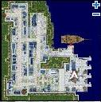 1. Talk to Mr. O' BrewSTER at [Alberta](Alberta.md) (204, 75)

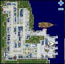 2. Go to Tulabel Luto Agency at [Alberta](Alberta.md) (228, 88) and warp to [Amatsu](Amatsu.md) for 3,000 [Zeny](Zeny.md).

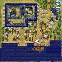 3. Talk to Tulabel Luto Guide at [Amatsu](Amatsu.md) (192, 102) and buy a photo album for 5,000 [Zeny](Zeny.md).

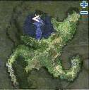 4. Find Sign Post at Amatsu Field (169,312)

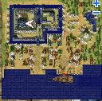 5. Find Sign Post at the top floor of Amatsu Palace(197,169

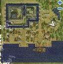 6. Find Sign Post at [Amatsu](Amatsu.md) (260, 189)

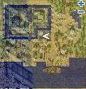 7. Find Sign Post at [Amatsu](Amatsu.md) (178, 185)

8. Go back to the Tulabel Luto Guide and she'll give you a completed Amatsu photo album.

9. Go back to the Tulabel Luto Agency and warp to [Kunlun](Kunlun.md) for 3,000 [Zeny](Zeny.md).

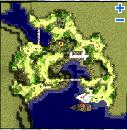 10. Talk to Tulabel Luto Guide at Kunlun Field (256, 100) and buy a photo album for 5,000 [Zeny](Zeny.md).

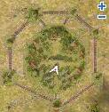 11. Find Sign Post at [Kunlun](Kunlun.md) (162, 120)

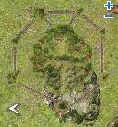 12. Find Sign Post at [Kunlun](Kunlun.md) (36, 12)

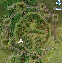 13. Find Sign Post at [Kunlun](Kunlun.md) (106, 107)

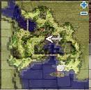 14. Find Sign Post at Kunlun Field (222, 228)

15. Go back to the Tulabel Luto Guide and she'll give you a completed Kunlun photo album.

16. Go back to the Tulabel Luto Agency and warp to [Louyang](Louyang.md) for 3,000 [Zeny](Zeny.md).

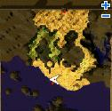 17. Talk to Tulabel Luto Guide at Louyang Field (197, 118) and buy a photo album for 5,000 [Zeny](Zeny.md).

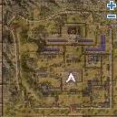 18. Find Sign Post at [Louyang](Louyang.md) (218, 117)

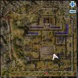 19. Find Sign Post at [Louyang](Louyang.md) (256, 96)

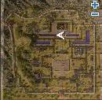 20. Find Sign Post at [Louyang](Louyang.md) (217, 232)

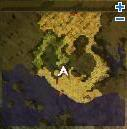 21. Find Sign Post at Louyang Field (199, 179)

22. Go back to the Tulabel Luto Guide and she'll give you a completed Louyang photo album.

23. Go back to the Tulabel Luto Agency and warp to [Ayothaya](Ayothaya.md) for 3,000 [Zeny](Zeny.md).

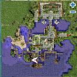 24. Talk to Tulabel Luto Guide at [Ayothaya](Ayothaya.md) (142, 71) and buy a photo album for 5,000 [Zeny](Zeny.md).

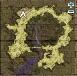 25. Find Sign Post at Ayothaya Field (115, 300)

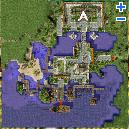 26. Find Sign Post inside the Ayothaya Palace(99, 162)

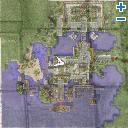 27. Find Sign Post at [Ayothaya](Ayothaya.md) (150, 164)

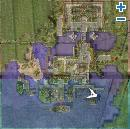 28. Find Sign Post at [Ayothaya](Ayothaya.md) (233, 86)

29. Go back to the Tulabel Lute Guide and she'll give you a completed Ayothaya photo album.

30. Go back to Mr. O' BrewSTER and give him the 4 photo albums. (Note: After giving him the albums, a Mobster named ‘Mr. O' BrewSTER's Assis’ spawns near the NPC.)

31. Wait for 30 minutes, talk to him again and get your reward: 1Baseball Cap \[1\], 1 Mastela Fruit

## Pirate Quest

<!-- Quest info -->
- **Level requirement:** 0 / 60
- **Item requirement:** 2 Alcohol, 2 Karvodailnirol, 30 Steel, 10 Oridecon, 1 Iron Hammer, 15 Trunk, 2 Elunium, 2 Glass Bead, 10 Rusty Screw
- **Zeny requirement:** 100,000
- **Item reward:** Pirate Dagger, Pirate Eye Bandage

1. Visit Weather Beaten Old Man in the east room of Hugel Pub ([Hugel](Hugel.md) 127,66).

2. Listen to what he says and respond with "Wow, that sounds like my kinda lifestyle!" and he will offer to make a Pirate Dagger in exchange for some materials.

  *  2 Alcohol
  *  2 Karvodailnirol
  *  20 Steel
  *  8 Oridecon
  *  1 Iron Hammer
  *  15 Trunk

3. Talk to him with the items in your inventory to receive a Pirate Dagger.

    **NOTE: players must be above [base level](Levels.md) 60 to continue past this point**

4. After receiving a dagger, Talk to him again to hear of his woe's with the Kraken and Turtle Island.  He mentions that he entered a strange swamp from the map with the throne room.

5. Immediately south of the throne room on the Turtle Palace map, Players will be taken to the swamp where Capitan Wesley had stored his treasure. (south west (tur dun04 71, 50) for 80+ and south east (tur dun04 132, 62) for 60+)

6. At various points around the swamp, players will find pieces of a map, pieces of a key, pieces of a shovel, and finally the Pirates Treasure box. The points must be done in order as follows

  {| class="wikitable"
|+ Coordinates
! 60+ to 80- !! 80+
|-
| Top Left (27,79)|| Top Right (77,73)
|-
| Center Left (24,53)|| Center (44,43)
|-
| Top Right (79,74)|| Bottom Right (78,22)
|-
| Bottom Left (18,26)|| Top Left (27,79)
|-
| Center (44,43)|| Bottom Left (18,31)
|-
| Bottom Right (76,22)|| Center Left (16,49)
|}

7. After obtaining his treasure box, return to Capitan Wesley in [Hugel](Hugel.md).  He will insist that the player keep the treasure box, however since the key for it is broken he needs a few materials to make a new one

  *  10 Steel
  *  2 Elunium
  *  2 Oridecon
  *  2 Glass Bead
  *  10 Rusty Screw
  *  100,000 [Zeny](Zeny.md)

8. After bringing the materials, the player will participate in a "battle" with the lock on the treasure box similar to the battle with Sudri in the [Seal of Mjolnir Quest](God_Items_Quest.md), with the important exception that it is rather difficult to lose.

  *  Note: if the pick is close to breaking, the player should select the option "Dry Hands" to restore 15 durability to the pick. Dry Hands then Apply Pressure to the Lock repeatedly works well, although it may begin to fail or become too random near the end.

9. After successfully bringing the lock's durability to zero, the box will open and players will receive a Pirate Eye Bandage.

## Pirate Quest 2

<!-- Quest info -->
- **Level requirement:** Unknown
- **Item requirement:** 10 Squid Ink, 5 Feather of Birds, 6 Worn Out Page, 1 Key of Clock Tower OR 1 Key of Underground
- **Items required:** Eye Patch (Purchasable at the Payon armor dealer) OR Pirate Dagger (Available only through previous quests.)
- **Base EXP reward:** Varies
- **Job EXP reward:** Varies
- **Window:** Yes

1. Head to [Comodo](Comodo.md) and talk to "J Roger" at (*217, 141*) wearing your pirate gear and pick the obvious choices.
1. Head to the east cave (*beach dun3*)  Talk to the "Half Buried Chest" at either (*86, 65*), (*95, 87*), (*191, 213*), (*270, 74*) or (*244, 31*).  Do so until it gives you a "Treasure Box".
1. Head back to [Comodo](Comodo.md) and once again talk to "J Roger".  He will give you your first [EXP](Experience.md) reward.
1. Talk to him again and he will ask you for the items to make a treasure map.
1.
  1. Talk to him when you have gathered the items and he prepares the map.  Talk to him again and he'll give you the map as well as the now locked Treasure Box.
  1. The place he sends you appears to be random.  If he says *"in front of the shore, where the light house is"* then see **Step 6a**.   If he says *"the shore of the Romantic Island  where Mobsters wander"*, **Step 6b**.  If he says *"the screeching bridge where wild otters play"*, go to **Step 6c**.
1.
  1. Head to Comodo Pharos Beacon (*cmd fild07*), you can teleport there via the [Comodo](Comodo.md) [Kafra](Kafra.md) Employee. As soon as you get there you'll get a popup and a marker (*coordinate : 212,134*) on your mini-map of where to bury the treasure. **Note:** It's best to walk as teleporting or flywinging removes the marker from your map. Once at the marker, bury the treasure in the "Soft Earth" located between a bunch of trees. Follow the prompts, and drink the whatsit for your second [EXP](Experience.md) reward. **Skip to Step 7**.
  1. Head to Comodo Field 02 (*cmd fild02* one north, two west of Pharos Lighthouse ).  As soon as you get there you'll get a popup and a marker (*coordinate : 162,117*) on your mini-map of where to bury the treasure. **Note:** It's best to walk as teleporting or flywinging removes the marker from your map. There are two portals to the map, the marker will not come up unless you enter from the portal on the beach.  Once at the marker, bury the treasure in the "Soft Earth".  Follow the prompts, and drink the whatsit for your second [EXP](Experience.md) reward.  **Skip to Step 7**.
  1. Head to Comodo Field 04 (*cmd fild04* One north, one west of Pharos Lighthouse). 4 As soon as you get there you'll get a popup and a marker (*coordinate : 127,260*) on your mini-map of where to bury the treasure. **Note:** It's best to walk as teleporting or flywinging removes the marker from your map.  Once at the marker, bury the treasure in the "Soft Earth" located in the grass to the south of the bridge.  Follow the prompts, and drink the whatsit for your second [EXP](Experience.md) reward.
1. Go back to [Comodo](Comodo.md) to talk to "J Roger".  He informs you that the treasure has been stolen!  (Somehow..)  And the culprit is a pirate anchored near the lighthouse.  You can get to the lighthouse via the [Comodo](Comodo.md) [Kafra](Kafra.md) Employee (Comodo Pharos Beacon).
1. The pirate captain is located at (*80, 119*) on Beacon Island (*cmd fild07*).  Talk to him a couple times until he asks you to tell him the pirate spirit.  The answers are:
  * "Great"
  * "sailors"
  * "Help"
  * "the weak and old"
1.   Then
  * "conciliate him"
  * "You preach at him"
1.   He gives you an "old compass" to return to the boy (J Roger) as well as your final [EXP](Experience.md) reward.
    **Note** : The quest is finished after receiving the old compass, there is no actual compass to give to the boy.

## EXP Rewards

*Experience Reward (Valkyrie Server):
* 250,000 [Base Experience](Base_EXP_Chart.md) and 70,000 [Job Experience](Job_EXP_Chart.md) per reward wearing one piece of equipment.
* 312,500 [Base Experience](Base_EXP_Chart.md) and 87,500 [Job Experience](Job_EXP_Chart.md) per reward wearing two pieces of equipment.
* 375,000 [Base Experience](Base_EXP_Chart.md) and 105,000 [Job Experience](Job_EXP_Chart.md) per reward when wearing all three.*Experience Reward (Premium Servers):
* 375,000 [Base Experience](Base_EXP_Chart.md) and 105,000 [Job Experience](Job_EXP_Chart.md) per reward wearing one piece of equipment.
* 468,000 [Base Experience](Base_EXP_Chart.md) and 131,250 [Job Experience](Job_EXP_Chart.md) per reward wearing two pieces of equipment.
* 562,500 [Base Experience](Base_EXP_Chart.md) and 157,500 [Job Experience](Job_EXP_Chart.md) per reward when wearing all three.

*Valid Equipment:
* Top Headgear: Corsair, Pirate's Pride - Pirate Bandana does not count.
* Mid Headgear: NPC-bought Eye Patch, and quest reward Pirate Eye Bandage
* Lower Headgear: Pirate Dagger.

## Ice Titans

The following [NPC](NPC.md) can be temporarily found in the Ice Dungeon. They will give the player a choice of how many monsters they wish to hunt at a time. 50, 100, or 150 monsters can be hunted. [EXP](Experience.md) rewarded per kill is the same for all three amounts (i.e. Killing 100 monsters gives twice as much experience as killing 50), as well as being the same gained when normally killing a monster (effectively making leveling on the monsters equal to 2x EXP). **[Valkyrie](F2P.md) has rewards equal to 1x, while Ymir has rewards equal to 1.5x.**

* **Note:***Each quest **is repeatable** so long as the player remains within the level limits.** **Note:***[Mercenary](Mercenary_System.md) kills will **not** increase your kill count!''

| [NPC](NPC.md) | Location | Minimum Level | Maximum Level | Monster | [Base EXP](Base_EXP_Chart.md) Reward (50) | [Job EXP](Job_EXP_Chart.md) Reward (50) | Base EXP Per Monster | Job EXP Per Monster |
| --- | --- | --- | --- | --- | --- | --- | --- | --- |
| Ice Titan Snowman | (ice dun03 154, 27) | 70 | 98 | Ice Titan | 693,600 | 396,400 | 13,872 | 7,928 |
| Siroma Snowman | (ice dun01 156, 25) | 50 | 80 | Siroma | 111,500 | 50,250 | 2,230 | 1,005 |

## Monster Hunting Quest

<!-- Quest info -->
- **Level requirement:** 30
- **Base EXP reward:** Varies (See Table)
- **Job EXP reward:** Varies (See Table)
- **Item reward:** 1 Crown of Deceit \[1\]
- **Window:** yes

1.  Talk to **Derik Ver** ([Prontera](Prontera.md) 173, 178) outside the [Prontera](Prontera.md) upgrade shop, he explains the recent problems with monster populations in areas mysteriously changing. He asks you to visit **Farah** in [Geffen](Geffen.md) tower.
1.  Just outside Geffen dungeon, speak to **Farah** (gef_tower 146, 36). She asks you to hunt some monsters. (Consult the table below)
  * **Note**: If you are in a [Party](Party.md), and another player in that party kills the required monsters, the kill(s) will count for all party members who are on screen of the killer.
1.  Return to **Farah**, she thanks you and asks you to return to **Derik Ver**.
  * Receive some [Base Experience](Base_EXP_Chart.md)
1.  **Derik Ver** asks you to find **Korey** at Byalan Island to investigate it.
1.  Speak to **Korey** (iz dun02 348, 333), he asks you to hunt some monsters. (Consult the table below)
1.  Return to **Korey**, he thanks you and asks you to return to **Derik Ver**.
  * Receive some [Base Experience](Base_EXP_Chart.md)
1.  **Derik Ver** then asks you to find **Franklin** deep inside the abyss lake.
  * Dragon parts are needed to enter the Abyss Lake, as normal.
  * Players level 84 and under will be stopped by **Corwin** at the entrance of abyss lake, they will be told they are too weak to continue.  Return to **Derik Ver** to complete the quest.
    * **Note**: It's possible to flywing onto the middle island of Abyss Lake without needing dragon parts and talk to **Corwin**
1.  Speak to **Franklin** (abyss02 174, 258), he'll ask you to hunt some monsters.
1.  Return to **Franklin**, he thanks you and asks you to return to **Derik Ver**.
  * Receive some [Base Experience](Base_EXP_Chart.md)
1.  **Derik Ver** says all the areas have now been investigated, and he rewards you with some headgears.
1.  Return to **Derik Ver**, he says more areas seem to be morphing.  He asks you to find **Marie** near the clocktower in [Al De Baran](Al_De_Baran.md).
1.  Speak to **Marie** (c tower1 196, 185), she asks you to hunt some monsters.
1.  Return to **Marie**, she thanks you and asks you to do some further clearing.
  * Receive some [Base Experience](Base_EXP_Chart.md) and [Job Experience](Job_EXP_Chart.md)
1.  Return to **Marie**, she again thanks you and asks you to do yet more clearing.
  * Receive some [Base Experience](Base_EXP_Chart.md) and [Job Experience](Job_EXP_Chart.md)
1.  Return to **Marie**, she thanks you and asks you to return to **Derik Ver**.
  * Receive some [Base Experience](Base_EXP_Chart.md) and [Job Experience](Job_EXP_Chart.md)
1.  Return to **Derik Ver**, He thanks you.
1.  **Derik Ver** asks you to go help a group of people investigating Glast Heim.
1.  Speak to **Mr. Brando** (glast 01 366, 308), he asks higher level players to exterminate some monsters then report to his wife.
  * Lower level players do not have to kill any monsters, but have a 5 min time limit to find his wife.
1.  After exterminating the monsters, find **Mrs. Brando** (gl knt01 142, 281), she asks you to hunt a few more monsters.
  * Lower level players will be asked to deliver a message to Kipp in the Glast Heim Prison within 5 minutes
  * Receive some [Base Experience](Base_EXP_Chart.md) and [Job Experience](Job_EXP_Chart.md)
1.  After exterminating the monsters, find **Kipp** (gl prison 10, 59), He asks you to hunt a few more monsters.
  * Lower level players will be asked to deliver a message to Cherice in the Glast Heim Sewers within 10 minutes
  * Receive some [Base Experience](Base_EXP_Chart.md) and [Job Experience](Job_EXP_Chart.md)
1.  After exterminating the monsters, find **Cherice** (gl sew02 295, 299), She asks you to hunt a few more monsters.
  * Lower level players will be asked to deliver a message to Grandma Vira in the Glast Heim Churchyard within 6 minutes
  * Receive some Base [Base Experience](Base_EXP_Chart.md) and [Job Experience](Job_EXP_Chart.md)
1.  After exterminating the monsters, find **Grandma Vira** (gl chyard 150, 146), She asks you to hunt a few more monsters.
  * Lower level players will be asked to find her husband's grave in the Glast Heim Churchyard within 3 minutes. **Fido** (gl chyard 252, 75) will tell you that you have found it and tell you to return to [Prontera](Prontera.md).
1.  **Grandma Vira** or **Fido** thanks you and asks you to return to **Derik Ver**.
  * Receive some [Base Experience](Base_EXP_Chart.md) and [Job Experience](Job_EXP_Chart.md)
1.  Return to **Derk Ver**, He thanks you and says he thinks this was the last area to help with.
1.  Return to **Derik Ver**, he says to take his research to his brother Jacob in [Juno](Juno.md).
1.  Speak to **Jacob** (yuno 176,120), he asks you to look up some histories in the Juno Library (yuno 339, 203).
1.  Visit the Juno Library and learn about the Crown of Deceit that can work monsters up into a frenzy. In the northwestern room in the Juno Library (the two top left portals) talk to the books beside the dragon book-ends on the top of the bookshelves near (yuno_in04 107, 107).

1.   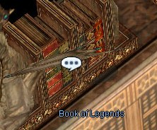

1.  Return to **Jacob**, he asks you to hunt 30 Dustiness and 30 Poporing to get ingredients for a magic solvent to remove the Crown's power.
1.  Return to **Jacob**.
  * Receive a Crown of Deceit \[1\].
1.  Visit [Payon](Payon.md)'s mashing mallet (payon 212,129) to combine the Crown of Deceit and the solvent. **Make sure the Crown is not equipped and is in your inventory before this step!**

1.   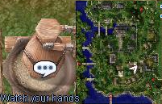

1.  Return to **Derik Ver**.
  * Receive some [EXP](Experience.md).

## Hunting Table

|   | 30 ~ 59 | 30 ~ 59 | 30 ~ 59 | 60 ~ 84 | 60 ~ 84 | 60 ~ 84 | 85 ~ 99 | 85 ~ 99 | 85 ~ 99 |
| --- | --- | --- | --- | --- | --- | --- | --- | --- | --- |
|   | Monsters | [Base EXP](Base_EXP_Chart.md) | [Job EXP](Job_EXP_Chart.md) | Monsters | Base EXP | Job EXP | Monsters | Base EXP | Job EXP |
| Set 1 | *50 Poison Spore* & *35 Poporing* | 80,000 | None | *20 Ghoul* & *25 Drainliar* | 350,000 | None | *50 Jakk* & *50 Nightmare* | 500,000 | None |
| Set 2 | *35 Cornutus* & *25 Hydra* | 80,000 | None | *55 Swordfish* & *45 Marc* | 350,000 | None | *50 Merman* & *40 Strouf* | 500,000 | None |
| Set 3 | NA | NA | NA | NA | NA | NA | *30 Acidus (Blue)* & *30 Acidus (Gold)* | 500,000 | None |
| Set 4 | *40 Poring* & *40 Poporing* | 80,000 | 50,000 | *30 Clock* & *40 Punk* | 400,000 | 250,000 | *30 Brilight* &  *25 Cramp* | 500,000 | 350,000 |
| Set 5 | *50 Marin* & *25 Sasquatch* | 80,000 | 50,000 | *30 Alarm* & *50 Archer Skeleton* | 400,000 | 250,000 | *60 Penomena* & *30 Cramp* | 500,000 | 350,000 |
| Set 6 | *30 Metaling* & *40 Dustiness* | 80,000 | 50,000 | *50 Stem Worm* & *20 Iron Fist* | 400,000 | 250,000 | *70 High Orc* & *30 Orc Archer* | 500,000 | 350,000 |
| Set 7 | *NA* | 80,000 | 50,000 | *20 Ghoul* & *10 Whisper* | 400,000 | 250,000 | *25 Evil Druid* & *1 Dark Priest* | 500,000 | 350,000 |
| Set 8 | *NA* | 80,000 | 50,000 | *20 Rideword* & *50 Raydric* | 400,000 | 250,000 | *15 Khalitzburg* & *90 Raydric* | 500,000 | 350,000 |
| Set 9 | *NA* | 80,000 | 50,000 | *25 Zombie Prisoner* & *20 Skel Prisoner* | 400,000 | 250,000 | *20 Injustice* & *20 Rybio* | 500,000 | 350,000 |
| Set 10 | *NA* | 80,000 | 50,000 | *30 Anolian* & *20 Wind Ghost* | 400,000 | 250,000 | *10 Imp* & *40 Majorous* | 500,000 | 350,000 |
| Set 11 | *NA* | 80,000 | 50,000 | *25 Wraith* & *10 Skel Prisoner* | 400,000 | 250,000 | *2 Dark Priest* & *20 Evil Druid* | 500,000 | 350,000 |

## Notes

---
**Categories:** [Base Experience Reward](categories/Base_Experience_Reward.md), [Job Experience Reward](categories/Job_Experience_Reward.md), [Quest Window Quests](categories/Quest_Window_Quests.md), [Temporary Event Quests](categories/Temporary_Event_Quests.md)
*Source: [iRO Wiki Classic](https://irowiki.org/classic/IRO_7th_Anniversary_Event_%282010/06/03%29_~_%282010/07/01%29) — GFDL 1.3+*
