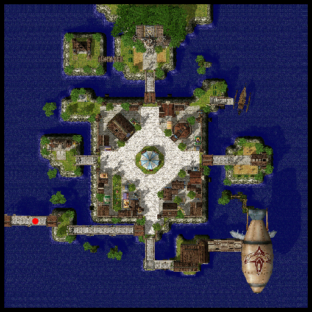

# Izlude

## About Izlude

Also known as the Satellite City of [Prontera](Prontera.md). Izlude is home to the [Swordsman](Swordman.md) association. The [Izlude Arena](Izlude_Arena.md) can also be found north of the town. The [Airship](Airship.md) traveling to [Juno](Juno.md) and [Rachel](Rachel.md) can also be found at the south part of the town.

## Story

The place where those who wish to become Swordmen gather to train. There is a ferry which takes you to [Alberta](Alberta.md), and an express ship which takes adventurers to the underwater dungeons, Byalan Island. King Tristan III built the Izlude Arena to promote professionals throughout the nation. Even now, many skilled adventurers gather here to show off their talents and have their names listed in the arena's Hall of Fame.

## Guide

## Structures

## Buildings

* 1 - Arena (128,225) ---- see Izlude Arena, for details
* 2 - Swordsman Association (52,138)
* 3 - Swordsman Hall (213,129)
* 4 - Tool Shop (146,146)
* 5 - Weapon Shop (112,148)

## Billboards and Signs

* Bulletin Board - Izlude: The Satellite City (131,116) - Gives background information on Izlude
* Sign (144,148) - Flavor Text
* Sign (54,139) - Flavor Text

## NPCs

## Regulars

Guides - Izlude Guide are at (121,87)
* Shows Swordsman Association, Swordsman Hall, Arena, Izlude Marina, Weapon Shop, Tool Shop on minimap

Kafra Employees are at (134,88)
* Save, Kafra storage (40z), Teleport service, Rent cart, Reserve points

## Store NPCs

* Weapon Dealer (Weapon Shop)
  * Arrow, Silver Arrow, Bow, Rod, Knife, Cutter, Main Gauche, Sword, Falchion, Blade, Katana, Slayer, Bastard Sword, Two-handed Sword, Broad Sword, Axe
* Armor Dealer (Weapon Shop)
  * Buckler, Shield, Shoes, Boots, Muffler, Manteau, Cap, Helm, Jacket, Adventurer's Suit, Wooden Mail, Mantle, Coat, Padded Armor, Chain Mail, Full Plate, Novice Armlet
* Tool Dealer (Tool Shop)
  * Magnifier, Red Potion, Orange Potion, Yellow Potion, White Potion, Green Potion, Concentration Potion, Awakening Potion, Fly Wing, Butterfly Wing, Trap, Arrow
* Pet Merchant (164,138)
  * Pet Food, Pet Incubator, Backpack, Rocker Glasses
* Butcher (105,99)
  * Meat
* Milk Merchant (92,105)
  * Milk
* Fruit Merchant (94,98)
  * Apple, Banana, Carrot, Potato

## Trade NPCs

* Smile Assistance - Smile Girl (129,118)
  * Mr. Smile for 10 Clover, 10 Fluff, 10 Jellopy
* Monster Tamer - Shogo (Tool Shop)
  * Orc Trophy for 1 Chivalry Emblem, 1 Scorpion Tail
  * No Recipient for 1 Old Portrait
  * Book of the Devil for 1 Old Magicbook, 2 Horrendous Mouth
* Givu (Arena, Point Exchange Room)
  * **Amount traded is selectable for items**
  * 5 Honey for 20 Arena Points
  * 5 Royal Jelly for 30 Arena Points
  * 5 Mastela Fruit for 30 Arena Points
  * 8 Condensed White Potion for 30 Arena Points
  * 3 Anodyne for 20 Arena Points
  * Yggdrasil Seed for 20 Arena Points
  * Yggdrasilberry for 40 Arena Points
  * Old Blue Box for 100 Arena Points
  * Old Purple Box for 300 Arena Points
  * Old Card Album for 1,000 Arena Points
  * ??? Base experience points for 40 Arena Points
  * Souvenir Photo with NPCs or Monsters (Baphomet, Dark Lord, Doppelganger, Eddga, Dracula, Samurai, Stormy Knight, Phreeoni, Girl, Valkyrie) for 10 Arena Points

## Quest NPCs

* Swordsman (Swordsman Association, middle room) - Swordsman job change NPC
* Swordsman (Swordsman Association, middle room) - Part of Swordsman job change quest
* Krongast (69,181) - Part of Blacksmith job change quest
* Knight De Thomas - De Thomas (Swordsman Hall, front room) - Teaches HP Recovery While Moving

## Travel NPCs

* Kafra Employee (134,88)
  * [Geffen](Geffen.md) - 1200z
  * [Payon](Payon.md) - 1200z
  * [Morroc](Morroc.md) - 1200z
  * [Al De Baran](Al_De_Baran.md) - 1800z
* Sailor (201,181)
  * Byalan Island - 150z
  * Alberta - 500z
* Edgar (182,186)
  * [Alberta](Alberta.md) - 250z
* Honeymoon Helper - Helper (171,185)
  * [Jawaii](Jawaii.md) - 100,000z
* Teleporter (Arena, middle room)
  * Arena's Point Exchange Room - free

*To be transported to the Arena Stages, you enter the chat and wait instead of trying to speak to the NPC.*

* lvl 50s Waiting Room (Arena, northwest room)
  * Level 50 Arena Stage - 1,000z
* lvl 60s Waiting Room (Arena, west room)
  * Level 60 Arena Stage - 1,000z
* lvl 70s Waiting Room (Arena, southwest room)
  * Level 70 Arena Stage - 1,000z
* lvl 80s Waiting Room (Arena, southeast room)
  * Level 80 Arena Stage - 1,000z
* Ponox (Arena, east room)
  * Pre-Party Arena Stage?? - free
* ???Helper NPC (Arena, Pre-Party Arena Stage???)
  * Party Arena Stage?? - 1,000z for all members??

## Background NPCs

* Soldier (124,178) - talks about selling loot to NPC Merchants
* Kylick (150,143) - talks about either Amatsu and its cuisine or Binoculars/Izlude's Telescope (two sets of conversation)
* Dega (150,118) - talks about Monsters with Cast Sensor and magic spells of their own or about Mt.Mjolnir and its aggressive insect monsters or about a place where every type of poring may be found (three sets of conversation)
* Cuskoal (119,121) - talks about the Arena or gathering information at pubs (two sets of conversation)
* Red (56,126) - argues with Cebalis about which skill is better, Bash or Magnum Break
* Cebalis (58,126) - argues with Red about which skill is better, Bash or Magnum Break
* Bonne (55,74) - welcomes you to Izlude and talks about Izlude and the bridge
* Charfri (135,78) - talks about Izlude and/or Byalan Island (two sets of conversation)
* Aaron (Swordsman Association, east room) - talks about stats, focusing on swordsmen
* Vendigos (Arena, middle room) - talks about how the Arena works
* Arena Record Staff - Owen Kheuv (Arena, middle room) - gives the current best records for all level challenges
* Helper Pat - Pat (Arena, northwest room) - talks about the rules of the Level 50 Arena Stage
* Helper Ben - Ben (Arena, west room) - talks about the rules of the Level 60 Arena Stage
* Helper Vicious - Vicious (Arena, southwest room) - talks about the rules of the Level 70 Arena Stage
* Helper Epin - Epin (Arena, southeast room) - talks about the rules of the Level 80 Arena Stage
* Helper Lunic - Lunic (Arena, east room) - talks about the rules of the Party Arena Stage
* Helper Lonik - Lonik (Arena, east room) - will inform you if there's anyone in there (where? :O)

## Dungeon

## Undersea Dungeon

Known as Byalan Dungeon. A dungeon found in Byalan Island that is filled with low to mid level monsters.
Most monsters here are of Water Property so Wind Elemental weapons are very useful for leveling.
Most low level melee class characters train in this dungeon. Mostly, [Swordsman](Swordman.md) and [Merchant](Merchant.md) type characters usually seen [Bash](Bash.md)ing Vadons and Marinas.
While the first two levels of the dungeon is safe for a low level characters, the 3rd level needs a caution.
It is home for the Obeaune and Marse monsters. Obeaunes are aggresive mermaid like monsters fond of casting
[Lex Divina](Lex_Divina.md) while hitting the target hard. Marse can blind the target and his attack can leave an unwary [Merchant](Merchant.md) dead. Mid level characters usually train in the 3rd level of the dungeon.
Moving on to the next level are infested with fish like monsters. Watch out for the incoming Water Ball of the Swordfish! Marc, a sea horse like monster hits really hard and can stun it's target immobile while receiving a lot of damage from a huge mob of monsters. Usually leaving a [Knight](Knight.md) kissing the seafloor.
Stay away from the exploding Marine Spheres as much as possible.
Finally the last level, Mermans are deadly but gives a decent amount of experience. Penomenas are like Archers attacking from afar while dealing a lots of damage. Strouf keeps on casting [Frost Diver](Frost_Diver.md) and [Lightning Bolt](Lightening_Bolt.md) combo on you.
And the green fish like monster called Deviace is considered as Mini Boss of the dungeon can be found in here.
His [Water Ball](Water_Ball.md) can bring a full HP Knight down in just a matter of seconds. Either way, the dungeon is a great place for some levels if you are melee type character but just remember to be cautious and bring a lot of Potions and Fly Wings with you.

* To get to Byalan Island talk to the Sailor (201,181). He will charge you 150z.
* You can not save on Byalan Island but there is a Kafra Employee for storage and cart rental.
* To reach the dungeon, go north around the eye of the skull and then go south to reach the entrance.

**Related pages:**

* [Towns](Towns.md)
* [Rune-Midgarts Kingdom](Rune-Midgarts_Kingdom.md)
* [Alberta](Alberta.md)
* [Al De Baran](Al_De_Baran.md)
* [Archer Village](Archer_Village.md)
* [Comodo](Comodo.md)
* [Geffen](Geffen.md)
* [Izlude](Izlude.md)
* [Morroc](Morroc.md)
* [Payon](Payon.md)
* [Prontera](Prontera.md)
* [Umbala](Umbala.md)
* [Republic of Schwartzvald](Republic_of_Schwartzvald.md)
* [Einbech](Einbech.md)
* [Einbroch](Einbroch.md)
* [Hugel](Hugel.md)
* [Juno](Juno.md)
* [Lighthalzen](Lighthalzen.md)
* [Arunafeltz States](Arunafeltz_States.md)
* [Rachel](Rachel.md)
* [Veins](Veins.md)
* [Manuk](Manuk.md)
* [Amatsu](Amatsu.md)
* [Ayothaya](Ayothaya.md)
* [Kunlun](Kunlun.md)
* [Jawaii](Jawaii.md)
* [Louyang](Louyang.md)
* [Moscovia](Moscovia.md)
* [Nifflheim](Nifflheim.md)
* [Lutie](Lutie.md)

---
*Source: [iRO Wiki Classic](https://irowiki.org/classic/Izlude) — GFDL 1.3+*
