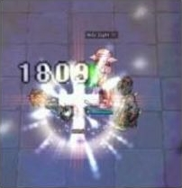
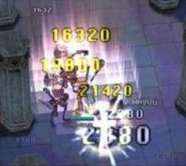

# Izlude Arena

## Overview

The **Izlude Arena** is a time attack battle located in the 12 o'clock direction in [Izlude](Izlude.md).

There are six different courses in the Arena that players may select from, divided between three modes:
* *Individual* mode places the player against a set list of [Monster](Monster.md)s.
* *Party* mode places a five person party against a set list of monsters.
* *Personal Force* mode is restricted to [Acolyte](Acolyte.md)s and [Priest](Priest.md)s and places the player against a set list of monsters that can be killed with Acolyte or Priest skills. The majority of these monsters are of the [Undead](Undead.md) element.

In all modes, players are given an objective when they enter a room which they must accomplish in order to continue to the next room. Sometimes all monsters must be defeated to advance; sometimes only a few. Still other times the player only needs to run to the exit on the other side of the room.

Experience is not awarded for successfully defeating monsters in the Arena and most Arena monsters do not drop items either. Note, however, that experience is **not** lost if one dies in the Arena.

## Arena Points

Arena points are prizes awarded for participating in the Arena. 20 points are awarded upon the successful completion of a course. 1 point is awarded as a participation prize if the player fails for any reason. [Al de Baran Turbo Track](Al_de_Baran_Turbo_Track.md) Points may also be converted into Arena Points. Points may be exchanged for various consumable items or base EXP. To be transported to the exchange room, talk to the Teleporter (arena_room: 106, 93). This is also who you need to speak to if you wish to convert Turbo Track Points to Arena Points.

The following are what Arena Points may be used for:
* 20 Arena Points for 5 Honey
* 20 Arena Points for 3 Anodyne
* 20 Arena Points for 1 Yggdrasil Seed
* 30 Arena Points for 5 Royal Jelly
* 30 Arena Points for 5 Mastela Fruit
* 30 Arena Points for 8 Condensed White Potion
* 40 Arena Points for 1 Yggdrasilberry
* 100 Arena Points for 1 Old Blue Box
* 300 Arena Points for 1 Old Purple Box
* 1,000 Arena Points for 1 Old Card Album

For 40 Arena Points a player can receive some [Base EXP](Base_EXP_Chart.md)
* [50-69] 3,000 EXP
* [70-79] 6,000 EXP
* [80-89] 10,000 EXP
* [90-99] 30,000 EXP

The player may also use 10 Arena Points to summon an NPC version of a number of different MVP bosses and other noteworthy game characters which will use a series of emoticons which you may take screenshots of.

## Individual Mode: Levels 50-69

**Time limit: 5 minutes**
* **First Room**
  Objective: Kill all Smokies
  Monsters: 10 Drops, 10 Poisonous Toads, 5 Smokies, 4 Hydras
* **Second Room**
  Objective: Proceed to the next room
  Monsters: 5 Mummy, 3 Ghoul, 3 Familiar
* **Third Room**
  Objective: Kill all Karakasa
  Monsters: 5 Karakasa, 5 Marse, 3 Hydra
* **Fourth Room**
  Objective: Kill all Kobolds
  Monsters: 2 Kobolds (Mace), 1 Kobold (Axe), 9 Familiar, 5 Flora
* **Fifth Room**
  Objective: Kill all monsters that were in the room at the beginning
  Monsters (beginning): 3 Hydra, 2 Orc Lady, 1 Golem
  Monsters (spawned): ? Zerom, ? Desert Wolf
  Special Note: When monsters die on this map, new monsters are spawned to replace them.
* **Sixth Room**
  Objective: Kill all Drops
  Monsters: 5 Drops, 3 Smokie, 2 Golem, 2 Sandman, 2 Scorpion, 2 Skeleton Worker
* **Seventh Room**
  Objective: Kill the Red Plant
  Monsters: 20 Hydras, 2 Punk, 1 Red Plant
* **Eighth Room**
  Objective: Proceed to the last room
  Monsters: None
* **Ninth Room**
  Objective: Kill Vocal
  Monsters: 8 Familiar, 1 Vocal

## Individual Mode: Levels 60-79

**Time limit: 6 minutes**
* **First Room**
  Objective: Kill 5 Goblins
  Monsters: 4 Goblins (Axe), 2 Goblins (Knife), 2 Goblins (Flail), 2 Goblin Archers, 1 Rotar Zairo
* **Second Room**
  Objective: Proceed to the next room
  Monsters: 5 Orc Zombies, 5 Ghouls, 4 Zeroms, 5 Matyrs, 8 Drainliar, 3 Requiem
* **Third Room**
  Objective: Kill all Mantises
  Monsters: 4 Mantises, 4 Obeaune, 6 Hydras
* **Fourth Room**
  Objective: Kill all non-aggressive monsters (i.e. the Golem and the Marse)
  Monsters: 1 Golem, 1 Marse, 2 Dokebi, 2 Sasquatch, 2 Baby Leopard, 1 Chepet
* **Fifth Room**
  Objective: Kill all monsters except the Kapha and the Hydras
  Monsters: 1 Drainliar, 1 Myst, 1 Raggler, 2 Orc Skeleton, 11 Hydras, 1 Kapha
* **Sixth Room**
  Objective: Kill all Miyabi Dolls
  Monsters: 2 Miyabi Dolls, 26 Greatest Generals
  Special: When the Miyabi Dolls are killed, new monsters will spawn to replace them. Known replacement spawns include Cruisers and Side winders.
* **Seventh Room**
  Objective: Kill all monsters
  Monsters: 2 Jakk, 1 Isis, 1 Myst
* **Eighth Room**
  Objective: Proceed to the next room
  Monsters: None
* **Ninth Room**
  Objective: Kill the Goblin Leader
  Monsters: 1 Goblin Leader, 4 Horong, ? Greatest Generals

## Individual Mode: Levels 70-89

**Time limit: 7 minutes**
* **First Room**
  Objective: Kill all Kobolds
  Monsters: 1 Kobold(hammer), 2 Kobold(axe), 2 Kobold(mace)
* **Second Room**
  Objective: Kill all Horongs and escape
  Monsters: 2 Horong, 3 Archer Skeleton, 4 Mummy, 5 Ghoul
* **Third Room**
  Objective: Kill all monsters except Enchanted Peach Tree
  Monsters: 2 Enchanted Peach Tree, 1 Bloody Butterfly, 2 Parasite
* **Fourth Room**
  Objective: Kill all Stem Worms, while avoiding Bathories
  Monsters: 3 Stem Worm, 2 Bathory
* **Fifth Room**
  Objective: Kill all Argiope
  Monsters: 5 Argiope
  Special: When the Argiope die new monsters spawn to replace them. Known replacements include Ridewords, Mantis, and Familiar
* **Sixth Room**
  Objective: Kill all Hammer Goblins
  Monsters: 3 Hammer Goblins, ? Goblins
* **Seventh Room**
  Objective: Kill the Alice in the center of the room
  Monsters: 1 Alice, 4 Nightmare, 8 Familiar, 1 Raydric
* **Eighth Room**
  Objective: Proceed to the next room
  Monsters: none
* **Ninth Room**
  Objective: Kill Kobold Leader and all Kobolds
  Monsters: 1 Kobold Leader, 5 Kobold, ? Familiar

## Individual Mode: Levels 80-99

**Time limit: 8 minutes**
* **First Room**
  Objective: Kill All Nightmare
  Monsters: 4 Nightmare, 4 Hunterfly
* **Second Room**
  Objective: Kill All Monsters.
  Monsters: 3 Marionette, 6 Zombie, 1 Deviruchi, 4 Skel Prisoner, 1 Raydric Archer
* **Third Room**
  Objective: Kill All Assulters
  Monsters: 2 Assulters, 2 Clocktower Manger, 4 Marionette, 1 Sidewinder
* **Fourth Room**
  Objective: Kill All Ninetails
  Monsters: 4 Ninetails, 4 Archer Skeleton, 1 Pasana, 1 Minorous, 1 Lava Golem
* **Fifth Room**
  Objective: Kill All Earth Petites
  Monsters: 4 Earth Petite, 2 Sky Petite
* **Sixth Room**
  Objective: Kill all monsters.
  Monsters: 2 Alice, 2 Deviruchi, 2 Bapho Jr.
* **Seventh Room**
  Objective: Kill all Fur Seals while avoiding Mermen
  Monsters: 3 Fur Seal, 3 Merman
* **Eighth Room**
  Objective: Move to the next room
  Monsters: None
* **Ninth Room**
  Objective: Kill 1 Ancient Mummy
  Monsters: 1 Ancient Mummy, 5 Argos

## Party Mode: 5 Person Parties

**Time limit: 10 minutes**

**No level requirement**

**Objective is always to kill all monsters**

The room order in party mode is not totally fixed. There are *11* rooms. The first room, where you appear, and the last one are empty. Clearing a certain room will activate a certain portal. Unless specified, the number of monsters is random.
* **First Room**
  Monsters: 8 Deviruchis, 2 Wanderers, 6 Mermans, 4 Penomena and 1 Wind Ghost
* **Second Room**
  Monsters: Zherlthsh, Alarm, Ancient Worm, Penomena, Clock Tower Manager, and Clock
* **Third Room**
  Monsters: Assulter, Rideword, Arclouse, Penomena, Wraith
* **Fourth Room**
  Monsters: Penomena, Sting
* **Fifth Room**
  Monsters: Tengu, Wicked Nymph, Evil Cloud Hermit
* **Sixth Room**
  This room has two path : a narrow one and a broad path. The monster you fight change according to the path you pick.
  Monsters: Mysteltainn and Executioner or Chimera and Greatest Generals
* **Seventh Room**
  Monsters: Raydric Archers, Zombie Prisoners, Ancient Mummy, Nightmare Terror, Chimera and Bloody Knight
* **Eighth Room**
  Monsters: 2 Lava Golems, Anolians, 5 Elders, 2 Explosion
* **Ninth Room**
  Monsters: A random [MVP](MVP.md) (Dracula, Evil Snake Lord, Incantation Samurai or other)

## Personal Force Mode: Acolytes

This area is located in the 1 o'clock direction of the Arena (arena_room: 111, 101). Since this mode is specifically for [Acolyte](Acolyte.md)s and [Priest](Priest.md)s, most of the monsters in it are either easy to defeat with simple melee attacks or are of the [Undead](Undead.md) type. Players can overcome the [Undead](Undead.md) monsters with [Heal](Heal.md), [Turn Undead](Turn_Undead.md), [Holy Light](Holy_Light.md) and [Magnus Exorcismus](Magnus_Exorcismus.md). Using [Pneuma](Pneuma.md) is effective for ranged undead monsters such as Firelock Soldiers and Archer Skeletons.

The Acolyte Arena is divided into nine rooms. The challenge will be performed moving clockwise and you will have to finish all of the sections within 8 minutes. Due to the characteristics of the [Acolyte](Acolyte.md) class, [Undead](Undead.md) monsters are the main race in the Acolyte Arena.

## Acolytes: 60 to ?

* **First Room**
  Objective: Kill all monsters
  Monsters: 5 Red Plants
* **Second Room**
  Objective: Kill 10 Drops
  Monsters: 20 Drops
* **Third Room**
  Objective: Kill all monsters
  Monsters: 10 Zombies
* **Fourth Room**
  Objective: Proceed to the next room
  Monsters: None
* **Fifth Room**
  Objective: Kill all monsters
  Monsters: 8 Orc Zombies
* **Sixth Room**
  Objective: Proceed to the next room
  Monsters: 12 Hydras
* **Seventh Room**
  Objective: Kill all monsters
  Monsters: 2 Firelock Soldiers and 3 Archer Skeletons
* **Eighth Room**
  Objective: Proceed to the next room
  Monsters: None
* **Ninth Room**
  Objective: Kill all monsters
  Monsters: 4 Zombies, 1 Zombie Prisoners and 1 Skel Prisoners

## Priests: 70 or under

* **First Room**
  Objective: Kill all monsters
  Monsters: 10 Zombies
* **Second Room**
  Objective: Kill all monsters
  Monsters: 5 Orc Skeletons
* **Third Room**
  Objective: Kill all monsters
  Monsters: 5 Red Plants
* **Fourth Room**
  Objective: Kill all monsters
  Monsters: 1 Skeleton Prisoner, 1 Zombie Prisoner, 1 Evil Druid, 1 Wraith
* **Fifth Room**
  Objective: Kill all Gargoyles
  Monsters: 4 Gargoyles, ? Hydras
* **Sixth Room**
  Objective: Kill the Kalizburg
  Monsters: 1 Kalizburg, ? Permeters
* **Seventh Room**
  Objective: ?
  Monsters: ?
* **Eighth Room**
  Objective: Proceed to the next room
  Monsters: None
* **Ninth Room**
  Objective: Kill 1 Boss Monster
  Monsters: 1 Mimic

## Priests: 80 or under

* **First Room**
  Objective: Kill all monsters
  Monsters: 10 Zombies
* **Second Room**
  Objective: Kill all monsters
  Monsters: 5 Ghoul
* **Third Room**
  Objective: Kill all monsters
  Monsters: 5 Red Plants
* **Fourth Room**
  Objective: Kill all monsters
  Monsters: 1 Skeleton Prisoner, 1 Zombie Prisoner, 1 Evil Druid, 1 Wraith
* **Fifth Room**
  Objective: Kill all Gargoyles
  Monsters: 4 Gargoyles, ? Penomena
* **Sixth Room**
  Objective: Kill all Kalizburg
  Monsters: 4 Kalizburg, ? Permeters
* **Seventh Room**
  Objective: Kill the ancient mummy
  Monsters: 1 Ancient Mummy
* **Eighth Room**
  Objective: Proceed to the next room
  Monsters: None
* **Ninth Room**
  Objective: Kill 1 Boss Monster
  Monsters: 1 Wraith Dead

## Priests: 91-99

* **First Room**
  Objective: Kill all monsters
  Monsters: 15 Zombies
* **Second Room**
  Objective: Kill all monsters
  Monsters: 8 Ghoul
* **Third Room**
  Objective: Kill all monsters
  Monsters: 5 Red Plants
* **Fourth Room**
  Objective: Kill all monsters
  Monsters: 2 Skeleton Prisoner, 2 Zombie Prisoner, 2 Evil Druid, 2 Wraith
* **Fifth Room**
  Objective: Kill all Gargoyles
  Monsters: 4 Gargoyles, 20 Penomena
* **Sixth Room**
  Objective: Kill all Khalitzburg
  Monsters: 4 Khalitzburg, 10 Permeters
* **Seventh Room**
  Objective: Kill 1 Ancient Mummy
  Monsters: 1 Ancient Mummy
* **Eighth Room**
  Objective: Proceed to the next room
  Monsters: None
* **Ninth Room**
  Objective: Kill 1 Boss Monster
  Monsters: 1 Dark Illusion (Mini Boss)

**Related pages:**

* [Al de Baran Turbo Track](Al_de_Baran_Turbo_Track.md)
* [Hugel Minigames](Hugel_Minigames.md)
* [Izlude Arena](Izlude_Arena.md)

---
**Categories:** [Minigames](categories/Minigames.md)
*Source: [iRO Wiki Classic](https://irowiki.org/classic/Izlude_Arena) — GFDL 1.3+*
