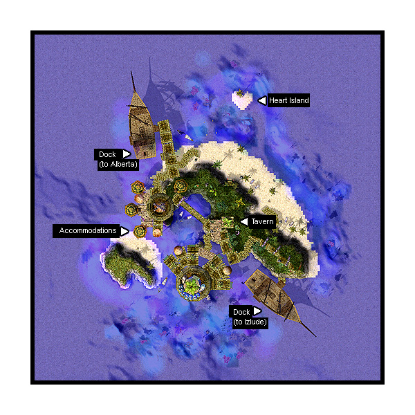

# Jawaii

## About Jawaii

Of the coast of Izlude lies the small tropical island of Jawaii: Famous vacation and honeymoon spot. Whether it’s drinking and meeting people at the singles bar, or reliving your wedding / honeymoon, Jawaii offers all these and more.

There is an NPC in [Izlude](Izlude.md) that has the uncanny ability to recognize married couples. She will sweep you and your spouse away to lovely Jawaii. There is a 100,000 Zeny fee to be taken there. There are rooms with four different themes where couples can share their intimate moments. Although the [Rune-Midgarts Kingdom](Rune-Midgarts_Kingdom.md) prohibits alcoholic beverages, you can have alcohol in the tavern in Jawaii.

Special Products: “Sweet Memory of Marriage,” a special photo album for couples. Ice Cream which, when shared as a couple, enhances the romantic atmosphere. Jawaii Special Cocktail which is recommended by a handsome bartender. (*Warning: Excessive drinking during your honeymoon can cause you to have a huge fight with your spouse*)

## Story

As more and more people were married in the Rune-Midgarts Kingdom, they longed for a romantic place where they could take a vacation alone with their new husbands and wives. As officiator of wedding ceremonies in Rune-Midgard, Tristram III recognized the need for such a place and ordered for the development of a lover’s paradise, the beautiful, heart-shaped island now known as Jawaii. However, it has also been said that the king has high hopes that this new island will bring much revenue to the Kingdom’s Treasury. Nevertheless, Tristram III is a ruler blessed with kindness, generosity and, perhaps, shrewdness.

## Guide

## Structures

## Buildings

* 1 - Tavern (192,216)

## Billboards and Signs

* None

## NPCs

## Regulars

None

## Store NPCs

Ice Cream Guy (near 183,173)
  Ice Cream

## Trade NPCs

Bartender (Tavern)
  Various drinks for 100z. See section about drinks
Honeymoon Helper - Helper (214,168)
  Sweet Memory of Marriage for 50,000z
Waitress (Tavern)
  Meat for 1,000z
  Yellow Potion for 1,000z

## Quest NPCs

None

## Travel NPCs

Employee - Alowa (141,200)
  Sweet Room - 1,000z
Employee - Larks Rania (112,173)
  Villa Room - 1,000z
Employee - Sharkie Rania (107,189)
  Honey Room - 1,000z
Employee - Pine Oran (108,199)
  Antique Room - 1,000z
Mariner (239,112)
  [Izlude](Izlude.md) - free
Mariner (122,263)
  [Alberta](Alberta.md) - free

## Background NPCs

* Customer - Buchi (Tavern)
* Customer - Cage (Tavern)
* Employees (Tavern) --- *Trigger when you enter the square (31,99), (31,93), (25,99) and (25,93). Do /omg for singles and /kis for married characters.*
* Employee Amy
* Employee Buffy
* Employee Fey
* Employee Itere
* Employee Kay
* Employee Tonia
* Employee Tryteh
* Employee Yasmine
* Jawaii Resident - Waii Waii (240,146)
* Jawaii Resident - Jawa Jawa (220,235)
* Jawaii Resident - Iwa Iwa (165,121)
* Tavern Lady - Lady (188,218)
* Waja Waja (168,247) ---- *the closest thing Jawaii has to a guide*

## Other

## Single Army Invasion

Lonely? Why not visit the Jawaii singles bar and meet new people. Who knows, you might find the love of your life here. And if for some reason you end up getting rejected, head over to the bar and have our bartender prepare something to wash those miseries. Aside from being a top notch bartender, he’s a good listener, and gives very good advice. The Single Army is out to ruin Jawaii's Tavern and all the honeymooning vacationers! If you are single, you too can join their raucousness by meeting up with some customers in Prontera's main Pub. They will offer you drinks and you guys can discuss your lack of a "significant other" (Everyone in the room will say Dazzler Quotes (or possibly Unbarring Octave Quotes)). The drinks will take away some hp, but should you decide to sign their contract and go somewhere "better", your hp will be refilled and you'll be transported to Jawaii's Tavern for no cost. Only restriction is, you can't leave the Tavern. Enjoy ruining all those horrible couples' vacation and drinking away!

## Bartender

Jawaii is just about the only place where the pub actually sells you alcohol, but everyone knows alcohol is bad for you. The Bartender NPC can sell you different kind of drinks for 100z with special effects, but each time you drink, a portion of your hp is taken away. You can drink yourself to 0 HP though and not "die". However, the Bartender NPC also michieviously offers free drinks now and then. Should you accept this drink, prepare to be lying dead on the floor, "passed out" if you will. If you want to escape this "free drink", you can press Esc and go to character select. When you log back on your character, you will still be at Jawaii's Tavern and not dead.

## Honeymoon Rooms

Bored at the Jawaii bar? Grab your sweetheart and head over to the Jawaii beach. Take a romantic stroll down Jawaii beach, or spend some quality alone time with your sweetheart at our little Heart-Shaped Island. At the end of they day, you can rent our spacious and luxurious honeymoon suites (all at affordable prices).

These NPCs teleport you inside the four honeymoon rooms. They are basically buildings with no normal entrance. There you can celebrate your marriage in whatever way you want. Just remember that since money is involved, NPCs have no trouble double- or triple-booking rooms.

**Related pages:**

* [Towns](Towns.md)
* [Rune-Midgarts Kingdom](Rune-Midgarts_Kingdom.md)
* [Alberta](Alberta.md)
* [Al De Baran](Al_De_Baran.md)
* [Archer Village](Archer_Village.md)
* [Comodo](Comodo.md)
* [Geffen](Geffen.md)
* [Izlude](Izlude.md)
* [Morroc](Morroc.md)
* [Payon](Payon.md)
* [Prontera](Prontera.md)
* [Umbala](Umbala.md)
* [Republic of Schwartzvald](Republic_of_Schwartzvald.md)
* [Einbech](Einbech.md)
* [Einbroch](Einbroch.md)
* [Hugel](Hugel.md)
* [Juno](Juno.md)
* [Lighthalzen](Lighthalzen.md)
* [Arunafeltz States](Arunafeltz_States.md)
* [Rachel](Rachel.md)
* [Veins](Veins.md)
* [Manuk](Manuk.md)
* [Amatsu](Amatsu.md)
* [Ayothaya](Ayothaya.md)
* [Kunlun](Kunlun.md)
* [Jawaii](Jawaii.md)
* [Louyang](Louyang.md)
* [Moscovia](Moscovia.md)
* [Nifflheim](Nifflheim.md)
* [Lutie](Lutie.md)

---
*Source: [iRO Wiki Classic](https://irowiki.org/classic/Jawaii) — GFDL 1.3+*
