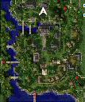

# Juice Ingredients

*For a list of other NPC made items, go to [Item Mixing](Item_Mixing.md).*

*  See: [Juice Quest](Juice_Quest.md) for how to begin.  This must be done on every character that wants to make juice.

| Juice Type | Ingredients | NPC and Location | Map Location |
| --- | --- | --- | --- |
| Apple Juice | 1 Apple 1 Empty Potion Bottle 3 Zeny | Marx Hansen   Inside Payon   (payon_in03 188,146) |  |
| Banana Juice | 1 Banana 1 Empty Potion Bottle 3 Zeny | Marx Hansen   Inside Payon   (payon_in03 188,146) |  |
| Carrot Juice | 1 Carrot 1 Empty Potion Bottle 3 Zeny | Marx Hansen   Inside Payon   (payon_in03 188,146) |  |
| Grape Juice | 1 Grape 1 Empty Potion Bottle 3 Zeny | Marx Hansen   Inside Payon   (payon_in03 188,146) |  |

**Related pages:**

* [Items](Items.md)
* [Armor](Armor.md)
* [Headgear](Headgears.md)
* [Weapons](Weapons.md)
* [Weapon Materials](Weapon_Materials.md)
* [Garments](Garments.md)
* [Footgear](Footgear.md)
* [Accessories](Accessories.md)
* [Equipment Sets](Equipment_Sets.md)
* [Skill Equipment](Skill_Equipment.md)
* [Cards](Card_System.md)
* [Card Reference](Card_Reference.md)
* [Card Sets](Card_Sets.md)
* [Item Mixing](Item_Mixing.md)
* [Juice Ingredients](Juice_Ingredients.md)
* [Potion Ingredients](Potion_Ingredients.md)
* [Dye Ingredients](Dye_Ingredients.md)
* [Tame Ingredients](Tame_Ingredients.md)
* [Headgear Ingredients](Headgear_Ingredients.md)
* [Headgear Quests](Headgear_Quests.md)
* [Pet Equipment](Pet_Equipment.md)
* [Counteragent and Mixture Quest](Counteragent_and_Mixture_Quest.md)
* [Quest Items](Quest_Items.md)
* [Healing Items](Healing_Items.md)
* [Autocast](Autocast.md)

---
**Categories:** [Item Mixing](categories/Item_Mixing.md)
*Source: [iRO Wiki Classic](https://irowiki.org/classic/Juice_Ingredients) — GFDL 1.3+*
