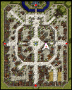
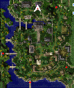

# Juice Quest

<!-- Quest info -->
- **Level requirement:** None
- **Item requirement:** 1 Meat
- **Quest reward:** Ability to make fruit juice

1. With 1 Meat in your inventory, go to the second floor of the inn in east [Prontera](Prontera.md) (prontera 204, 188) and talk with Morrison. Show him the meat, but decline to give it to him when he asks for it.

**Tip:** You can buy Meat from the Butcher at (prontera 64, 125).

2. Talk with Marianne, who mentions hearing of someone in another town who produces fruit juice.

3. Go to the fruit juice workshop in [Payon](Payon.md), at (payon 155, 327), and talk with Marx Hansen, who offers to make fruit juice for you.

To make a single bottle of fruit juice, he requires one piece of fruit, one Empty Potion Bottle, and 3 zeny. He can make juice from Apples, Bananas, Carrots, and Grapes.

---
**Categories:** [Item Mixing](categories/Item_Mixing.md), [Quests](categories/Quests.md)
*Source: [iRO Wiki Classic](https://irowiki.org/classic/Juice_Quest) — GFDL 1.3+*
