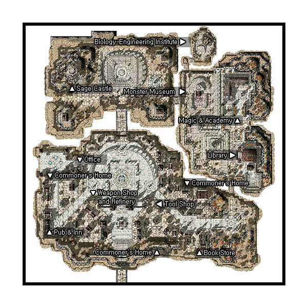

# Juno

## About Juno

Juno is the floating city, high in the clouds. It is also the location of the Sage Headquarters.

## Story

The capital of [Republic of Schwartzvald](Republic_of_Schwartzvald.md). Located in the air above El Mes Plateau, Juno is a floating city with three islands – the glorious island Solomon, island of intelligence Sonotora, island of prosperity Mineta. The `Heart of Ymir` is what allows this land to exist. Many come to research the strange powers and ancient civilization. Juno is called the `City of the Wise One` for this reason. Juno is located above the El Mes Plateau, which is north of [Al De Baran](Al_De_Baran.md). Currently, the airship which used to provide transportation between [Izlude](Izlude.md) and [Juno](Juno.md) is operating, so adventurers that wish to go to this land no longer have to climb through the rough land of the El Mes Plateau.

## Quests

Quests added with the Juno update can be found here.

## Guide

* Note: This image is somewhat outdated, as there is now an airport in the middle of the left side, and an Office building at the top center part.

## Structures

## Buildings

* 1 - Armory (118,136)
* 2 - Biology-Engineering Institute (283,365)
* 3 - Bookstore (264,88)
* 4 - Doctor's House (245,146)
* 5 - House #1 (49,151)
* 6 - House #2 (196,87)
* 7 - Inn (49,105)
* 8 - Library (341,203)
* 9 - Magic Academy (323,283)
* 10 - Monster Museum (278,292)
* 11 - Office (94,181)
* 12 - Research Lab (218,175)
* 13 - Sage Castle (88,320)
* 14 - Tool Shop (195,139)

## Billboards

* Billboard (153,113) - Gives background information on Juno

## NPCs

## Regulars

Juno Guide - Ms. Yoon (153,47)
  Show in minimap: Armory, Tool Shop, Sage Castle, Street of Book Stores, Juphero Plaza, Library of the Republic, Schwicherbil Magic ;Academy, Monster Museum
Kafra Employee (152,187)
Kafra Employee (327,108)
Kafra Employee (277,221)
  Save, Kafra storage (40z), Teleport service, Rent Cart, Reserve points
Lamberta (Armory)
  Upgrading NPC
Dilemma (Armory)
  Level 1/2 metal NPC
Delight (Armory)
  Level 3/4 metal NPC
Repairman (Armory)
  Repair NPC
Missing NPCs
  Inn NPC, PVP NPCs

## Store NPCs

Magic Dealer (163,187)
  Blue Gemstone, Rod, Wand, Staff, Arc Wand, Circlet, Silk Robe, Silver Robe
Outlet (205,103)
  Novice Breastplate, Legion Plate Armor, Greaves, Turban, Gemmed Sallet, Repeating Crossbow
Pet Merchant (197,114)
  Pet Food, Pet Incubator, Backpack, Rocker Glasses
Tool Dealer (226,107)
  Scell, Garlet, Zargon
Tool Dealer (218,97)
  Arrow, Magnifier, Red Potion, Orange Potion, Yellow Potion, White Potion, Green Potion, Concentration Potion, Awakening Potion, Fly Wing, Butterfly Wing
Armor Dealer (Armory)
  Novice Armlet, Guard, Mirror Shield, Sandals, Hood, Gemmed Sallet, Cotton Shirts, Jacket, Adventurer's Suit, Silk Robe, Silver Robe
Tool Dealer (Tool Shop)
  Arrow, Magnifier, Red Potion, Orange Potion, Yellow Potion, White Potion, Green Potion, Concentration Potion, Awakening Potion, Fly Wing, Butterfly Wing
Weapon Dealer (Armory)
  Arrow, Silver Arrow, Sword, Bow, Knife, Cutter, Main Gauche, Dirk, Dagger, Stiletto, Rod, Wand, Staff, Arc Wand
Chef Assistant (130,173)
  Cooking Oil, Pot

## Trade NPCs

Old Blacksmith - Skillful Looking Artisan (241,52)
  Angel Wing Ears for 1 Angel Wing, 1 Elven Ears, 20,000 Zeny
  Evil Wing Ears for 1 Evil Wing, 1 Elven Ears, 20,000 Zeny
Zhenbolt (300,188)
  Burning Blood Bandana for 300 Red Muffler, 300 Burning Heart, 1 Bandana, 1 White Hairstuffs
Nehrish (Monster Museum)
  Decorative Golden Bell for 1 Golden Bell, 1 Emperium, 3 Gold, 20,000 Zeny
  Crown of Ancient Queen for 1 Queen's Hair Ornament, 1 Emperium, 3 Gold, 20,000 Zeny
  Crown of Mistress for 1 Coronet, 1 Emperium, 3 Gold, 40,000 Zeny

## Quest NPCs

Active little girl - Hisa (208,164)
  ??
Bain (Pub & Inn)
Bajin (Pub & Inn)
  [Alchemist Item Gathering](Alchemist_Item_Gathering.md)
Doctor - ??? (Doctor's House)
   ??
Manager - Cukure (Research Lab)
  [Seal of Sleipnir](God_Items_Quest.md)
Noyee (164,200)
  Seal of Sleipnir
Staff of the Academy - Metheus Sylphe (Magic Academy)
  [Sage](Sage.md) job change NPC
Practical Examination P - Hermes Tris (Magic Academy)
Claytos Verdo (Magic Academy)
Saphien Layless (Magic Academy)
Lucius Celsus (Monster Museum)
Aebecee George (Biology-Engineering Institute)
Dean of the Academy - Kayron Grik (Sage Castle)
  [Sage](Sage.md) job change quest
Wagan (Tool Shop)
Metto (Monster Museum)
Stangckle (House #1)
Kato (Inn)
CiCi (Magic Academy)
  Part of [Stop Metto's Research](Stop_Metto's_Research.md)
Old Man - Sketzi Bundin (Bookstore)
Luke's Songs Vol.1 (Bookstore)
Battle Songs (Bookstore)
Apple of Idun (Bookstore)
Old Book (Bookstore)
  [Geffen Bard Quest](Geffen_Bard_Quest.md)

## Travel NPCs

Kafra Employee (152,187), (327,108) and (277,221)
  [Al De Baran](Al_De_Baran.md) - 1200z

## Other NPCs

* A Citizen of Juno - Shalima (157,87)
* Freidrich (184,173)
* Juno Artisan - Artisan (157,205)
* Juno Despot - Ninno (343,68)
* Juno Fighter - Sergiof (328,239)
* Juno Granny - Granny (337,227)
* Juno Sage - Le Morpheus (165,111)
* Juno Soldier (334,182)
* Juno Soldier (150,228)
* Juno Soldier (165,228)
* Juno Soldier (263,320)
* Juno Soldier (227,292)
* Juno Soldier (150,283)
* Juno Soldier (165,283)
* Sage Esklah - Esklah (163,328)
* Sage Syklah - Syklah (305,207)
* Sage Yklah - Yklah (261,99)
* Adventurer - Energetic Young Man (Office)
* Book of Ymir (Sage Castle)
* Heart of Ymir (Sage Castle)
* Metheus Sylphe (Sage Castle)
* Museum Guide - Cenia (Monster Museum, south room)
* Representative - Marlin Putiur (Office)
* Studying Scholar (Office)
* Auction Hall Guide (129,116)

## Other

## Monster Museum

Monster listing for the monsters on display in the Monster Museum. To look at the monsters, click the base of the plaque in front of the tube. Each monster will talk about itself.

## South Room

* Alice
* Assulter
* Chepet
* Deviace
* Galapago
* Penomena
* Raydric
* Sage Worm
* Seal
* Violy

## North Room

* Ancient Mummy
* Arclouze
* Blazzer
* Caterpillar
* Dragon Tail
* Geographer
* Incubus
* Male Thiefbug
* Mandragora
* Marine Sphere
* Megalodon
* Owl Duke
* Rafflesia
* Ride Word
* Sleeper
* Stem Worm
* Succubus
* Tri Joint
* Wanderer

## Dungeons

* **Magma Dungeon**

Magma Dungeon is located one south and one east of Juno.
The name of the dungeon suggest that mostly Fire Property monsters house the area.

* **Juperos Ruins**

Underneath El Mes Plateau lies the ruins of the city of Juperos , an ancient but highly advanced civilization. Juperos is well protected by automated guards and security devices to prevent unauthorized entry to prohibited areas. Although many of Juno's [Scholar](Scholar.md)s have their own speculations on the cause of the fall of such a technologically advanced race, no one is really sure what went wrong. One of the most popular theories is that Vesper Newton, a mad scientist conducting experiments with the famed Heart of Ymir has something to do with it.

**Related pages:**

* [Towns](Towns.md)
* [Rune-Midgarts Kingdom](Rune-Midgarts_Kingdom.md)
* [Alberta](Alberta.md)
* [Al De Baran](Al_De_Baran.md)
* [Archer Village](Archer_Village.md)
* [Comodo](Comodo.md)
* [Geffen](Geffen.md)
* [Izlude](Izlude.md)
* [Morroc](Morroc.md)
* [Payon](Payon.md)
* [Prontera](Prontera.md)
* [Umbala](Umbala.md)
* [Republic of Schwartzvald](Republic_of_Schwartzvald.md)
* [Einbech](Einbech.md)
* [Einbroch](Einbroch.md)
* [Hugel](Hugel.md)
* [Juno](Juno.md)
* [Lighthalzen](Lighthalzen.md)
* [Arunafeltz States](Arunafeltz_States.md)
* [Rachel](Rachel.md)
* [Veins](Veins.md)
* [Manuk](Manuk.md)
* [Amatsu](Amatsu.md)
* [Ayothaya](Ayothaya.md)
* [Kunlun](Kunlun.md)
* [Jawaii](Jawaii.md)
* [Louyang](Louyang.md)
* [Moscovia](Moscovia.md)
* [Nifflheim](Nifflheim.md)
* [Lutie](Lutie.md)

---
*Source: [iRO Wiki Classic](https://irowiki.org/classic/Juno) — GFDL 1.3+*
