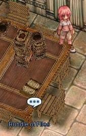
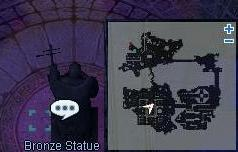

# Juperos Ruins History Quest

<!-- Quest info -->
- **Level requirement:** N/A
- **Item requirement:** 4 Transparent Plate (1 of each color)
- **Base EXP reward:** 200,000 or more
- **Item reward:** 4 or more Gift Box
- **Window:** yes

1. Go inside the [Juno](Juno.md) Library, located on the northeast island (yuno 341, 293).

2. In the Juno Library, talk to the Scholar (Fayruz) located in the farthest room (yuno_in04 190, 125) and then choose the bottom option.

3. On the nearby table, read the "Bundle of Files" (yuno_in04 186, 125). You should be reading through the document "Thesis: The fall of Juperos".

4. Next, you'll need to go through the other books in the library:

*  Book (yuno_in04 167, 127)
*  Book (yuno_in04 188, 117)
*  Paper (yuno_in04 188, 116)
*  Book (yuno_in04 187, 109)
*  Book (yuno_in04 186, 104)

In the north room:

*  Shwaltzvalt Adventurer (yuno_in04 118 15)
*  Aragham Caul Biography (yuno_in04 117 6)

In the south room:

*  Jellopy Soup (yuno_in04 116 106)
*  Popular Feasts(yuno_in04 102 106)

4. Talk to Fayruz again and choose the second option. She'll ask you to go to Juperos and find some things and bring them to her.

5. Find and talk to the 4 bronze statues near the entrance to the second floor. After you talk to them, your character tells you to go back to Fayruz and tell her about the findings.

6. Talk to Feyruz again. She will translate the text you recovered from the statues. She will ask you to take some more documents to her.

7. You need to kill Dimiks to get the documents required. There are 4 types of Dimiks that will drop 4 types of Transparent Plates. You will need all 4 plates.

8. Each time you bring one of the plates back to Feyruz, she will give you a Gift Box as a reward. The quest is over once you bring back all 4 kinds of plates.

*  You gain 100,000 [Base EXP](Base_EXP_Chart.md) for each plate you turn in. (This has not been confirmed whether or not this works for more than 2 plates, however.)

---
**Categories:** [Base Experience Reward](categories/Base_Experience_Reward.md), [Lighthalzen Quests](categories/Lighthalzen_Quests.md), [Quest Window Quests](categories/Quest_Window_Quests.md), [Quests](categories/Quests.md)
*Source: [iRO Wiki Classic](https://irowiki.org/classic/Juperos_Ruins_History_Quest) — GFDL 1.3+*
