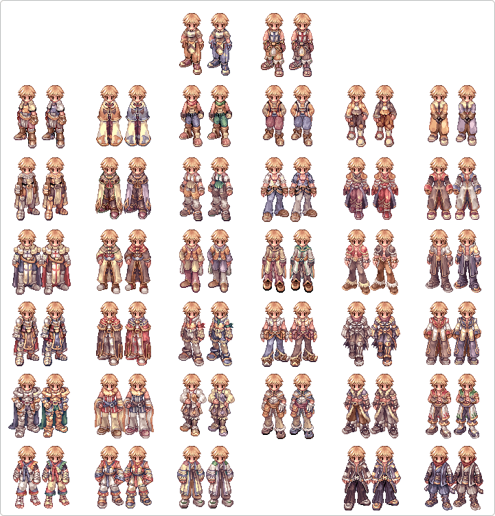
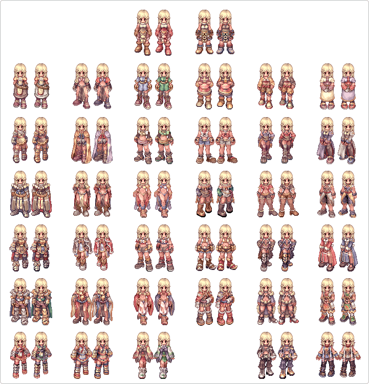

# Kafra Shop

## Overview

The Kafra Shop is the iRO version of an Item Mall.  To purchase items through the Kafra Shop, users must use Kafra Shop Points.  These items are divided into several categories.  Current categories in the Kafra Shop include Consumable Items, Headgears, Boxes, Rental Weapons (Valkyrie only) and Rental Accessories (Varies based on server).

**Item cost varies based on which type of server you are on.  Some items on the [free](F2P.md) Valkyrie server cost 20-80% more points to purchase than those on the Premium Server (Ymir).**

## Kafra Shop Points

Kafra Shop Points can be purchased directly on the [Warp Portal Website](http://iro.ragnarokonline.com/payment/billingStart.asp?process=point).  Kafra Shop Points can also be obtained by redeeming [Gravity Game Prepaid Cards](http://iro.ragnarokonline.com/payment/billingStart.asp?process=card) purchased at retail stores like Target.  By and large, the more you spend to renew/purchase points, the more points will be earned for the money. As a basic general conversion, $1 USD = 100 Kafra Shop Points.

Kafra Shop Points can also be obtained without spending money.  The player may fill out surveys and receive points if the survey conditions and requirements are met.  The list of available surveys may change from time to time.  New surveys may be added and some surveys may be removed if enough participants have successfully completed the survey forms.  Therefore, it may be helpful to occasionally recheck the list of available surveys.

**Warning:** It should be noted that **many** surveys disqualify participants before completion of the survey, thus resulting in no points awarded. Most players have found the surveys to be a waste of time.

"Kafra Shop Points" are not to be confused with "Kafra Points" earned by spending [Zeny](Zeny.md) on regular [Kafra](Kafra.md) Employee services, such as using Storage, Teleporting and renting [Carts](Pushcart.md). Those points can be used at the Kafra Headquarters in [Al De Baran](Al_De_Baran.md).

## In-Game NPCs

Kafra Shop Employees are located in Juno (Valkyrie only), Payon (Ymir and Valkyrie) and Prontera (Valkyrie only).  Items available for purchase in the Kafra Shop are all listed in order of when they were added.  Older items are at the top, while newer items are at the bottom.  If you need to find out how many unused Kafra Shop Points remain, simply click on a Kafra Shop Employee vending items and the total will be displayed at the bottom of the Shop Items list window.

In Payon (payon 171, 142), two other [NPC](NPC.md)s near the employee are also Kafra Shop related.  The first is Ripped Callus (payon, 173, 141) who works out with characters who have purchased Gym Passes, and can level up their Enlarge Weight Limit skill up to level 10.  The other, Suhnbi (payon 174, 138), upgrades items using Enriched Elunium or Enriched Oridecon.  This NPC is able to upgrade items using Kafra Shop purchased Enriched Elunium and Enriched Oridecon.

In Prontera on the Valkyrie Server, the Kafra Shop Employees are also located in the north side room of the Prontera weapon/armor upgrade shop (prontera 176, 187).  Four Kafra Shop Employees in the bottom right corner of the room sell items.  Ripped Camus in the upper right corner works out with characters who have purchased Gym Passes, and can level up their Enlarge Weight Limit skill up to level 10.  The NPC named Suhnmi, in the upper left corner, is able to upgrade items using Enriched Elunium or Enriched Oridecon.

In Juno (yuno 143, 183) on the Valkyrie Server, there are four Kafra Shop Employees vending items.  Next to them is Ripped Callus (yuno 139, 188) who works with characters who have purchased Gym Passes, and can level up their Enlarge Weight Limit skill up to level 10.  The other, Selti (yuno 142, 188), upgrades items using Enriched Elunium or Enriched Oridecon.

## Items

The list of items can be found at the [Kafra Shop Items Page](http://iro.ragnarokonline.com/kafrashop/itemmalllist.asp), which lists items, their prices, and user ratings.  The items can also be viewed in-game by visiting the aforementioned Kafra Shop NPC.

On iRO, Kafra shop items are grouped into the following categories:
* [Consumables](http://iro.ragnarokonline.com/kafrashop/itemmalllist.asp?Mallidx=1)
* [Headgears](http://iro.ragnarokonline.com/kafrashop/itemmalllist.asp?Mallidx=2)
* [Armors](http://iro.ragnarokonline.com/kafrashop/itemmalllist.asp?Mallidx=3)
* [Weapons](http://iro.ragnarokonline.com/kafrashop/itemmalllist.asp?Mallidx=4)
* [Accessories](http://iro.ragnarokonline.com/kafrashop/itemmalllist.asp?Mallidx=5)
* [Scrolls](http://iro.ragnarokonline.com/kafrashop/itemmalllist.asp?Mallidx=6)
* [Boxes](http://iro.ragnarokonline.com/kafrashop/itemmalllist.asp?Mallidx=7)

## Dye

Characters may dye their clothing using a Card from the Kafra Shop.  To dye your clothing, talk to Dinorah Lacostt (285, 167) inside [Prontera](Prontera.md) (prontera 87, 91).  The dye remains through job changes, and to return to your original color, you must purchase a separate ticket and repeat the process.

Click on the following images to see a preview of the clothing dye for each job (the left side is the original color, and right the dyed one)

| Column 1 | Column 2 |
| --- | --- |
|   |   |

---
**Categories:** [General Information](categories/General_Information.md)
*Source: [iRO Wiki Classic](https://irowiki.org/classic/Kafra_Shop) — GFDL 1.3+*
