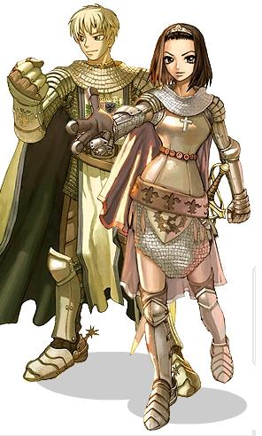

# Knight

<!-- Job info -->
- **Job base:** Swordman
- **Job type:** 2-1
- **Changes at:** [Prontera](Prontera.md) Chivalry
- **Skills:** 10
- **Skill points:** 76
- **Quest skills:** 1
- **Skills from soul link:** 1
- **STR:** 8
- **AGI:** 2
- **VIT:** 10
- **INT:** 0
- **DEX:** 6
- **LUK:** 4

## Overview

The Knight class is the primary second job for the [Swordman](Swordman.md) class. Being a hack and slash type of character, Knights are granted access to a new mastery that will open a new type of weapon to wield aside from the [Swordman's](Swordman.md) swords. They are also allowed to acquire powerful [AoE](Area_of_Effect.md) skills like the famed [Bowling Bash](Bowling_Bash.md) and the [spear](Spear.md) exclusive skill, [Brandish Spear](Brandish_Spear.md).

## Jobchange Guide

*See [Knight Job Change Guide](Knight_Job_Change_Guide.md) for detailed information.*

Changing into a Knight from a [Swordman](Swordman.md) requires the player to complete a number of tasks:
*  Item Collection
*  A Written Test
*  Battle Test
*  Word Association Quiz
*  A test of self control
*  Personality Quiz

After completing these tests, the player will be transformed into a Knight. All this takes place inside the [Prontera](Prontera.md) Chivalry ([Prontera](Prontera.md) xx, yy).

## Builds

## Hybrid

* STR: 70-90
* AGI: 60-90
* VIT: 60-90
* INT: 1
* DEX: 40-50
* LUK: 1

Weapon: [Element](Element.md)al or [Card](Card_System.md)ed [Spear](Spear.md)s or [Two Handed Sword](Two_Handed_Sword.md)s

These knights try to get the best of both realms. By having a good chemistry of [AGI](Stats.md) and [VIT](Stats.md) depending on the user's playing style, they gain survivability in some areas while losing it in others. Hybrids are denoted by which stat is the highest. AGI-VIT Knights usually stick with a setup similar to an AGI knight. VIT-AGI Knights, likewise, generally stay with the setup of a VIT Knight.

Ranking by efficiency, players tend to use AGI-VIT combination because of its higher [ASPD](ASPD.md) which allows players to do [Pierce](Pierce.md) chaining or if not solo with [Twohand Quicken](Twohand_Quicken.md) with a decent [ASPD](ASPD.md). This build was the best for pre-Transcendent patch Knight dueling.

## AGI Two-Hand Sword

* STR: 90-100
* AGI: 80-99
* VIT: 10-30+
* INT: 1
* DEX: 40-60
* LUK: 1-10

Weapons: [Element](Element.md)al [Two Handed Sword](Two_Handed_Sword.md)s or [Card](Card_System.md)ed [Two Handed Sword](Two_Handed_Sword.md)s

[AGI](Stats.md) Knights believe that the best way to decrease damage is to prevent it from ever happening. They have high [ASPD](ASPD.md) and [Flee](Stats.md), but vitality, and by extention health, are low compared to other Knights. Additionally, using two-handed swords pushes their attack power higher than most [VIT](Stats.md) Knights. Their main method of attack is [Twohand Quicken](Twohand_Quicken.md), which increases [ASPD](ASPD.md) by 30%. When faced with multiple foes, they break out [Bowling Bash](Bowling_Bash.md). Finally, [Counter Attack](Counter_Attack.md) allows for a higher critical chance against evasive or fortified foes.

## VIT

* STR: 80+
* AGI: 1-20+
* VIT: 90-100
* INT: 1-12
* DEX: 40
* LUK: 1

Weapon: [Element](Element.md)al or [Card](Card_System.md)ed One or Two-Handed [Spear](Spear.md)s

[VIT](Stats.md) Knights are good tanks in Ragnarok Online. They have the highest health and good defense rate, and unlike agility Knights, they usually use shields for added defense and [Spear](Spear.md) type weaponry. Levels mostly by mobbing, utilizing their tanking ability.

## SVD

* STR: 100+
* AGI: 40
* VIT: 80
* INT: 1-30
* DEX: 45-60
* LUK: 1

Weapon: [Element](Element.md)al or [Card](Card_System.md)ed One or Two-Handed [Spear](Spear.md)s

SVD Knights ([STR](Stats.md)/[VIT](Stats.md)/[DEX](Stats.md)) may seem similar to VIT Knights, but they have more uses than just being meatshields. Their damage output is higher while maintaining decent [VIT](Stats.md), allowing them to excel at [MvP](MVP.md)ing or [PvP](PvP~d29d2.md) in comparison.

The typical SVD knight will level primarily on Large sized monsters utilizing pierce or they will make use of [Bowling Bash](Bowling_Bash.md) or [Brandish Spear](Brandish_Spear.md) for mobbing.

Strength should be 100 at a minimum, most knights typically get around 120. This allows knights to be able to gain 1-hit-KO against High Orcs and possibly Minorous. At later levels, these knights will typically go to Thor's volcano and use [Pierce](Pierce.md) against Kasas.

Intelligence is a variable stat, and general consensus seems to be that at least 12 points in it is necessary. If the player is able to gain 1-hit-KOs while using an Earth Deleter Card, no intelligence may be needed.

Agility is not for defence and should only be gotten for the purpose of using [Pierce](Pierce.md) at a faster rate.

## AGI-Spear

* STR: 100-110
* AGI: 70+
* VIT: 40+
* INT: 1
* DEX: 40+
* LUK: 1

Weapons: [Element](Element.md)al or [Card](Card_System.md)ed [Spear](Spear.md)s

Another type of [AGI](Stats.md) Knights are those who use [Spear](Spear.md) type weapons. Using high [AGI](Stats.md) to decrease the [ASPD](ASPD.md) delay of [Pierce](Pierce.md), [AGI](Stats.md) Spear Knights can dish out high amounts of damage using elemental spears to rapidly use Pierce on large size monsters. One famous leveling method is [Pierce](Pierce.md) chaining with [Aspersio](Aspersio.md) in Chivalry against Raydrics to Abysmal Knights.

The intention of this build, unlike the Two-Handed Sword build is not to dodge 95%, but to deal damage with rapid [Pierce](Pierce.md) and sometimes [AoE](Area_of_Effect.md)s before the enemy can do harm to you. For that reason, [AGI](Stats.md) Spear Knights often have more [STR](Stats.md) than [AGI](Stats.md).

## AGI-Crit

* STR: 70-80+
* AGI: 70-90+
* VIT: 1-30
* INT: 1
* DEX: 1-20
* LUK: 30+

Weapon: [Card](Card_System.md)ed [Two Handed Sword](Two_Handed_Sword.md)s, Muramasa

The AGI-Critical aka AGI-LUK Knight is essentially a knight with crit-sin stats. The advantages to this are obvious, Knights have more health than assassins, a passive health regeneration, and are also capable of attaining higher attack speeds. However, this will not be able to match the critical rate of an [Assassin](Assassin.md), and will have significantly less flee.

With the advent of [Soul Linker](Soul_Linker.md)s, this build is much more viable, as even higher [ASPD](ASPD.md) can now be attained with a sword and shield.

## Muramasa

* LUK: BaseLv + 1
* *Remaining stats are left to the reader's discretion.*

This is a special build that relies on the usage of the weapon called Muramasa. Because the Muramasa [curses](Status_Effects.md) the wielder randomly, if the player has one more point of total LUK than their baselevel, the curse effect can be negated.

The Morrigane gear set helps immensely with this build, as it lowers the base luk required to meet the curse immunity requirement, as well as giving a large amount of crit and lucky/perfect dodge.

## Equipment

Most Knights have different sets of gear for special purposes, regardless of what their build is. Items from these sets are interchangeable, while some are very situational. For example, a Combat Knife may prove to be more useful than a Fortune Sword in a map rich with [Demi Human](Demi_Human.md) monsters, but not against any other race of monsters. These are merely **suggestions** and **examples**; the reader should know what exactly best fits them. It also focuses on armor equipment, **not** just weapons. **Note**: this guide is outdated in some areas as a lot of ingame content has changed, it's a year old, don't quote Rav on it. The guide was also intended for Knights not yet transcended to [Lord Knight](Lord_Knight.md)s, hence the lack of Valkyrie Armor and some other weapons. The role of a Knight in WoE used to be more supportive, few ever [Provoke](Provoke.md)s (or have in the history of Ragnarok Online) and it wouldn't make much of a difference now anyway (aside from everyone having Evil Druid carded armor). Armor switching is also becoming increasing useless. Ultimately, most Knights and [Lord Knight](Lord_Knight.md)s brute force their way through PvP/WoE, and it is unlikely there will be a complete detailed guide about either class: so play however. Just don't be stupid and miss out on [Spear Stab](Spear_Stab.md).

## Tanking/Pure Defensive

All Knights once shared the same goal of obtaining over 80 [DEF](DEF.md). While this is no longer as desirable for [WoE/PvP](War_of_Emperium.md) with the addition of many defense-ignoring skills or items such as the [Ice Pick](Ice_Pick.md), it is still a successful set up for PvM. These armors reduce damage received, which is helpful for *tanking* [MvP](MVP.md)s or mobbing.

* Notes
  * In short, use armor with the highest base [DEF](DEF.md) and a **high upgrade**. +10 would reduce the most damage, but +7s can suffice. Also use equipment that provides considerable [Perfect Dodge](Perfect_Dodge.md).
  * Using armor with high **base** [DEF](DEF.md) is important: a +6 Cap (4 base [DEF](DEF.md)) and a +4 Helm (6 base [DEF](DEF.md)) may appear to have the same overall armor [DEF](DEF.md) (10). However, each upgrade only adds +2/3 defense. The Cap, in truth, supplies 8 [DEF](DEF.md) while the Helm delivers 8.67
  * Sometimes the highest base [DEF](DEF.md) gear is too limited to over-upgrade. Move onto the second best.

* Top headgear:
  * Helm (6 [DEF](DEF.md))
  * Bone Helm (7 [DEF](DEF.md))

* Middle headgear:
  * Fin Helm (2 [DEF](DEF.md))

  * Lower headgear:
  * Iron Cain (1 [DEF](DEF.md))

* Body armor:
  * Full Plate (1) (10 [DEF](DEF.md))
  * Chainmail (1) (8 [DEF](DEF.md))
  * Cards: MvPs usually break body armor; Cornutus card prevent this and add 1 [DEF](DEF.md). Select monsters use elemental skills that require elemental armor for resistance. Against Dark Lord, a Pasana carded armor would reduce its painful [Meteor Storm](Meteor_Storm.md) to 25% of the original damage. For general tanking, [Peco Peco](Peco_Peco_Ride.md) and sometimes Steel Chonchon cards are still employed.

* Garment:
  * Manteau (1) (4 [DEF](DEF.md))
  * Pauldron (1) (5 [DEF](DEF.md))
  * Cards: Raydric card reduces [Neutral](Neutral.md) damage by 20%. Frequently the best garment card to choose for this purpose.

* Shield:
  * Shield (1) (6 [DEF](DEF.md))
  * Cards: Racial cards (-30% damage from respective race). Some races lack this kind of card, such as [Undead](Undead.md). In this case, size cards (-25% from respective size, i.e. Mysteltainn -25% from small & 1 [DEF](DEF.md)) can be used. Medusa carded shields are preferred against Osiris, to counter its [Stone Curse](Stone_Curse.md).

* Footgear:
  * Boots (1) (4 [DEF](DEF.md))
  * Greaves (1) (5 [DEF](DEF.md))
  * Cards: Upgrade under +9 - Verit (+8% [HP](Max_HP.md)/[SP](SP.md)), Matyr (+10% [HP](Max_HP.md), [AGI](Stats.md) +1). Upgrade +9 or more - Firelock Soldier (+10% [HP](Max_HP.md)/[SP](SP.md), [STR](Stats.md) +2).

* Accessories:
  * Safety Ring (3 [DEF](DEF.md), 3 [MDEF](Stats.md))
  * Yoyo carded ([Perfect Dodge](Perfect_Dodge.md) +5, [AGI](Stats.md) +1), preferably in Slotted Rosaries (3 [MDEF](Stats.md), [LUK](Stats.md) +1)

* Weapons:
  * Anything that adds [Perfect Dodge](Perfect_Dodge.md) or reduces damage.
  * Fortune Sword ([Perfect Dodge](Perfect_Dodge.md) +20, [LUK](Stats.md) +5)
  * Combat Knife (-10% damage from [Demi Human](Demi_Human.md)s)

## Leveling/+Damage&EXP

Leveling equipment is the most diverse – nearly anything can be worn. All defensive gear can be replaced with low [DEF](DEF.md) stat-increasing gear to level faster at the cost of becoming exceptionally vulnerable to monster attacks. Conversely, a financially lacking player might not do so, to reduce Potion consumption. These are some ideas for gear that will contribute to damage output or increased EXP gain if used properly. They will not enable its user to level faster if they die more than it is worth, or are not able to "take on" as many monsters.

* Notes
  * Any gear that amplifies: [SP](SP.md), [ATK](Stats.md), [STR](Stats.md), [AGI](Stats.md), [CRIT](Stats.md) or [DEX](Stats.md) will hopefully increase damage output.
  * Achieving [strength](Stats.md) bonuses always take priority over reaching higher [ASPD](ASPD.md).
  * When leveling with [Brandish Spear](Brandish_Spear.md) or [Bowling Bash](Bowling_Bash.md), +[AGI](Stats.md) or [CRIT](Stats.md) gear is nearly useless.

* Top headgear:
  * Slotted Baseball Cap, Cap, Helm, etc with cards: Willow ([SP](SP.md) +80) / Carat ([SP](SP.md) +150 if over +8) / Deviruchi ([STR](Stats.md) +1) / Nightmare ([AGI](Stats.md) +1) / Cramp ([STR](Stats.md) +3 if worn with Tarou Card)
  * Anything that increases [SP](SP.md) or adds stats that benefit DPM: Crown of Mistress ([SP](SP.md) +100, [INT](Stats.md) +2), Ghost Bandana ([AGI](Stats.md) +2), Hot-blooded Headband ([STR](Stats.md) +2)

* Middle headgear:
  * Slotted Sunglasses/Glasses with cards suggested for the top headgear, save Carat card
  * Evil Wing Ears ([STR](Stats.md) +1)

* Body armor:
  * Elemental cards previously mentioned take priority if an elemental attack is too powerful. Otherwise, cards: Picky ([ATK](Stats.md) +10, [STR](Stats.md) +1), Thief Bug ([AGI](Stats.md) +1), Pupa ([HP](Max_HP.md) +700)

* Garment:
  * Bapho Jr card ([AGI](Stats.md) +3, [CRIT](Stats.md) +1)

* Shield:
  * If handling one, racial/size cards. Two handed weapons generally have more [ATK](Stats.md), but shields are a nice way of compensating for lack of [DEF](DEF.md).

* Footgear:
  * +10% EXP gained and +20% increased damage cards (i.e. Am Mut; 10% more EXP is gained for every [Demi Human](Demi_Human.md) monster killed, but each [Demi Human](Demi_Human.md) monster deals 20% more damage)
  * Cards: Male Thiefbug ([AGI](Stats.md) +2), Firelock Soldier ([HP](Max_HP.md)/[SP](SP.md) +10%- if footgear is upgraded to +9 or higher, [STR](Stats.md) +2), Sohee ([SP](SP.md) +15%, [SP](SP.md) recovery +3%)

* Accessories:
  * If meleeing, Kobold cards ([CRIT](Stats.md) +4, [STR](Stats.md) +1) preferably in Brooches (1) or Rings (1) if level 90+
  * Mantis cards ([STR](Stats.md) +3), preferably in Rings (1) for an easy [STR](Stats.md) +8
  * The Sign ([ATK](Stats.md) +5%)

## MvP (Killing)

Killing [MvP](MVP.md)s with intent to be the [MvP](MVP.md)er is different from tanking them, although a lot of the same gear can be carried over. Receiving damage from MvPs rewards tank damage points, so taking as much damage as possible may be ideal. If this is too risky, do not substitute any [defense](DEF.md) gear for **damage** gear, besides Safety Rings for Muscle Rings or 2644. Remember to always use Immortal/correct elemental armor when needed.

The weapons used should be very specific to what is being killed. Putting aside Abysmal Knight cards, the best carded weapons are achieved by combing race, element, and size cards. Race and element cards add +20% damage to a specific race, while size cards add +15% damage to a specific sized monster and +5 [ATK](Stats.md). If [MvP](MVP.md)ing with [Pierce](Pierce.md), use a +10 four slotted "2:1:1" Pike. The numbers in "2:1:1" indicate it either has:

* two race cards, one element card, one size card
* or two element cards, one race card, one size card

If a race card is unavailable, use 3 element cards and 1 size card or 2 element cards and 2 size cards (3:1 or 2:2). Likewise if an element card is unavailable. If both race and element do not exist, a quadruple size weapon can be considered. The same method can be used with Katanas, if [MvP](MVP.md)ing with [Bowling Bash](Bowling_Bash.md), although they require high [STR](Stats.md) to out damage two slotted Two Handed Swords. Sabers only have three slots max, so a 2:1 or 1:1:1 must be made.

* 2:1 - 2x element & 1x race or 2x race & 1x element
* 1:1:1 - 1x element 1x race 1x size

Other weapons to consider: [Ice Pick](Ice_Pick.md), Tridents, Brocca

## PvP

[PvP](PvP~d29d2.md) demands excessive armor switching to combat statuses and elements. Defensive gear is useful against most [Enchant Deadly Poison](Enchant_Deadly_Poison.md) [Sonic Blows](Sonic_Blow.md), and [Double Strafing](Double_Strafe.md), but otherwise reduction gear prevails. A moderate amount of [MDEF](Stats.md) is good, but it is often overrated: 80 [MDEF](Stats.md) makes Knights susceptible to too much, and isn't needed when little damage is taken with half the [MDEF](Stats.md) and elemental armors.

* Notes
  * [STR](Stats.md) gear can be used. The extra damage taken from slapping on [STR](Stats.md) gear is as overrated as 80 [MDEF](Stats.md) is.
  * Don't forget to bring items like Green Potions to cure the [Silence](Status_Effects.md) status, or Holy Water to cure [Curse](Status_Effects.md).
  * Endow Scrolls and Cursed Water are also accommodating.

* Top headgear:
  * Poo Poo Hat (-10% from [Demi Human](Demi_Human.md)s, 0 [DEF](DEF.md) - no additional damage taken from [Ice Pick](Ice_Pick.md)s)
  * Drooping Cat (15 [MDEF](Stats.md), curse resistance +30% - should not be necessary)

* Middle headgear:
  * Cards: Willow ([SP](SP.md) +80), Nightmare ([AGI](Stats.md) +1 but also grants immunity to the [Sleep](Status_Effects.md) status which can be devastating), Marduk (grants immunity to the [Silence](Status_Effects.md) status – only to be switched on if Green Potion supply is being threatened)

* Body armor:
  * Elemental armors, if used properly, can reduce more damage than any other piece of equipment in [PvP](PvP~d29d2.md). It is suggested that they are kept in separate types of armor for quick equipping. Key elements: [Poison](Poison.md) (Argiope card), [Undead](Undead.md) (Evil Druid card - also stops [Stone Curse](Stone_Curse.md) and [Frozen](Status_Effects.md)), [Wind](Wind.md) (Dokebi card), [Shadow](Shadow.md) (Bathory card), [Ghost](Ghost.md) (Ghostring card), [Fire](Fire.md) (Pasana card).
  * Unfrozen Silk Robe (1) (+5% resistance to [Water](Water.md) attacks, can no longer be frozen & 10 [MDEF](Stats.md))

* Garment:
  * Ragamuffin (10 [MDEF](Stats.md))
  * Cards: -30% from element cards (i.e. Dustiness), Raydric, Frilldora

* Shield:
  * Cranial Mirror Shield (1) (-30% from [Demi Human](Demi_Human.md)s & 4 [DEF](DEF.md), 5 [MDEF](Stats.md))
  * Cranial Valkyrie Shield

* Footgear:
  * Crystal Pumps (10 [MDEF](Stats.md), [LUK](Stats.md) +5 – a lot of [HP](Max_HP.md) is lost using these instead of carded footgear)
  * Cards: Verit (+8% [HP](Max_HP.md)/[SP](SP.md)), Matyr (+10% [HP](Max_HP.md), [AGI](Stats.md) +1), Firelock Soldier (+10% [HP](Max_HP.md)/[SP](SP.md), [STR](Stats.md) +2)

* Accessories:
  * Unslotted Rosaries (5 [MDEF](Stats.md) each)
  * Cards: Alligator (5% less damage from ranged and targeted magic attacks each) preferably in Slotted Rosaries (3 [MDEF](Stats.md)) if level 90+, Horong (enables use of [Sight](Sight.md)), Smokie (enables use of level 1 [Hide](Hiding.md))

* Weapons
  * Hydra & Skeleton Worker carded weapons, [Ice Pick](Ice_Pick.md), etc.
  * Status inflicting weapons (i.e. quadruple [stun](Status_Effects.md), quadruple [curse](Status_Effects.md))

## WoE

Most of the PvP gear can be transferred to WoE. Skills and ranged attacks don’t do as much damage however, so not as much gear is mandatory. The most vital are:

* Unfrozen Armor
* Cranial Shield
* Status Weapons

As a normal Knight, do not focus primarily on killing people - [STR](Stats.md) gear is not needed. Spamming [Provoke](Provoke.md) on enemy wizards or stat using people to aid guild members or allies is more beneficial.

Against the Emperium, [Ice Pick](Ice_Pick.md)s are the best weapon available, coupled with Cursed Water. Evil Druid armor is helpful at the Emperium to negate [Aspersio](Aspersio.md) from enemy [Priest](Priest.md)s, although another Cursed Water can simply be consumed or weapon switched to remove the [Holy](Holy.md) property.

## Class Data

## Skills

*See [Swordman](Swordman.md) Skills for first class skills.*

| Skill | Description | Levels | Type |
| --- | --- | --- | --- |
| [Bowling Bash](Bowling_Bash.md) | Knock targets backward, causing up to 500% damage in a 3x3 cell area that hits twice. | 10 | Offensive |
| [Brandish Spear](Brandish_Spear.md) | Attacks an area of ememies around the caster. Damage for each enemy increases the closer they are to the caster. | 10 | Offensive |
| [Cavalier Mastery](Cavalier_Mastery.md) | At maximum level removes the 50% [ASPD](ASPD.md) penalty when riding a [PecoPeco](Peco_Peco_Ride.md). | 5 | Passive |
| [Counter Attack](Counter_Attack.md) | Block an enemy's attack and automatically perform one critical attack on them, ending the Counter Attack stance. | 5 | Active |
| [Peco Peco Ride](Peco_Peco_Ride.md) | Enables [Knight](Knight.md)s or [Crusader](Crusader.md)s to ride a Peco Peco. | 1 | Passive |
| [Pierce](Pierce.md) | Strikes a single target for an amount of hits based on target's size. Requires a Spear class weapon. | 10 | Offensive |
| [Spear Boomerang](Spear_Boomerang.md) | Must be wielding a Spear weapon. Throws the equipped spear at a single target (the spear does not require retrieval). | 5 | Offensive |
| [Spear Mastery](Spear_Mastery.md) | Adds +4 ATK per skill level to Spear weapons. If the player is riding a PecoPeco, an additional +1 ATK per skill level is added. | 10 | Passive |
| [Spear Stab](Spear_Stab.md) | Strikes a target enemy and all enemies in a line between the player and the target. Requires a Spear. All struck enemies are knocked back 6 cells. | 10 | Offensive |
| [Twohand Quicken](Twohand_Quicken.md) | Temporarily increase Attack Speed when a Two Handed Sword weapon is equipped for the skill's duration. | 10 | Supportive |

## Quest Skills

| Skill | Description | Levels | Type | Job Level Requirement | Quest |
| --- | --- | --- | --- | --- | --- |
| [Charge Attack](Charge_Attack.md) | Ranged attack: Rush a target, dealing more damage depending on how far away you are from it. | 1 | Offensive | 40 | [Charge Attack Quest](Knight_Skill_Quest.md) |

## Soul Link

*[Knight Spirit](Knight_Spirit.md) enables use of*

| Skill | Description | Levels | Type |
| --- | --- | --- | --- |
| [One-Hand Quicken](One-Hand_Quicken.md) | Temporarily increase ASPD by 30% when wielding One-Handed Swords. | 1 | Supportive |

## Job Bonuses

The Levels in which one receives a certain bonus

| Stat\Amount | +1 | +2 | +3 | +4 | +5 | +6 | +7 | +8 | +9 | +10 |
| --- | --- | --- | --- | --- | --- | --- | --- | --- | --- | --- |
| STR | 4 | 10 | 15 | 21 | 27 | 33 | 46 | 47 |   |   |
| AGI | 13 | 38 |   |   |   |   |   |   |   |   |
| VIT | 1 | 3 | 8 | 12 | 17 | 18 | 23 | 29 | 36 | 43 |
| INT |   |   |   |   |   |   |   |   |   |   |
| DEX | 5 | 20 | 31 | 40 | 48 | 49 |   |   |   |   |
| LUK | 5 | 20 | 28 | 37 |   |   |   |   |   |   |

## ASPD

## External Links

**Related pages:**

* [Knight](Knight.md)
* [Lord Knight](Lord_Knight.md)
* [Skills](Skills.md)
* [Bowling Bash](Bowling_Bash.md)
* [Brandish Spear](Brandish_Spear.md)
* [Cavalier Mastery](Cavalier_Mastery.md)
* [Charge Attack](Charge_Attack.md)
* [Counter Attack](Counter_Attack.md)
* [One-Hand Quicken](One-Hand_Quicken.md)
* [Peco Peco Ride](Peco_Peco_Ride.md)
* [Pierce](Pierce.md)
* [Spear Boomerang](Spear_Boomerang.md)
* [Spear Mastery](Spear_Mastery.md)
* [Spear Stab](Spear_Stab.md)
* [Twohand Quicken](Twohand_Quicken.md)
* [Aura Blade](Aura_Blade.md)
* [Clashing Spiral](Clashing_Spiral.md)
* [Frenzy](Frenzy.md)
* [Fury (2)](Fury_(2).md)
* [Parry](Parry.md)
* [Relax](Relax.md)
* [Spear Dynamo](Spear_Dynamo.md)
* [Traumatic Blow](Traumatic_Blow.md)
* [Vital Strike](Vital_Strike.md)
* [Quests](Quests.md)
* [Knight Job Change Guide](Knight_Job_Change_Guide.md)
* [Knight Skill Quest](Knight_Skill_Quest.md)
* [Rebirth Walkthrough](Rebirth_Walkthrough.md)
* [Weapons](Weapons.md)
* [One Handed Sword](One_Handed_Sword.md)
* [Spear](Spear.md)
* [Two Handed Sword](Two_Handed_Sword.md)

**Related pages:**

* [Classes](Classes.md)
* [Novice](Novice.md)
* [High Novice](High_Novice.md)
* [Super Novice](Super_Novice.md)
* [Acolyte](Acolyte.md)
* [Archer](Archer.md)
* [High First Class](High_First_Class.md)
* [Mage](Mage.md)
* [Merchant](Merchant.md)
* [Swordman](Swordman.md)
* [Thief](Thief.md)
* [Priest](Priest.md)
* [Monk](Monk.md)
* [Hunter](Hunter.md)
* [Bard](Bard.md)
* [Dancer](Dancer.md)
* [Wizard](Wizard.md)
* [Sage](Sage.md)
* [Blacksmith](Blacksmith.md)
* [Alchemist](Alchemist.md)
* [Knight](Knight.md)
* [Crusader](Crusader.md)
* [Assassin](Assassin.md)
* [Rogue](Rogue.md)
* [Transcendent](Transcendent.md)
* [High Priest](High_Priest.md)
* [Champion](Champion.md)
* [Sniper](Sniper.md)
* [Minstrel](Minstrel.md)
* [Gypsy](Gypsy.md)
* [High Wizard](High_Wizard.md)
* [Scholar](Scholar.md)
* [Mastersmith](Mastersmith.md)
* [Biochemist](Biochemist.md)
* [Lord Knight](Lord_Knight.md)
* [Paladin](Paladin.md)
* [Assassin Cross](Assassin_Cross.md)
* [Stalker](Stalker.md)
* [Gunslinger](Gunslinger.md)
* [Ninja](Ninja.md)
* [TaeKwon Kid](TaeKwon_Kid.md)
* [TaeKwon Master](TaeKwon_Master.md)
* [Soul Linker](Soul_Linker.md)

---
**Categories:** [Classes](categories/Classes.md), [Knight](categories/Knight.md)
*Source: [iRO Wiki Classic](https://irowiki.org/classic/Knight) — GFDL 1.3+*
