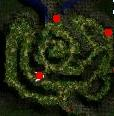

# Koschei the Immortal

<!-- Quest info -->
- **Level requirement:** 60
- **Item requirement:** 1 Cursed Water, 1 Holy Water, 10 Hinalle Leaflet, 2 Yggdrasil Leaf, 25 Steel, 3 Gold, 2 Cursed Ruby
- **Items required:** 1 Poring Card + 1 Milk if you are Swordman class or 1 Crystal Mirror if you are a Thief class
- **Zeny requirement:** 5,000z if Mage class (unconfirmed)
- **Quests required:** [Finding The Moving Island Quest](Finding_The_Moving_Island_Quest.md)
- **Base EXP reward:** 1,000,000
- **Item reward:** 1 Old Purple Box if player is level 99 -OR- 1 Royal Family Tea if not level 99 (unconfirmed if rewards are level-based)
- **Quest reward:** Ability to create Yellow & Red Condensed Potions
- **Window:** yes

1. Speak to the Sage outside Moscovia Dungeon (mosk_fild02 198, 252). He mentions a large rock where the road splits ahead.
  * You need to have a Poring Card in your inventory to start the quest.
1. Speak to the Mysterious Stone (mosk_dun01 169, 168). Chose the middle path (?). A Grey Wolf will appear and attack you.
1. Return to the Mysterious Stone to speak to the Grey Wolf again. Offer to help him and he will warp you across the map.
1. Speak to the Wall at (mosk_dun01 45, 257). You will be told to go get a Golden Key from the key maker in Moscovia.
1. The Blacksmith (moscovia 181, 127) says you will need a lot of materials for the Golden Key and asks you to bring him 25 Steel.
1. After bringing him 25 Steel, he will give you a pair of *Iron Boots* which you must wear during your adventuring (These are an actual footgear you must equip. DEF:5?) . He asks you to collect 2 Cursed Ruby, 3 Gold, 1 **Red Ring**, 2 **Lusalka's Hair**, and 10 **Golden Thread**.
  * Red Ring
  1. Speak to Vassili Grandpapa (moscovia 206, 81), and ask him about the *Red Ring*. He tells you that he gave it to his younger daughter Mashenka who had passed away. He frequently mentions his elder daughter Ryubaba.
  1. Speak to Ryubaba (moscovia 213, 216) and tell her how pretty she is. Repeatedly. Then ask her about the Red Ring, and she will tell you that Mashenka disappeared near the swamp.
    * if you accidentally tell Ryubaba she is not pretty she will refuse to talk to you and you will be warped a short way in front of a little boy. Talk to the little boy and he will tell you he likes cookies and candy. Bring him 1 of each item he will then tell you that Ryubaba loves roses. Find 1 witherless rose and then talk to Ryubaba again. you may now ask her about the *Red Ring* and then continue as norma.
  1. Speak to the Shepherdess at (mosc_fild02 157, 233), she tell you to look around for a while.  She also asks you to bring her 25 *Sharp Branch*.
    * *Sharp Branches* can be obtained from Thornbush at the following locations: (149,223), (149,188), (125, 182), (101, 197), (114, 223), (159,178), (142,246), (160,226) - When clicking on the Thornbushs, not all yield a Sharp Branch. If they do not yield the Sharp Branch it will damage your HP. Simply move on to next Thornbush. There are only 8 Thornbushs so they will yield a Sharp Branch more then once.
    * (For some reason you actually need 26 Sharp Branches)
  1. After collecting 26 Sharp Branches from all of the thornbush, return to the Shepherdess and she will make you a *Wooden Flute*.
  1. Return to Ryubaba and play the flute for her. She will offer to trade the flute for the ring. Refuse her offer (?). Play the flute for Vassili and he will give you the ring.
  * Lusalka's Hair
  1. While wearing the *Iron Boots*, speak to the Worried Mother (moscovia 166, 164), and offer to help find her missing daughter.
  1. Speak to her a second time and she will tell you that you will need Holy Water to protect you from the Lusalka's gaze, and that the Lusalka can only be found between 5pm and 6am PST.
  1. After 5pm PST, walk to the end of the dock at (mosk_fild02 113, 202). Speak to the Lusalka that appears. Accept her request to find her lover.
  1. Find Wanderer from a strange land in prontera (228,279). Tell him you're looking for *Igor*.
  1. Speak to Morroc Villager (morocc 165, 82). He tells you Igor headed for the pyramids.
  1. Head to the pyramids and find a soldier at (moc_pyrd04 126,119). It's Igor! Give him the earrings and tell him about his lover, Svetlana.
  1. Speak to him a second time and give him encouragement. Agree to deliver his message to his love, the Lusalka.
    * Don't forget your Holy Water to protect yourself from her stare!
  1. Speak to Lusalka again to deliver his message and take 2 locks of her hair.
    * Be sure to walk to the end of the pier and pick up the two locks of hair (actual items in your inventory) after you are attacked.
  * Golden Thread
  1. Return to Maria (The Wall at mosk_dun01 45, 257). She will open a warp portal to Marozka's dungeon.
  1. Work your way past the monsters and collect 100 Well-baked Cookies from the oven. Note, they are not actual items.
  1. Continue heading through the dungeon and collect 100 Apples from the tree near the exit, head out the portal.
  1. Speak to Marozka at (mosc_fild02 243, 270). He asks you to come back in an hour.
  1. After an hour has passed, speak to him again. He will ask you several riddles.
    * Answers are: *A Mirror*, *4*, *Day*, *A Candle*, *An Hourglass*
  1. After passing the quiz, you will be given 10 *Gold Thread*.
1. Return to The Blacksmith with the required materials. He will cast a protection spell on you and tell you to go visit the Key Maker in a cabin in the forest. He will tell you to remember the spell as it wears off fast as he is only a blacksmith. The spell is: "Spellshield Protection"
1. Speak to Baba Yaga (mosk_dun02 48 213), She will ask you to enter the spell name. She will make the key, but requires a favor first.
  * [Swordsman](Swordman.md) classes are asked to drive out a ghost from the jar near the cabin (mosk_dun02 57,220) as it irritates her.
  1. Click on the jar and it will summon 2 Male Thief Bugs and an Ancient Worm. Defeat them and click on the Jar again.
  1. Select "What can I do for you?" The Ghost will want to play a card game with you. It says it needs to find its cards.
  1. Click the jar again and it will start the game. (**Note** During the card game, enemies can still attack you. Simply press the cancel option to end game and kill enemy) The ghost will tell you that it has a Ghostring, Angeling and a Poring card. All you have to do it guess what card it picks 3 out of 5 times.
  1. After defeating the Ghost he will agree to be quiet and will say that he enjoyed drinking milk. You will need to have a milk in your inventory for the ghost. Talk to him and he thank you for the milk and promise to stay quiet. The Milk is not consumed but is needed in inventory.
  * [Acolyte](Acolyte.md) classes are asked to silence the coffin behind her house. Talk to the coffin, chose the following options (in order)
  1. Pour *Holy Water* (1 Holy Water is consumed.)
  1. Pray
  1. Sing a Hymn
  1. Kick
  * [Mage](Mage.md) classes (Unconfirmed portion).
  1. Buy a book in Amatsu from an NPC (top right). NOTE: It will cost you 5,000z.
  1. Return to Baba Yaga, and she will use the spell to summon monsters. It's unknown as of now if you have to kill them.
  1. Keep talking with Baba Yaga until she gives you the Gold Key.
  * [Archer](Archer.md) classes are asked to cast a spell on her runaway cow.
  1. Cows are located in one of three spots.

  1. 

  1. When prompted, recite the spell that Baba Yaga told you to use. (Check Quest Window ALT+U)
  * [Thief](Thief.md) classes are asked to find Baba Yaga's Silver Spoon which was stolen by pirates.
  1. Travel to Sunken Ship, 1st level.
  1. In order, find the following locations:Find the "Old Bed" treasure01 (25,39) (the first room on the left at the entrance). Choose "Bed Sheet" (maybe nothing serious happens, if so then choose all other options then bad sheet last)
  1. Find "Dirty Wall" treasure01 (98,118) (its a room on the other side and the next part of the corridor). It will mention a mirror, so you will need a Crystal Mirror (its only needed at the last step but its vital there)
  1. Find "Old_Wooden_Box" treasure01 (60,183)(in the far corner of the large room at the end of the corridor). Keep checking it until you find a handler of a key.
  1. Find "Opened Treasure Chest" treasure01(27,115)(the room on the opposite side of the corridor where you found the dirty wall). Keep checking until you find the other piece of the key and you put it together.
  1. Find "Old Treasure Box" (the large room on the lower right side of the map, at the center of the room). BEFORE DOING ANYTHING, MAKE SURE YOU HAVE A CRYSTAL MIRROR IN YOUR INVENTORY! Try to open the box. The mirror will reflect the flash from the mermaid figure's eye on the box and you receive "Baba Yaga's Silver Spoon" (real item). Now you may return to Baba Yaga.
  * [Super Novice](Super_Novice.md) are asked to buy her a broom found only in Payon.
  1. Speak to Broom Grandma in Payon at (65, 118). She doesn't have any brooms because they were all stolen by ghosts...
  1. Go to Payon cave to find the tree (163, 186) where the ghosts are hiding.
  1. Confront the ghost tree and answer its questions about a Kafra race.
    * Jasmine
    * Roxie
    * Glaris
    * Defolty
    * Tailing
  1. Then listen to the story about upgrading your Hat of the Sun God to +7 and then breaking it!
    * Antonio broke it...
  1. Finally, play dice with the ghost tree.
  1. You get three tries to throw the same number as the ghost. It's random, so just keep trying until you get it. When you win, you will get THE BEST BROOM MADE IN PAYON!!
1. Speak to Baya Yaga after completing your task. You will be given the **Golden Key**.
1. Speak to Maria to release her. Koschei will appear to fight you. He is very similar to Gopinch (MVP) with no mobs.
1. After defeating him, speak to Maria again.
1. Return to Baba Yaga with 1 Holy Water, 1 Cursed Water, 10 Hinalle Leaflet, and 2 Yggdrasil Leaf. Must have all items at the same time.
1. Return to Maria and use the Death Potion first, then the Life Potion.
1. Return to Baba Yaga who offers to make Condensed Red & Yellow Potions.
  * Condensed Red Potion: 1 Red Potion, 1 Test Tube, 1 Medicine Bowl, 5 Apples, 20 Zeny
  * Condensed Yellow Potion: 1 Yellow Potion, 1 Test Tube, 1 Medicine Bowl, 10 Bananas, 50 Zeny

---
**Categories:** [Base Experience Reward](categories/Base_Experience_Reward.md), [Moscovia Quests](categories/Moscovia_Quests.md), [Quest Window Quests](categories/Quest_Window_Quests.md)
*Source: [iRO Wiki Classic](https://irowiki.org/classic/Koschei_the_Immortal) — GFDL 1.3+*
