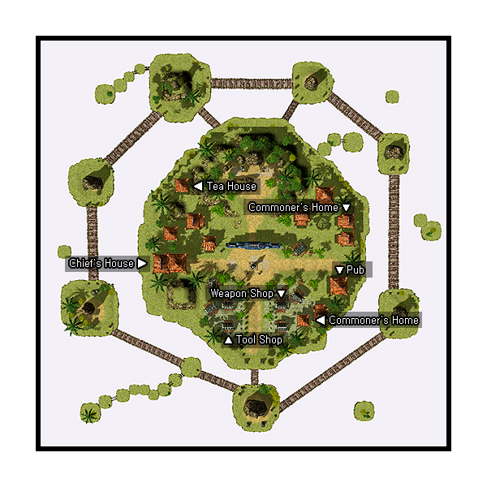

# Kunlun

## About Kunlun

Kunlun is another cultural town off the coast of the [Rune-Midgarts Kingdom](Rune-Midgarts_Kingdom.md). To get there, pay the NPC at the docks in Alberta 10,000 Zeny. Kunlun has one [field map](http://ro.amesani.org/db/map-info/gon_fild01/) and [three dungeon maps](http://ro.amesani.org/db/map-info/gon_dun01/).

The boat drops you off in the field map.  To get to the town, you have to get to the center of the field map and find the NPC who's near some statues of some kind of beast.  Walk up the stone ramp to the left of the NPC to find the town's entrance.

## Story

A foreigner who arrives in [Alberta](Alberta.md) is escorted to [Prontera](Prontera.md). After hearing about a civilization, King Tristan III orders a crew to sail and find this place. Despite all the hardships, the crew members finally establish a sea route to this newfound civilization. To this day, many people come and go to this new land. A place known for its stunning tourist attractions, sceneries, deep religious roots and impressive economic conditions. Despite their technological advancements, the people of Kunlun are a rather superstitious lot, worshipping deities known as "Hermits". These Hermits are an absolute power unto themselves, controlling human existence and limitations. Anyone can become a Hermit. The natives of Kunlun strived for perfection, believing that if they are good enough and work hard enough to achieve enlightenment, their souls would someday become one with the Hermits.

Unfortunately, not all who become Hermits remain good. Some are overwhelmed by their divinity, ending up being corrupted by it. They would use their power to do whatever they wish, regardless of how harmful or malicious the acts are. Neighboring cities and villages sometimes fear that these evil beings, now known as Evil Cloud Hermits, might someday upset the balance and cause great disasters for Kunlun.

## Mythology

Kunlun is a mountain range in western China, believed to be a Taoist paradise. Said to be three (or nine) stories high, whoever climbs to Kunlun's top will gain access to the heavens. The mythological "Queen Mother of the West," Xi Wang-mu, associated with peaches and peach trees, resides in this mountain range.

## Quests

Quests added with the Kunlun update can be found [here](Quests.md).

## Guide

## Structures

## Buildings

* Empty House (195,94)
* Empty House (220,162)
* Residence of the Chief (110,131)
* Teabrewer's House (107,183)
* Wine Maker('s Pub) (214,114)

## Billboards

* None

## NPCs

## Regulars

Guides - He Yuen Zhe (163,60)
  Show on minimap: Residence of the Chief, Tool Dealer, Weapon Dealer, Armor Dealer, Wine Maker
Kafra Employee (159,122)
  Save, Kafra storage (80z), Rent Cart, Reserve points
Missing NPCs
  Upgrading NPC
  Level 1/2 metal NPC
  Level 3/4 metal NPC
  Repair NPC
  Inn NPC
  PVP NPCs

## Store NPCs

Armor Dealer (173,84)
  Bandana, Sandals, Shoes, Hood, Muffler, Guard, Buckler, Adventurer's Suit, Silk Robe, Silver Robe, Wooden Mail, Belt
Tool Dealer (147,84)
  Arrow, Steel Arrow, Magnifier, Red Potion, Orange Potion, Yellow Potion, White Potion, Green Potion, Concentration Potion, Awakening Potion, Fly Wing, Butterfly Wing, Trap
Weapon Dealer (174,101)
  Main Gauche, Stiletto, Blade, Ring Pommel Saber, Katana, Bastard Sword, Pike, Partizan, Hammer, Chain

## Trade NPCs

None

## Quest NPCs

Chief - Shi Yan Wen (Residence of the Chief)
  [Chief's Quest](Chief's_Quest.md)
Han Ran Jiao (237,226)
  [Dropped Knife Quest](Dropped_Knife_Quest.md)
Hostess - Mei Yen Fang (Wine Maker's Pub)
  Part of Chief's Quest
Iron Man - Song Mao Tou (180,118)
  [Battle Arena Entrance Quest](Battle_Arena_Entrance_Quest.md)
Ji Chung Zhe (Teabrewer's House)
  Dropped Knife Quest
Man in Hangover - Xue Bong (Wine Maker's Pub)
  Part of Chief's Quest
Stranger - Zuo Hei (100,241)
  Part of Chief's Quest

## Travel NPCs

Iron Man - Song Mao Tou (180,118)
  Kunlun Battle Areana - *free after activating Battle Arena Entrance Quest*
Kunlun Envoy - Zhang Quing Long (153,64)
  Kunlun harbor - free (Note: from Kunlun's harbor, another Kunlun Envoy can take you back to Alberta for free)

## Other NPCs

* Gatekeeper - Kunlun Guard (x2) (113,135) and (113,127)
* Girl - Shi Ying Xiao (139,142)
* Guide - Li Xi Jiao (169,71)
* Jian Chung Xun (200,82)
* Jing Wen Zhen (181,161)
* Liang Zhun Bu (268,88)
* Qian Yuen Shuang (118,111)
* Soldier - Wa Qiu Wu (166,196)
* Madam - Shang Hua Yen (Residence of the Chief)
* Yu Jiu Xia (Wine Maker's Pub)

**Related pages:**

* [Towns](Towns.md)
* [Rune-Midgarts Kingdom](Rune-Midgarts_Kingdom.md)
* [Alberta](Alberta.md)
* [Al De Baran](Al_De_Baran.md)
* [Archer Village](Archer_Village.md)
* [Comodo](Comodo.md)
* [Geffen](Geffen.md)
* [Izlude](Izlude.md)
* [Morroc](Morroc.md)
* [Payon](Payon.md)
* [Prontera](Prontera.md)
* [Umbala](Umbala.md)
* [Republic of Schwartzvald](Republic_of_Schwartzvald.md)
* [Einbech](Einbech.md)
* [Einbroch](Einbroch.md)
* [Hugel](Hugel.md)
* [Juno](Juno.md)
* [Lighthalzen](Lighthalzen.md)
* [Arunafeltz States](Arunafeltz_States.md)
* [Rachel](Rachel.md)
* [Veins](Veins.md)
* [Manuk](Manuk.md)
* [Amatsu](Amatsu.md)
* [Ayothaya](Ayothaya.md)
* [Kunlun](Kunlun.md)
* [Jawaii](Jawaii.md)
* [Louyang](Louyang.md)
* [Moscovia](Moscovia.md)
* [Nifflheim](Nifflheim.md)
* [Lutie](Lutie.md)

---
*Source: [iRO Wiki Classic](https://irowiki.org/classic/Kunlun) — GFDL 1.3+*
