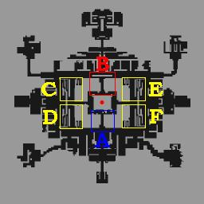

# Leveling Spots

## Mage Types

## Mage

*See [Mage Leveling](Mage_Leveling.md) for details*

## Wizard

*See [Wizard Leveling](Wizard_Leveling.md) for details*

## Sage

*See [Sage Leveling](Sage_Leveling.md) for details*

## Merchant Types

## Blacksmith

You can go either the VIT route or AGI route. AGI gives you the option to control-click to level, whereas VIT makes mobbing easier.
AGI types might want to invest some time in getting the Battleground medallions for the increase in ASPD provided.
You will have to invest on specialised weapons for any of the locations you intend on leveling.

*
The map is not too mobby, so mobbing might not be a good option here. 1-hitting or control-clicking works though.
* Clock Tower High Orcs
Extremely mobby map. You can either mob here, or use Mammonite for 1-hitting the High Orcs.
* Hill Winds
Quite a mobby map, but it is better to 1-hit the Hill Winds, as they have a 4 cell range, making mobbing them slightly difficult. The drops almost pay back the cost of Mammonite. Alternatively you can simply control-click them to death.
* Bathories
A nice map to mob. Control clicking is also viable here with a good weapon. 1-hitting will almost always be impossible due to the requirement of an Asperio.
* Rachel Sanctuary 1F
A nice place to either control-click or mob with an anti-demi human weapon.
* Ice Titans
Can become very expensive. You will need a Swordfish carded armor and an Ice Pick,along with a Soul Linker buff slave for Full Adrenalin Rush. You can either Mammonite them or Control-click. Priest support is recommended.
* Thor Dungeon
Very difficult place to level, but EXP can pay off. You will need many white potions, and a HP for assumptio, along with an Ice Endow. As long as you can hit the Kasas, withdecent Mammonite damage, Thors can become possible.

## Alchemist

*  Leveling Spots
  * Prontera Culvert 4 Low-level
  * Toy Monitoring Room Toy Factory 2: Low-level
  * Orc Dungeon Level 2: Low-level
  * Clock Tower B4f 70+ (125+ hit)
  * Inside Ancient Shrine Tamruans: 80+
  * Sphinx Level 4: 80+
  * West Kokomo Beach 80+
  * Somatology Laboratory Biolabs 1: 80+ (only Removers if flee is low)
  * Prontera Guild Dungeon 80+ (Fireblend / Ice Pick)
  * Clock Tower B2f High Orcs: 80+
  * El Mes Plateau Sleepers: 80+ (Ice Pick)
  * Turtle Island 85+ (200+ flee)
  * Rachal Sanctuary 90+ (200+ Flee)
* For Homunculus AFK leveling spots, please also see the [Homunculus System](Homunculus_System.md) page.

## Acolyte Types

## Acolyte

| Map | Start Level | End Level | Leveling type | Monsters | Notes |
| --- | --- | --- | --- | --- | --- |
| Payon Cave 1 | 12 | 30 | Solo |  *  Everything | Unless you have good [SP](SP.md)/[INT](Stats.md) gear or friends then your SP will run out fast when heal bombing, so make sure that you have an equip like a [Mace](Mace.md) to defend yourself while regenerating HP and SP. |
| Payon Cave 2 | 30 | 40 | Solo |  *  Archer Skeleton *  Soldier Skeleton | For acolytes with higher INT, heal-bombing the undead monsters in Payon Cave is a fairly quick method of gaining exp. |
| Glast Heim Churchyard | 30 | 40 | Party (preferably with a higher level) |  *  Wraith *  Zombie *  Evil Druid *  Ghoul | Mimics, Hunter Flies and the occasional appearance of Dark Lord can make leveling here as an acolyte annoying. |
| Louyang Field | 30 | 50 | Party (with [Mage](Mage.md)) |  *  Mi Gao | Make sure that you don't get too close to Mi Gaos, and remember to heal your Mage friend. Otherwise, you'll both die very quickly without decent equips. |
| Glast Heim Underprison 1 | 40 | 50 | Party or Solo |  *  Zombie Prisoner *  Injustice (careful) | Use [Holy Light](Holy_Light.md) on the Injustices. |
| Glast Heim Culverts 3 | 40 | 50 | Party (with Mage) |  *  Sting | Try not to step in the [Quagmire](Quagmire.md). |
| Glast Heim Culverts 3 | 50 | 65 | Party (with Low level [Dancer](Dancer.md)/[Bard](Bard.md) or Newly-changed [Wizard](Wizard.md)) |  *  Sting | May want to step it up a bit and find a newly changed [Wizard](Wizard.md) to level with at Prison instead since they can mob, or a low level [Dancer](Dancer.md)/[Bard](Bard.md) to go to Stings with since they'll kill them much more efficiently than a [Mage](Mage.md). |
| Glast Heim Chivalry, Level 1 | 50 | 65 | Party (with [Grand Cross](Grand_Cross.md) [Crusader](Crusader.md)) |  *  Khalitzburg | Tag along with the crusader and heal-bomb the Khalitzburgs. |

## Priest

## Full Support Priest

| Map | Start Level | End Level | Leveling type | Monsters | Recommended Skills | Notes |
| --- | --- | --- | --- | --- | --- | --- |
| Payon Cave 1 | 12 | 30 | Solo |  * Skeleton * Zombie |  * [Heal](Heal.md) * [Holy Light](Holy_Light.md) * [Increase AGI](Increase_AGI.md) * [Blessing](Blessing.md) | Heal-bombing will use up SP quickly, so SP restoration items are a must during the lower levels here. Bring along Fly Wings as well, if you don't have Teleport, as the Familiars will irritate you. |
| Tatami Maze | 30 | 66 | Solo |  *  Firelock Soldier |  * [Heal](Heal.md) * [Holy Light](Holy_Light.md) * [Increase AGI](Increase_AGI.md) * [Blessing](Blessing.md) * [Pneuma](Pneuma.md) * [Teleport](Teleport.md) | [Pneuma](Pneuma.md) highly suggested. [Teleport](Teleport.md) and/or Fly Wings also highly suggested to flee from Shinobi. |
| Louyang Field 1 | 30 | 70 | Party (w/ Mage) |  *  Mi Gao |  * [Holy Light](Holy_Light.md) * [Heal](Heal.md) * [Increase AGI](Increase_AGI.md) * [Blessing](Blessing.md) | None |
| Glast Heim Churchyard | 50 | 70 | Solo |  *  Everything |  * [Heal](Heal.md) * [Holy Light](Holy_Light.md) * [Turn Undead](Turn_Undead.md) * [Increase AGI](Increase_AGI.md) * [Blessing](Blessing.md) * [Kyrie Eleison](Kyrie_Eleison.md) * [Assumptio](Assumptio.md) * [Teleport](Teleport.md) | [Teleport](Teleport.md) and/or Fly Wings to flee from Dark Lord. |
| Sphinx B4F | 70 | 99 | Solo or Party |  *  Anubis |  * [Heal](Heal.md) * [Holy Light](Holy_Light.md) * [Turn Undead](Turn_Undead.md) * [Increase AGI](Increase_AGI.md) * [Blessing](Blessing.md) * [Lex Divina](Lex_Divina.md) * [Kyrie Eleison](Kyrie_Eleison.md) * [Assumptio](Assumptio.md) | [Turn Undead](Turn_Undead.md) highly suggested, [Grand Cross](Grand_Cross.md) Crusader highly suggested. If going solo, [Lex Divina](Lex_Divina.md) is a must because of Sonic Blow, and offensive [Blessing](Blessing.md) is also highly recommended. |
| Magma Dungeon F1 | 70 | 99 | Party |  *  Everything |  * [Holy Light](Holy_Light.md) * [Heal](Heal.md) * [Increase AGI](Increase_AGI.md) * [Blessing](Blessing.md) | None. |
| Ice Dungeon F2 | 80 | 99 | Party |  *  Everything |  * [Holy Light](Holy_Light.md) * [Heal](Heal.md) * [Increase AGI](Increase_AGI.md) * [Blessing](Blessing.md) | None. |
| Ice Dungeon F3 | 95 | 99 | Party |  *  Everything |  * [Holy Light](Holy_Light.md) * [Heal](Heal.md) * [Increase AGI](Increase_AGI.md) * [Blessing](Blessing.md) | None. |
| Somatology Laboratory F3 | 95 | 99 | Party |  *  Everything |  * [Holy Light](Holy_Light.md) * [Heal](Heal.md) * [Increase AGI](Increase_AGI.md) * [Blessing](Blessing.md) | None. |

## Monk

First, it's a good idea to get all your [Basic Skill](Basic_Skill.md) at Training Grounds. An acolyte should not be afraid to spam his novice potions, as they will turn weak once you change into a [Monk](Monk.md).

Second, battle acolytes are some of the hardest classes to level. It's a requirement to reach job level 50, and acolytes have to use 20 skill points in Divine Protection and Demon Bane just to get their first monk skill.

| Map | Start Level | End Level | Leveling type | Monsters | Notes |
| --- | --- | --- | --- | --- | --- |
| Prontera Culvert 2 | 10 | 20 | Solo |  * Tarou * Plankton | Be careful of Familiar, as they are aggressive. In case of trouble, bring potions. |
| Mt. Mjolnir | 20 | 30 | Solo |  * Horn * Coco | These will give good Exp the next ten levels. If you're somewhat rich, get a stunner for 60k in the Morroc Ruins (moc_ruins 125,135). You can use it after level 27, and you'll notice a significant difference in attack. If you're not very rich, keep killing for Tarous. It's slow, but that's the leveling life of a battle acolyte. During this stage, try to level your [Pneuma](Pneuma.md) tree (Level 1 [Ruwach](Ruwach.md) > Level 2 [Teleport](Teleport.md) > Level 4 [Warp Portal](Warp_Portal.md) > [Pneuma](Pneuma.md)). If you sit upon a large pile of money, buy a good amount of red potions and try taking down Horns one map north of the Prontera Culvert entrance. |
| Payon Field | 20 | 30 | Solo |  * Spore | None. |
| Morroc Field | 20 | 40 | Solo |  * Muka | They give good exp and Guisarme get you a decent amount of zeny. As you level up your [AGI](Stats.md) it should be easy to handle these with just level 3 [Heal](Heal.md). |
| Toy Monitoring Room | 30 | 50 | Solo |  * Cruiser | If you have issues with killing cruisers, kill horns until you are able to face them. Otherwise, you can use [Pneuma](Pneuma.md) and avoid their long-ranged attacks. Before you reach level 40, consider resetting your stats - the Hypnotist in [Prontera](Prontera.md) (prontera 146, 232) will only reset them if you are below or at level 40. |
| Tatami Maze | 50 | 60 | Solo |  * Firelock Soldier | Kill these until Job 50. Leaf Cats are also a good place after base level 60. Alternatively, you could level safely by killing a great deal of Cruisers using [Pneuma](Pneuma.md) to protect yourself, but Firelocks give better job exp. Cruisers are safe, but Firelocks are best for exp. |
| Morroc Field | 60 | 75 | Solo |  * Sandman | Stay at Firelocks until you get enough job levels. If you choose to be an Occult Impact monk, you should go to Sleepers once the player gets level 5 [Occult Impaction](Occult_Impaction.md). If you are an [AGI](Stats.md) type monk or just want to go hand-to-hand combat with monsters for leveling, you should go for Sandman. |
| Turtle Dungeon 3 | 60 | 75 | Solo |  * Freezer * Permeter * Solider | This a perfect place for Occult Impact monks. You need a Triple Clamorous Chain and Priest with Lex Aeterna and you can one-hit the turtles. Great exp also for the higher level monks. Only the Pests get on your nerves. |
| Rachel Field 5 | 70 | 85 | Solo |  * Hill Wind | This place is for Combo Monks with an earth element weapon and 190 [FLEE](FLEE.md). Hill Winds have low HP and a good amount of exp. Just watch out for Drosera's [Close Confine](Close_Confine.md) |

## Thief Types

## Assassin

| Map | Start Level | End Level | Leveling type | Monsters | Notes |
| --- | --- | --- | --- | --- | --- |
| Payon Field | 1 | 20 | Solo |  *  Everything | None. |
| Prontera Culvert | 15 | 35 | Solo |  * Everything | None. |
| Prontera Culvert 2 | 15 | 35 | Solo |  * Everything | Careful of aggressive monsters. |
| Prontera Culvert 3 | 15 | 35 | Solo |  * Everything | Careful of aggressive monsters. |
| Sograt Desert 18 | 30 | 45 | Solo |  * Muka | None. |
| Lighthalzen Field | 40 | 60 | Solo |  *  Metaling | Be mindful of their [divest weapon](Status_Effects.md) attack. |
| Toy Monitoring Room | 40 | 60 | Solo |  *  Cruisers | None. |
| West Orc Village | 60 | 80 | Solo |  *  Anything / Everything | None. |
| Valley of Gyoll | 70 | 85 | Solo |  * Anything / Everything | None. |
| Rachel Sanctuary 1F | 70 | 80 | Solo |  *  Vanberk *  Isilla | None. |
| Juno Field | 75 | 90 | Solo |  *  Sleeper | None. |
| Ice Dungeon 3 | 80+ |   | Solo |  *  Ice Titan | None. |
| Clock Tower B2f | 80 | 90 | Solo |  *  High Orc | None. |
| Turtle Island Surface | 80 | 90 | Solo |  *  Everything | None. |
| Sphinx 4 | 80 | 90 | Solo |  *  Anything / Everything | None. |
| Turtle Island Dungeon | 80 | 99 | Solo |  *  Anything / Everything | With Ice Pick/House Auger |
| Cursed Abbey 2F | 90+ |   | Solo |  *  Zombie Slaughter *  Ragged Zombie | None. |
| Rachel Sanctuary 4F | 90+ |   | Solo |  *  Agav *  Echio *  Hodremlin | None. |
| Ruins of Juperos | 90 | 95 | Solo |  *  Anything / Everything | Or earlier with +8(+) Triple Beholder Jur and Grimtooth Status arrow optional but recommended |
| Somatology Laboratory | 95+ |   | Solo |  *  Anything / Everything | None. |

## Rogue

*See [Rogue Leveling](Rogue_Leveling.md) for details.*

## Archer Types

## Hunter

*  Training Grounds: 1-11
Try to stick to the Training Grounds until at least base 10, it isn't that hard, even with 1 strength.

* Prontera Field Savage Babes, Desert Wolf Puppies, PecoPeco Eggs, Condors, Pickies: 1-11
If you somehow end up in the prontera area and are not job 10 yet, go here, there is a better map for Wolf Puppies, but there you are likely to get overwhelmed if a lot assist what you are attacking, this map can also be applied to any class if you are still a novice, under job 10, and you can get your first few job levels here as well after changing.

* Mt. Mjolnir Floras, Mandragoras: 11-25
Use Fire Arrows, Floras are Large, so it may take a while at first, Floras cannot hit you if you are about 4+ spaces away, Mandragoras cannot hit you at about 5+ spaces away and are also weak to fire, beware Argiopes and Male Thief Bugs.

* Einbroch Field Floras, Geographers: 15-35
Use Fire Arrows.  Floras and Geographers are stationary and cannot attack beyond 4 cells.  Do not attack the Yoyos and Porcellio that roam this field.  Yoyos assist, and Porcellio hit hard and fast, at the recommended levels.

* Payon Field Greatest Generals: 30-60
Crystal Arrows recommended, Generals will not attack if you attack from about 4+ steps away, beware Horongs and Nine Tails, might be able to go here earlier if you have 80+ hit.

* Rachel Field Hill Winds, Droseras: 60+
Stone Arrows for Hill Winds and Fire Arrows for Droseras be carefull of droseras, Hill Winds have 4,233 HP you need kill them with 1 double strafe. 100 Orange Pots/Hour. High ASPD and Flee recomended.

* Einbroch Field Metalings, Geographers: 30-70+
Fire Arrows recommended, beware clusters of 2 or more Geographers as they will heal each other, ONLY try to kill the Mineral on the map if you have a high ASPD/Flee or have Ankle Snare, Geographers require 143 hit and cannot hit you from 4+ spaces away, Holdens have a 9 cell attack, so attack at your own risk, while there are other Metaling/Geographer maps, this one has the most Geographers and usually has lots of people, making it somewhat easier to find a party.

* Einbroch Field Goats, 5 Harpies (After 10.4): 70+
Crystal Arrows recommended for Goats. After Episode 10.4, 5 Harpies appear on the field, so have Stone Arrows handy.  [Ankle Snare](Ankle_Snare.md) is a must, as Goats assist, and have a stun attack.  A 3+ Goblin carded bow, 120+ DEX, and a 173+ ASPD are all you need for Goats.  This is just about the best soloing spot in the game (after Episode 10.4) for trappers.  If you have high FLEE (210+) and moderate VIT (30+), you can forgoe the traps.  Bring Green Potions for the Harpies, also they have a high AGI, and will use 2 traps, if you don't [Double Strafe](Double_Strafe.md) them.

* Juno Field Goats, Drillers, 40 Harpies (After 10.4): 70+ (pre 10.4), 80+ (post 10.4)
Crystal Arrows recommended for Goats, Stone Arrows for Harpies. After Episode 10.4, 40 Harpies appear on the field, reducing the ease of hunting and experience rate.  Prior to 10.4, this is the best soloing spot in the game for trappers (low FLEE Hunters), an easy 1 Mil/hr.  After Episode 10.4, you might consider the field mentioned above.

* Glast Heim Culverts 3 Sting, Gargoyle: 70+
Fire Arrows for Stings recommended, Earth Arrows for Gargoyle, Traps, and Alot of Fly Wings. The experience here is better than Geographers and it's quite easy to kill Stings. Try to aim to attack a Sting from a far, they die very easily to Fire Arrows but they Hit Hard and Fast if they get near. Beware of Gargoyles, if you see them, quickly Teleport away to avoid being hit.

* Papuchicha Forest Alligators, Poison Spores, Savages, PoPorings: 25-60
Unless you have a party or a tank, you will most likely be cliffing the Alligators, Wind arrows work best on Alligators, while Fire works best on the Savages, a +8 or higher multiple Goblin carded(extra damage againt Brutes, Alligator and Savage are Brutes) is recommended.

* Kokomo Beach Fur Seals, Galapagos: 70+
Wind Arrows for Fur Seals, Fire Arrows for Galapagos, and a 3+ Goblin carded bow for both.  Prior to your 80's, [Ankle Snare](Ankle_Snare.md) is pretty much a must.  Once your FLEE is above 195, you can forgoe the traps; however, Fur Seals have a very powerful water element attack, so water or wind property armor is recommended if you are not trapping.  They also have a fairly strong normal attack, so it is highly recommended to trap, or [Double Strafe](Double_Strafe.md).  Either way, a Fur Seal will go down fast.  These are basically like Stings, without annoying Gargoyles, but requiring Wind Arrows.

* Sphinx Minorous, Pasana, Marduk: 65+
Crystal Arrows and a +8 or higher multiple Vadon Carded bow extremely recommended, if you are lacking in ASPD/Flee, you will need to rely on Ankle Snare a lot, Beware Minorous' Hammerfall, especially in groups, Pasanas use Critical attacks as well, Pasana carded armor or Fire Resist potions are useful, as Marduk uses Firewall and Fire bolt, there are also a few Mimics to look out for.

* Clock Tower 2F Clocks, Punks, Ridewords: 65+
This is also a popular Mage Class leveling spot, so be prepared to have Mimcs and Ridewords dumped on you occasionally, Fire Arrows are very useful against Clocks, a +8 or higher bow with either multiple Skel worker cards(more damage against the medium sized clocks)or preferably multiple PecoPeco Egg cards(More damage against the Formless type Clocks, Ridewords, Mimics and Tower Keeper), try to avoid the 2 Elders on this map like the plague unless you are high level, a Party helps here, but the map is solo able.

* Clock Tower 3F Alarms, Ridewords: 65+
Same equipment recommendations as above, except use either Iron, Steel or Oridecon arrows, Iron are the easiest to get though, as above, beware of mage types dumping Ridewords and Mimics on you, another thing to look out for: Since the implementation of episode 10.2, the chance of an Alarm dropping a Clip accessory was severally reduced, since then, some individuals have been setting up mage class or Rogue bots in a attempt to farm Clips, a majority of the time, these bots gather large mobs and teleport away if a human player is in the area.

* Clock Tower 4F Alarms, Clocks, Owl Dukes: 65+ (Party HIGHLY recommended)
Owl Dukes can mess you up pretty badly, in addition to the bow recommended in the previous 2 spots, a +8 or higher multi Minorous carded(extra damage against Large sized Owl Dukes) or multiple Abysmal Knight carded(Extra damage against Boss flagged monsters, Owl Duke is boss flagged) bow, beware the lone Elder, as well as the Executioner, sometimes, there is a spot where all the ridewords on the map respawn at once, be prepared to teleport if you stumble into there.

* Turtle Island Surface Dragontails & Spring Bunnies: 85+ (10k zeny fee required)
Can be mobby from time to time. Use flywing or sandman trap when running into a mob. A malicious bow is good for regening HP if soloing.  Instead of bringing Fire/Stone quivers, bring Red Bloods (if you find them cheap) and Green Lives to craft; they are much lighter. Use fire arrows on bunnies and stone arrows on dragonflies, silver arrows on pests if you bother to kill them. Beware of bunny bashes, they hurt!  This is the best soloing spot for high FLEE hunters, bringing in around 1.5 Mil/hr, but take care.  OR, if you have good INT, go with a Priest, and you can bring in 1.5 Mil/hr for the both of you!  This a great place to use Focused Arrow Strike for you Snipers.

* Lighthalzen Dungeon 3 - Somatology Laboratory Bio Monsters ( non mvp ) : 95+(non trans) 90+(trans)
This place is for PROPERLY geared and seasoned hunters and snipers if u want to SOLO; BM mode is a MUST. Other wise find a party and shoot away.

**Equipment&stat Recommendations**.

140(hunter)//150(sniper) Selfbuff dex(instant arrow repel is a big plus). As much flee as possible, as immune and such is useless against the damage from the monsters found in bio3, 6000 base hp is recommended to survive LK's(spear boom) and High Wiz's FD.
Carded Demi-human(hydra) bow and Carded Demon(strouf) Bow or a Rudra's bow if you cant afford the strouf cards.
the Hydra bow will be used on BIO HWizzards, Whitesmiths, HPriests, Snipers; and the Stouf for Lord Knights and SinXs.
you will need 5 arrow types approx 200-300ea(varies) per run spaming DS, (200)Silver(Sinx) (300)Wind(Wsmiths) (200)Shadow(Hpreist) (300)Immaterial(HWiz) (300)Crystal(LKnights); Snipers will be killed another way specified later. (Silver=Shops, Crystal Arrows= Fang of Garms, Immaterial Arrows = Emperium, Shadow Arrow = Key of the Clock tower, Wind Arrows = wind of vendures)
Unfrozen is useful against Wizzards. Bring around 40 fly wings, rest fill up to 89% weight with bluepots or other sp regening items.

**Monster Tactics**

Each Monster requires a different approach. We will start from easiest to hardest

**Whitesmith** - Place an ankle snare down between you and the whitesmith, DS untill the WS is in the trap, move back place another trap and shoot away. (properly geared snipers will beable to kill the whitesmith before it is released from the 2nd trap easily. 150dex, hydra bow, 184ish atkspd) Wind arrows + hydra

**HighPreist** - Place an ankle snare down between you and the HPreist. Shoot untill it is in the trap, in which it will then pnuema(90% of the time). you can either a) move back and anklesnare+arrow shower it back into it, and when pnuema downs, shoot. B) use a skid trap if you have one to move it somewhere SAFE. be careful with the skid. Shadow arrows + hydra

**AssasinCross** - *be careful of cloaking sinx* if they pop out next to you, pray you dodge them to a)arrow repel b) move and snare quickly c)fly wing. make sure u keep atleast 5 spaces away to avoid grimtooth. If prior to trapping the SinX agi ups, just run away and wait out the agi up. otherwise just trap between and shoot away(you should move the trap as close to the sinx as possible with arrow shower first as an agi up'd sinx is impossible to hit). silver arrows + strouf

**LordKnight** - be very careful when luring theese into your traps, spear boomberangs can easily kill you in 1-2 hits without powerups. The lureing tactic for LK's is to first locate an LK, then trap 2 of them between you and your target. DS him once or twice then move backwards to a safe area where u can from so that the LK gets into the traps. MAKE SURE U ARE 10+ spaces away, which is nearly the edge of your screen or else it will SPEAR boomberang. if it survives past the first trap, move back another 2 steps so that it is in your next trap. if it gets near you, arrow repel, trap and move in the opposite direction or flywing. Crystal Arrows + Strouf

**Hwizzard** - The most dangerous if down improperly, but if down correctly, it is fairly easy and highest exp and easy to kill. first job for Hwizzard is like the LK, Locate it. scouting is VERY important for single lures in bio3. trap down, DS once or twice, and RUN like hell. if the HWiz gets a hit on you, it usually means death, FD=6k, and if frozen it instantly follows up with a JT, the damage is death. Fire ball=12k damage. SoulStrike = 3k and curses = follow up spells. sight Trasher = 1-2k, nothing to worry about. if u see the HWiz cast on you, run behind a wall or turn the corner, if done fast enough, the cast will fail and nothing will happen. if u have it trapped, just shoot away. *it will always use FD as its first spell*
Immaterial Arrows + Hydra.

**Snipers** - ALMOST impossible and yet its doable, requirements is about sniper, 260+flee, Falcon Assault and alota hp/def. As an agiuped sniper is nearly impossible to shoot, if u have a corner//wall to run behind, pop out and FA and run back. it is Dodgeable to a certain amount and it takes about 12 FA's with 20 int. Only to be done when ALL Areas//paths are blocked ( discussed next)

**Areas to Lure**

So now that you know how to kill the monsters, equipment to use, you must learn your surroundings. soloing is VERY risky and death is around every corner, therefore to minimize the risk, you must use the environment. there are usually 6 areas u can goto once you reach bio 3, all starting from the entrance. A) go directly south and lure monsters up the straight and narrow path. B) go directly north and spread out using the north wall to block monsters. Then Part C//D//E//F are similar. From the entrance go Either East or West. once there head Either North or South. you will then enter a section with a large wall on either the West if u went West or East if u went East. next to thoose will be stair cases. use theese stair cases to lure monsters from below up them, where u can trap ( be careful with your pathing or you will die when luring monsters). Remember to have patience when looking for monsters as rushing out will get you killed. More experienced Snipers//Hunters can venture out further, but be very careful.

*EXP if Done correctly with GOOD runs and NO deathes can net you around 10m exp/hr. But it is Very costly and Requires VERY high skills.*

**Hunting Up Arrows**
* Undersea Tunnel 4 Hydra, Marine Sphere, Phen, *Sword Fish*, *Marc*, and a few Merman: 80+ (Gills: Crystal Arrow Source)
Wind Arrows and a 3+ Drainliar carded bow.  A FLEE of 190+ is recommended.  Bring some traps for the Merman.  It can get a little mobby, so make certain to keep a good 120 SP handy for emergency [Double Straffing](Double_Strafe.md).  This map is also a good reason to have [Arrow Shower 9](Arrow_Shower.md).  The EXP rate is OK, around 500k/hr, but expect it to go up when the monsters are modified in Episode 11.1.  The real reason to come down here, is for Gills, dropped by Swordfish and Marc.  Each Gill makes 150 Crystal Arrows and 80 Iron Arrows.  It is possible to get 50-70 Gills for every 30 minutes of work.
(fangs of garm are also a great source of crystal arrows, 1000/fang. its soloable by a hunter//sniper with an unfrozen armor easily)

* Juno Field Grand Pecos: 70+ (Wind of Verdure)
Crystal Arrows recommended, as are Traps if your FLEE is less than 200.  A 3+ Goblin carded bow is recommended, as Grand Pecos have a reasonable DEF.  Some Grand Pecos will assist.  The EXP rate in this field is not-so-bad (about 600k/hr), but the primary reason to hunt here is Wind of Verdure.  It is possible to obtain 12-15 of the things for every 30 minutes of hunting.

* Juno Field Sleepers: 80+ (Great Nature, can be converted)
Bring Fire Arrows and Traps.  Sleepers have high DEF, and are normally recommended for Occult Impact Monks, and CRIT or Ice Pick wielding Assassins.  However, high DEX and Kaho/Pecopeco Egg cards, or a hyper-active [Falcon](Blitz_Beat.md) (45+ LUK) will make short work of them.  You will want to trap Sleepers, as they cast [Defending Aura 5](Defending_Aura.md) frequently while they attack.  Trapping reduces the frequency of its use.  Detect is also a must.  Surprisingly, the EXP rate is fairly good here (700k/hr), but the primary reason to hunt in this field is Great Nature.  You can easily obtain 20-30 pieces in 30 minutes of work.  Great Natures can be exchanged for other Elemental Stones in the [Ore Combining](Ore_Combining.md) quest in Amatsu (8:1 for Flame Heart or Crystal Blue, 12:1 for Rough Wind).  You can then take these stones to the Shaman in Umbala for the [Ore Downgrading](Ore_Downgrading.md) quest, which will average 8 Elemental Ores for every Elemental Stone.  In the end, you can get 160-240 Green Lives, 20-30 Red Bloods or Crystal Blues, or 12-20 Wind of Verdures for 30 minutes of not-so-bad hunting.

## Bard/Dancer

* Geographers -- [level 30+ @ ein fild04] Be careful because they heal each other if there is more than one. Don't go too close to them, cause they will probably kill you in about 2 or 4 hits.

* Mi Gao -- [level 40+ @ lou fild01] You might want to find a tank for the first couple levels because of the mantis'. Have them run and hit the Mi Gaos, they hit very hard.

* Les -- [level 40+ @ mosk dun01] Double Strafe with 117 DEX and Burning Bow+Fire Arrow will always one-shot Les. Be cautious of Mantis. Wooden Goblins have much higher defense and can heal fellow monsters on screen.

* Siroma -- [level 45+ @ ice dun01] A priest tank could be helpful because they don't change targets and can Lex Aeterna. Watch out for Gazetis and Roween.

* Bathory -- [level 65+ @ alde dun04] Silver Arrow with a Battlegrounds Bow (or PvP). Be careful of Silence. Must have Key of Underground to enter.

* Juperos -- [level 70-95] If your musical/dancing dancing skills are mastered (e.g.: you're a Supportive build), Juperos might be a nice leveling place if you're prior to the Rachel Episode update. Usually a party needs two couples to raid the place, and the skills they look for mostly are Gypsy's Kiss/Magic Strings and Mental Sensing.

* Sting -- [level 70+ @ gl sew03]  Try and find a priest that will accompany you here, it goes faster, and the priest can also level if they are around the same level as you. Be careful, stings are aggressive and there are also gargoyles on the map which are ranged.

* Dark Frame -- [level 70+] A nice alternative to Stings. On the Glast Heim overworld map, go to the four entrances above the entrance to Castle 1. Very helpful to clear a room off all the Ridewords with a [Snatch](Snatch.md) Rogue. Advisable to go here with a Priest early on and later by yourself. Much like Stings, they should die in 2 [Double Strafe](Double_Strafe.md)s with the right elemental arrows and bow.

* Hill Wind -- [level 75+ @ ra fild05] Hill Winds can be 1-shot killed with [Double Strafe](Double_Strafe.md) with 140 dex, Quadruple Clamorous Composite Bow, Stone Arrows, and a Dragon Tail carded Garment.  Bring lots of Fly Wings or a teleport clip.  Be careful of Hill Wind's long range melee attacks (3 cells) with fast aspd.  Also be careful of Drosera using Close Confine.

* Pinguicula -- [Bard/Dancer 9x, Minstrel/Gypsy 85+ @ spl fild02] Luciola Vespa do not aggro level 99 characters. That will give you time to Double Strafe freely, though they do have pretty decent attack. Bring lots of flywings. **Must have New World Quests started/completed in order to enter the map.**

* Nepenthes -- [Bard/Dancer 9x, Minstrel/Gypsy 85+ @ man fild01] There is no good element, so take arrows with the highest ATK you can (ie. Steel). Instant teleport when you see Centipede, and avoid all of the other monsters..

* Kasa -- [Minstrel/Gypsy recommended @ thor v01] 2x Vadon 2x Pecopeco Egg with Crystal Arrow. Of course have a high priest tank to Lex Aeterna and buffs. Things to have include: Penonmena/Alice shield; Pasana Armor; Raydric/Noxious garment (mostly for Clashing Spiral).

## Swordman Types

## Novice

* Training Ground: 1-13(Stay here pretty much until you reach level 13 or job level 10 - whichever comes first - by then you should be able to Apply for the Swordsman Class Change Quest upon leaving to Izlude.)

## Basic Swordman

* Prontera Culvert 1-2: 13-30
First, complete the [Prontera Culverts Entrance Quest](Prontera_Culverts_Entrance_Quest.md) to access the Culverts. The quest is in the Prontera Chivalry (also known as the Knight's Guild).
  * Culverts 1 is good for Thief Bugs, Thief Bug Eggs and Tarou.
    * Just watch for Thief Bug mobs. This should be a cakewalk though.
  * Once in Culverts 2, watch out for Thief Bug swarms.
    * It's very easy to get mobbed and killed at low level.
    * Female Thief Bugs will not be aided by Thief Bugs.
    * Work your way up to Spores eventually, as they give the best bEXP and jEXP.

* Payon Caves: 15-30 (Great loots, good exp, average damage.)

* Payon Forest: 21-40 (Below average loots, amazing exp, weak mobs, great for mobbing. Red mushrooms at the ruins.)

*  Prontera Culvert 3: 31-40 (At this level, it's possible to kill Male Thief Bugs. Try to bring some potions and upgrade the weapon until it's at the safety limit to maximize on damage. )

* Byalan Dungeon 1-2: 41-50 (Excellent loots, fair EXP. Bring some Potions and if you can afford it, preferably Wind Weapons. )

* Payon Dungeon 2-3: 41-50 (Apple of Archer can be obtained from the Archer Skeletons so feel free to hunt there for experience and loot. )

* Orc Dungeon 1: 51-70 (Mobbing Orc Zombies and Orc Skeletons is a great way of earning fast experience and loot. It's recommended to use a Fire Weapon here for maximum damage output.)

* Byalan Dungeon 3-4: 51-60 (Killing Obeaunes, Marse, Cornatus is good experience and loot. Try to see if one can either Shield [1] from Cornatus or a Fin Helm from Obeaunes during this level. Also, bring Fly Wing to avoid confrontation with the occasional Merman. )

* Glast Heim Sewers: 45-60 (Kill Whispers and Gargoyles for experience, and Fly Wing away from the Arclouses. Bring an Earth Weapon and a Heavy Shield. Try looking for the Whisper Card, Fabrics and Star Dust makes for good money. Endure, Bash, and Peco Wings are key to reaching this area.)

* Payon Dungeon 3-4: 51-60 (Kill Munaks and Bonguns for experience, and pet taming items such as Old Portrait and Girl's Diary can be obtained from them which you can trade those in at Izlude's Tool Shop Pet Tamer for the taming items of the monsters respectively. )

* Sphinx 3: 61-70 (Take on the Pasanas, Marduks, and Matyrs. Try to bring some Potions to heal and try to look out for the Pasana card, which will prove helpful for training here. )

* Coal Mine 3: 61-70 (It's a good place to train if one has enough Potions and proper gear. )

* Byalan Dungeon 4: 61-70 (Kill Mermans, but at this point it's somewhat mandatory to have a Wind Weapon killing can be done much faster and survival is easier. )

* Orc Dungeon 2: 71-80 (Mobbing Zenorcs and Orc Skeletons gives pretty decent experience. Shining Stone can be obtained here from Zenorc which can be used to tame Green Petites, some extra cash wouldn't hurt. )

* Pyramids 4: 71-99 (This place is a great place to train either by mobbing Isis with Brandish Spear or just beating them down using a 2 Handed Sword with 2 Hand Quicken. Getting a Priest's Aspersio is a great endowment to use in this map also for added damage. )

* Geffen Field 14: 71-99 (High Orcs are also good to kill, they drop decent loot and experience. It's recommended to get an Ice Elemental Weapon or Hydra Card weapons to maximize on the damage output. If possible, then Mob them till level 99. )

* Levels 70-99: MVPs (Party), Thanatos Tower (Party), Raydrics (Solo)

* Holy Ground 1F: 75-99 (Vanberk and Isilla give astoundingly high experience as well as good equipment i.e. High Fashion Sandals [1]. Try to obtain PvP gears such as Feather Beret and a decent armor to lessen their damage to at least ONE DIGIT. Mob Vanberks and Isillas if you can to level up faster. If a Hodremlin catches you, kill it fast for it might use the dreaded Sonic Blow whose damage can go as high as 9000. Leave Beholders alone; Dispel will annoy you.)

* **NOTE:** You must do two quests first; the [Lost Child Quest](http://irowiki.org/wiki/Lost_Child_Quest) and the [Rachel Sanctuary Quest](http://irowiki.org/wiki/Rachel_Sanctuary_Quest) to enter the Sanctuary.

## Knight

## Crusader

## Spear Crusader

* Mermen
* Hill Winds
* Tamruans
* Ice Dungeon 2 or 3 (With Ahlspiess)

## Shield Crusader

* High Orcs
* Hill Winds
* Bathories
* Penomenas

## Sacrifice

Partying, generally as a puller.

## Grand Cross

*See [Crusader Leveling](Crusader_Leveling.md) for details*

## Soul Linker

## PvM Melee Type

lvl 50-60 Leaf cats, Beetle kings, Wootan fighters

lvl 60-70 Ice Dungeon

*  You will need at least lvl 2 [Kaahi](Kaahi.md) to keep up with the damage.

**Related pages:**

* [Levels](Levels.md)
* [Experience](Experience.md)
* [Quest Table](Quest_Table.md)
* [Base EXP Chart](Base_EXP_Chart.md)
* [Job EXP Chart](Job_EXP_Chart.md)
* [Party](Party.md)
* [Guild System](Guild_System.md)
* [Homunculus System](Homunculus_System.md)
* [Leveling Spots](Leveling_Spots.md)
* [Mage Leveling](Mage_Leveling.md)
* [Crusader Leveling](Crusader_Leveling.md)
* [Rogue Leveling](Rogue_Leveling.md)
* [Stalker Leveling](Stalker_Leveling.md)
* [Wizard Leveling](Wizard_Leveling.md)

---
**Categories:** [General Information](categories/General_Information.md), [Leveling](categories/Leveling.md)
*Source: [iRO Wiki Classic](https://irowiki.org/classic/Leveling_Spots) — GFDL 1.3+*
