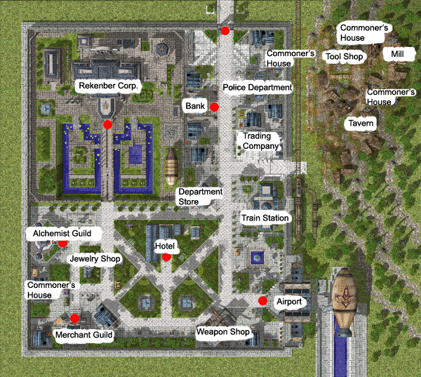

# Lighthalzen

## About Lighthalzen

The city of Lighthalzen is nestled in between canyons and mountain ranges, and the terrain around it is rough and rocky. Despite of this, the Rekenber Corporation still invested large sums of money to build and establish the city. The investment paid off, since now Lighthalzen is regarded as the commercial center of the Schwartzwald Republic. Teleporting or Fly-winging is prohibited in town. The fastest way to access the city
(besides a [Priest](Priest.md) with a memo) is via the [Airship](Airship.md).

## Story

Five hundred years ago, Zenit Zerter Lighthal, one of the leading scientists at the time, founded the Lighthal Laboratory. The research facility is set on a remote valley in the Schwartzwald Republic . Later on, when the [Rekenber Corporation](Rekenber_Corporation.md) gained ownership of the facility, they bought all the nearby villages and began construction of the great city known today as Lighthalzen.

The city-state of Lighthalzen is divided into two districts, the residential district on the south side of the city and the commercial district on the north side. The residential district's main attraction is the world-renowned Rekenber Hotel, located in the center of the district. The commercial district contains an airship landing strip, the Lighthalzen Bank, various trading posts, and the [Alchemist](Alchemist.md) Guild House. More importantly, it houses the [Rekenber Corporation](Rekenber_Corporation.md) Headquarters.

The [Rekenber Corporation](Rekenber_Corporation.md) is the biggest corporation in the Schwartzwald Republic . It is undeniably the driving force behind Lighthalzen, having great influence and responsibility over the city. The Corporation has spearheaded numerous researches and technological breakthroughs for years. These include the development of the Strahlenstein steam engine, which is being used for numerous tasks all throughout Schwartzwald, and the Airship, which has become a major form of interregional transportation in Midgard. But one of their most famous and controversial work is their research on the secrets of life, which resulted in the development of the Guardians – Midgard's first artificial life forms - said to be much stronger than any human being.

## Quests

Quests added with the Lighthalzen update can be found [here](Quests.md).

## Guide

Almost all of the inhabitants of Lighthalzen are employees of the [Rekenber Corporation](Rekenber_Corporation.md). Some work for the [Alchemist](Alchemist.md) Guild, while others are traders and businessmen hoping to seek fortune within the city. For security reasons, the company strictly regulates movement of people within the city. Visitors without sufficient identification will be denied access inside Lighthalzen. Despite this, the Rekenber Corporation still has a good reputation among the residents of Lighthalzen, for they have bought prosperity to their city.

Also on the outskirts of Lighthalzen is the slums area, where less fortunate citizens of Schwartzwald reside. The area started out as the remnants of the small villages bought out by the Rekenber Corp., but as more people poured in, the area gradually expanded. Although the Rekenber Corporation has an employment program for the residents of the slum area, and even donates 5% of its profits for social welfare programs, they prohibit the citizens of Lighthalzen from venturing into the slums.

## Dungeon

* **Somatology Laboratory**

Underneath Lighthalzen is the Somatology Laboratory, where most of the Rekenber Corporation's Life Experimentation tests are conducted. The first level is the main research facility, where most of the mainstream researches are done. It has state of the art equipment and also houses accommodations for its resident scientists. The second level is a highly restricted area, where only a few are granted access. This area is dedicated to the more clandestine experiments involving the secrets of life. Here one can find the prison cells where test subjects are confined. The last level serves as a disposal site for the laboratory's hazardous waste materials. However, remains of human bodies from the Life Experimentation tests are also thrown in here. It is rumored that the vengeful spirits of these people haunt the place.

A biology experiment laboratory. Many so called "clones" of the many different jobs in Ragnarok Online live here, an example being the 1-1 class character monsters on floors one and two, with one exception of a monster resembling a [Rogue](Rogue.md), a 2-2 class. It is said that the monsters in this dungeon are actually the angry spirits of humans who were experimented on, and had their bodies dumped in the bottom level. It is considered by many as the toughest dungeon in the game. The bosses of this dungeon are clones of all the 2-1 Transcendent classes:

* Assassin Cross Eremes
* High Priest Margaretha
* High Wizard Kathryne
* Lord Knight Seyren
* Master Smith Howard
* Sniper Cecil

Although all the biolab monsters look like players and use the same skills as players, they use them at a much higher level, far beyond the normal parameters of player's skills, both due to the high stats of the monsters, and the levels of the skill used. Kathryne Keyron (or simply the High Wizard Kathryne) casts a [Jupitel Thunder](Jupitel_Thunder.md) that hits 30 times, while the player's [Jupitel Thunder](Jupitel_Thunder.md) hits only 12 times (contrary to rumor, she does not cast level 28, [Jupitel Thunder](Jupitel_Thunder.md) level 10 hits 30 times when used by monsters, while only hitting 12 times when used by players)

Also located on level 3 of the Lighthalzen Biolabs are the near invincible boss versions of the 2-1 transcendent classes (level 99). These boss monsters summon the previously mentioned monsters advanced to level 99 in rapid succession. Killing these boss monsters requires a high-level party, and often requires extreme use of tactics or "tricks" that take advantage of unintended interactions or bugs.

This place is well known for the large amounts of experience it yields, plus the monsters also drop powerful equipments for their respective jobs.

**Related pages:**

* [Towns](Towns.md)
* [Rune-Midgarts Kingdom](Rune-Midgarts_Kingdom.md)
* [Alberta](Alberta.md)
* [Al De Baran](Al_De_Baran.md)
* [Archer Village](Archer_Village.md)
* [Comodo](Comodo.md)
* [Geffen](Geffen.md)
* [Izlude](Izlude.md)
* [Morroc](Morroc.md)
* [Payon](Payon.md)
* [Prontera](Prontera.md)
* [Umbala](Umbala.md)
* [Republic of Schwartzvald](Republic_of_Schwartzvald.md)
* [Einbech](Einbech.md)
* [Einbroch](Einbroch.md)
* [Hugel](Hugel.md)
* [Juno](Juno.md)
* [Lighthalzen](Lighthalzen.md)
* [Arunafeltz States](Arunafeltz_States.md)
* [Rachel](Rachel.md)
* [Veins](Veins.md)
* [Manuk](Manuk.md)
* [Amatsu](Amatsu.md)
* [Ayothaya](Ayothaya.md)
* [Kunlun](Kunlun.md)
* [Jawaii](Jawaii.md)
* [Louyang](Louyang.md)
* [Moscovia](Moscovia.md)
* [Nifflheim](Nifflheim.md)
* [Lutie](Lutie.md)

---
*Source: [iRO Wiki Classic](https://irowiki.org/classic/Lighthalzen) — GFDL 1.3+*
