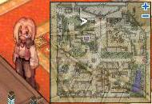
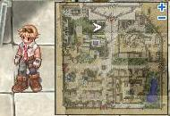
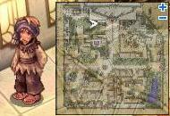
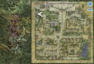
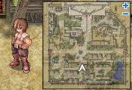
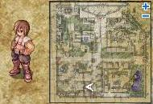
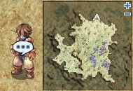
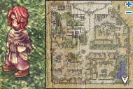
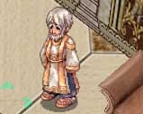

# Lost Child Quest

<!-- Quest info -->
- **Level requirement:** 60
- **Quest requirements:** Steps 1 through 5 of the [Rachel Sanctuary Quest](Rachel_Sanctuary_Quest.md)
- **Base EXP reward:** 900,000
- **Item reward:** 1 Old Purple Box
- **Window:** yes

1. Talk to Vincent (ra_in01 384,246) on the second floor of the mansion in [Rachel](Rachel.md) (rachel 100,240).

2. Go outside, and ask Logan (rachel 114, 232) about Phoebe; he directs you to Mr. Manson inside the house.

3. Go back inside, and talk to Mr. Manson (ra_in01 372, 200). He explains what he thinks happened, and sends you to talk to Jenny.

4. Exit the house again, and talk to Jenny (rachel 48, 236). Jenny gives more information and suggests checking the market.

5. Talk to the Idle Merchant (rachel 138, 73), who tells you he hasn't seen anyone and offers a rather disgusting "mock vegetable!"

6. Talk to the other Idle Merchant (rachel 120, 47), who tells you someone sent a message for you to come to the Ice Cave.

7. Head to the Ice Cave (1 map right, 3 maps up from [Rachel](Rachel.md),) and talk to the Suspicious Man (ra_fild01 245, 325). He attempts to kill you (You lose half your HP), but fails. You both then realize Vincent set you up, and you go back to talk to him.

8. Talk to Vincent, and he explains about his situation, and that Jenny is Phobe's mother, but he can't marry her since there's an inherent class difference in the city. You offer to find his son and the jewel that was stolen.

9. Talk to the Kid at (rachel 263, 32, the lower-right corner of the map, not the Kid right next to the pond) and you find out he's Phobe and took the jewel himself. You can't get him to come home, but you get the jewel.

10. Take the jewel back to Vincent, and he's very thankful and asks you to tell Jenny about Phobe.

11. Talk to Jenny, and she's happy to hear you found him, and is okay with you knowing about their secret.

12. Go back and talk to Vincent, who rewards you with an Old Purple Box, and gives you a letter of recommendation to take to Sir Zhed, the high priest at the temple.

* **NOTE**: If 10,000 donations for the sanctuary had already been made, players must complete steps 1 through 5 of the [Rachel Sanctuary Quest](Rachel_Sanctuary_Quest.md).

13. Go into the temple, and find High Priest Zhed (ra_temin 277, 159) on the east side of the first floor, and give him your letter. You explain the situation, and he gives you some Base Experience.

---
**Categories:** [Base Experience Reward](categories/Base_Experience_Reward.md), [Quest Window Quests](categories/Quest_Window_Quests.md), [Quests](categories/Quests.md), [Rachel Quests](categories/Rachel_Quests.md)
*Source: [iRO Wiki Classic](https://irowiki.org/classic/Lost_Child_Quest) — GFDL 1.3+*
