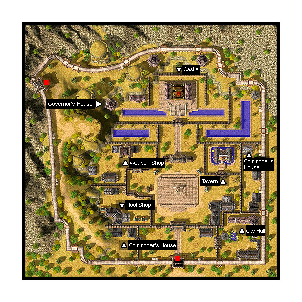

# Louyang

## About Louyang

Louyang is a town done in the style of China. It has a dungeon and one field map, which is very popular for leveling (and Dead Branching). To get to Louyang, you must pay the NPC at the [Alberta](Alberta.md) docks 10,000 Zeny.
Louyang boasts vast fields and tall mountains. Beyond the grand northern walls of the field lies the glorious Castle of the Dragon, capital of Louyang. Majestic in its size and architecture, this city is guaranteed to awe any visitor (best viewed from Louyang’s sightseeing tower). However, deep beneath the beautiful Castle of the Dragon is a dark crypt teeming with unspeakable horrors.

## Story

After the Japanese themed [Amatsu](Amatsu.md) and the Taiwanese themed [Kunlun](Kunlun.md) comes a new addition to the world of Midgard - Louyang, the Castle of the Dragon. Fashioned after ancient China, it now becomes the stage on which a chivalrous new tale will unfold. Far from the shores of Volsug, the brave adventurers discovered the land of Louyang. With its high mountains, vast fields, and the glorious Castle of the Dragon looming on the horizon, it wasn’t long before the adventurers were captivated by this foreign land’s mystique. Not only was the landscape spectacular, but the citizens were equally interesting. Here they discovered unique artworks, weapons, masterpieces, and products made by skilled native craftsmen; treasures not found in any other land. Rumors also speak of another kind of treasure, a treasure so vast that is was said to compare to the vaults of King Tristan III and those guarded by the Schwartzvald Republic

However, unlike in [Amatsu](Amatsu.md) or [Kunlun](Kunlun.md), foreigners weren’t welcome in Louyang. These people have a strong connection to their culture. The connection of the local folk was so strong that they ostracized outsiders in order to protect their way of life. The country of Louyang was headed by an Emperor who delegated the task of ruling the city’s regions to the federal government. The people of Louyang put their faith and loyalty in the Wu Lin.
The Wu Lin is a martial arts school which acts as the unofficial government of Louyang. Since the Wu Lin does not collect taxes from the people nor compete with the rule of the Emperor, the federal government tolerates their existence. To the eyes of the common people, one’s fists are more powerful than any law and this belief strengthened Wu Lin’s influence and numbers.

The Legend of Bailong

Long before the Wu Lin was founded, Louyang was victim to frequent invasions by evil creatures. It was because of these vile monsters that a street knight named Bai Long used his strength and leadership to gather many of Louyang’s best warriors to form the Wu Lin. Bai Long’s leadership and the Wu Lin’s courageous efforts defeated the threat of the monster invasion. It was also through the valiant efforts of the Wu Lin that the city of Louyang prospered. Due to his abilities and bravery, Bai Long was made the leader of the people.
Years passed and the glory of Bai Long’s youth faded. The peace enjoyed by Louyang slowly began to crumble. As Bai Long aged, many of the warrior schools began to fight with one another, each seeking to gain dominance over the others, and plotting to take Louyang from Bai Long. With dissention among the schools, monsters once again terrorize Louyang. Lamenting over the crumbling Wu Lin which was now fragmented by the selfishness and greed of the warring schools, Bai Long decided to open Louyang’s walls to the outsiders. So long as they were pure of heart and strong of will, Bai Long welcomed them into Louyang to help battle the fearsome monsters. The people welcomed these foreigners after recognizing the benefits of cultural exchange and foreign trade. They also needed these people to help fend off the creatures that constantly besieged them. However, not all are pleased with Bai Long’s decision. In hushed tones, many of the warrior schools and families of old still plot against Bai Long.

The story does not end here. It is merely a prelude of things to come. As a foreigner and an adventurer, it is YOUR adventure. You alone can decide what fate has in store for you in this new, mystic land!

## Quests

Within the city of Louyang you will meet several interesting people. They would be willing to lend their wisdom and knowledge for a small favor or two (quests).

Visitors can help the man in the highest peak of Louyang field, who’ll teach you how to clear your mind if you get him one of the specialty soups from the Louyang restaurant. There is also the Bard who’s seeking to complete his song, learn the secrets of Pharmacy from the Louyang Herbalist, or do errands for the legendary Poison King of Louyang.

By helping these people, not only do you get useful items, but experience (exp) as well.

Quests added with the Louyang update can be found [here](Quests.md).

## Guide

## Structures

## Buildings

*  City Hall (309,79)
*  Dragon Castle (218,254)
*  Doctor's Office (262,93)
*  Governor's House (134,245)
*  House (130,62)
*  Produce House (317,175)
*  Storage Building (125,120) & (129,120)
*  Tool Shop (137,98)
*  Tavern (280,166)
*  Weapon Shop (145,173)

## Billboards and Signs

None

## NPCs

## Regulars

Guides - Representative, Soldier (x2) are at (224,104), (213,213) and (160,175)

*  Shows Dragon Castle, Doctor's Office, City Hall, Weapon Shop, Tool Shop, Tavern on minimap

Kafra Employees are at (210,104)

*  Save, Kafra storage (80z), Rent Cart, Reserve points

## Store NPCs

*  Weapon Dealer (Weapon Shop)
  * Main Gauche, Stiletto, Blade, Ring Pommel Saber, Katana, Bastard Sword, Pike, Partizan, Hammer, Chain
*  Armor Dealer (Weapon Shop)
  * Bandana, Sandals, Shoes, Hood, Muffler, Guard, Buckler, Adventurer's Suit, Silk Robe, Silver Robe, Wooden Mail, Belt
*  Tool Dealer (Tool Shop)
  * Arrow, Steel Arrow, Magnifier, Red Potion, Orange Potion, Yellow Potion, White Potion, Green Potion, Concentration Potion, Awakening Potion, Fly Wing, Butterfly Wing, Trap

## Trade NPCs

Friendly Looking Lady - Hong Miao (Governor's House)
  access to 'observatory tower' for 500 [Zeny](Zeny.md) **---- To leave the observation tower, click on the Exit at (84,254)**

## Quest NPCs

*  Doctor - Hua Tuo (Doctor's Office) - [Doctor Quest](Doctor_Quest.md)
*  Tool Shop Master - Wang Chuiyi (Tool Shop) - Part of [Doctor Quest](Doctor_Quest.md)
*  Storage Keeper - Jiang Xiayou (Storage) - Part of [Doctor Quest](Doctor_Quest.md)
*  City Hall Officer - Jin Chiyuan (City Hall, first floor) - Part of [Doctor Quest](Doctor_Quest.md)
*  Studying Officer - Huang Zhishu (City Hall, second floor) - Part of [Doctor Quest](Doctor_Quest.md)
*  Hermit - Sun Mao (House) - [Revolution Quest](Revolution_Quest.md)
*  Pot #1 (Tavern) - Part of [Shout Mountain Quest](Shout_Mountain_Quest.md)
*  Pot #2 (Tavern) - Part of [Shout Mountain Quest](Shout_Mountain_Quest.md)

## Travel NPCs

None

## Background NPCs

*  Soldier (Dragon Castle, center room) - talks about ignoring guy to the east, and hopes you have a good time while at Louyang
*  Soldier (Dragon Castle, center room) - talks about a scammer
*  Soldier (Dragon Castle, center room) - sleeps, you can wake him up and then he goes back to sleep.
*  Soldier (Dragon Castle, center room) - talks about rumors, about stories of Louyang used to having monster invasions long ago but being boring now
*  Lord - Lord Bai Long (Dragon Castle, center room) - welcomes you to Louyang. Mentions a lost friend.
*  Soldier (Dragon Castle, center room) - talks about there nothing much about the west room, but welcomes you to look or if you have certain items in your inventory, bars you from entering
*  Soldier (Dragon Castle, west room) - talks about strangers in this room being weird and tells you that you have no business here and to leave.
*  Gunpowder Expert - Hao Chenryu (Dragon Castle, west room) - talks about only trusting his or her comrades for the 'cause of Louyang'.
*  Jiu Chi Ling (174,150) - talks about her brother, hinting at [Shout Mountain Quest](Shout_Mountain_Quest.md)'s start
*  Supply Stack (Storage) (x5) - describes the room and the clutter, then you are warned not to touch anythingn and that if you mess stuff up, you have to clean it up
*  Chi Wu Ping (261,123) - talks about being in pain, then notices you're not a local and advises you to go to the restaurant for their healthy soup
*  Trainees (box of 12 trainees inn a box of coords (272,133), (278,133), (272,129), (278,129)) - yell various things as they train
*  Powerful-looking Guy - Akiira (274,136) - talks about spiritual training's importance to martial arts
*  Fist master - Zhiang Xiau Ji (276,136) - talks about the mastering 'Claw of Dragon' and having patience in learning and furthering 'Claw of Dragon' and in martial arts in general
*  Muscular Woman - Zhi Ching Li (297,167) - talks about the Maiden Palace who are all female and looking for new recruits
*  Employee - Ya Hua (Tavern) - welcomes you to the restaurant or yawns
*  Employee - Chang Pai (Tavern) - welcomes you to the restaurant or yawns
*  Chef Assistant - Jin Wei Ling (Tavern) - talks about using his beloved martial arts with his cooking
*  Chef - Wang Shi Long (Tavern) - talks about the restaurant and its specialty dish, Dragon Soup
*  Jiang Rong (Tavern) - talks about Dragon Soup
*  Liu Jia Lim (Tavern) - talks about Dragon Soup
*  Li Min (Tavern) - talks about coming frequently to Louyang, and visiting this restaurant due to a craving for the recently, unforgettable taste of Royal Jelly
*  Employee - Huang Jia Xian (Tavern) - welcomes you, apologizes for wait and talks about the restaurant or asks for forgiveness and dozes off
*  Employee - Song Zhi Du (Doctor's Office) - notes down locations of medicines, notices your attention and can talk about his master and his job and prompts you when you mention Poison Organization (quest?)
*  Familiar-Looking Patien - ?????? (Doctor's Office) - coughs and goes "aww" or sleeps
*  Poison King - Nagash Arses (Produce House) -

**Related pages:**

* [Towns](Towns.md)
* [Rune-Midgarts Kingdom](Rune-Midgarts_Kingdom.md)
* [Alberta](Alberta.md)
* [Al De Baran](Al_De_Baran.md)
* [Archer Village](Archer_Village.md)
* [Comodo](Comodo.md)
* [Geffen](Geffen.md)
* [Izlude](Izlude.md)
* [Morroc](Morroc.md)
* [Payon](Payon.md)
* [Prontera](Prontera.md)
* [Umbala](Umbala.md)
* [Republic of Schwartzvald](Republic_of_Schwartzvald.md)
* [Einbech](Einbech.md)
* [Einbroch](Einbroch.md)
* [Hugel](Hugel.md)
* [Juno](Juno.md)
* [Lighthalzen](Lighthalzen.md)
* [Arunafeltz States](Arunafeltz_States.md)
* [Rachel](Rachel.md)
* [Veins](Veins.md)
* [Manuk](Manuk.md)
* [Amatsu](Amatsu.md)
* [Ayothaya](Ayothaya.md)
* [Kunlun](Kunlun.md)
* [Jawaii](Jawaii.md)
* [Louyang](Louyang.md)
* [Moscovia](Moscovia.md)
* [Nifflheim](Nifflheim.md)
* [Lutie](Lutie.md)

---
*Source: [iRO Wiki Classic](https://irowiki.org/classic/Louyang) — GFDL 1.3+*
