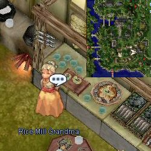
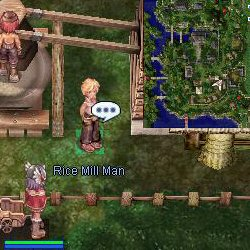
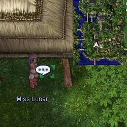

# Lunar New Year Event (2008/02/05) ~ (2008/02/12)

> **Note:** Not implemented on iRO Classic.

<!-- Quest info -->
- **Level requirement:** None
- **Item requirement:** Rice Pouch
- **Item reward:** Varies

1.  Inside the Payon Inn, Speak with Rice Mill Grandma. She complains about rodents that have stolen all her rice pouches.

1.   

1.  Bring her a rice pouch. (Dropped by Cramp, Martin, & Tarou)
1.  She asks you to take the rice pouch to her son.
1.  Just outside, give the rice pouch to her son.  He will process it into Sweet Rice.

1.   

1.  Take the rice back to the Grandma. She will reward you with one of the following:
  * 3 Hearty Rice Cake
  * 2 Lucky Rice Cake
  * 2 Honey Pastry
  * 2 Sesame Pastry
  * 3 Salty Rice Cake
  * 3 Plain Rice Cake
  * 2 Rainbow Cake
  * 2 Korean Rice Cake (Weighs 1, Description error)
  * 1 Green Maiden Pet Egg (Given along with one of the other items)
  * 1 Red Envelope (Given along with one of the other items after the player has received the Egg)

* Green Maiden
  * Food Mojji can be found in payon (126,113). 10 Mojii for 3,000 [Zeny](Zeny.md). The [NPC](NPC.md) will only sell Mojji to characters who have received an Egg from the Grandma.

*  Note: The Green Maiden Pet Egg can only be awarded once per character.

---
**Categories:** [Temporary Event Quests](categories/Temporary_Event_Quests.md)
*Source: [iRO Wiki Classic](https://irowiki.org/classic/Lunar_New_Year_Event_%282008/02/05%29_~_%282008/02/12%29) — GFDL 1.3+*
