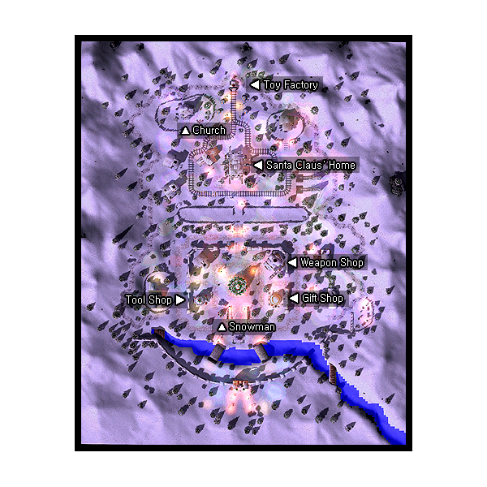

# Lutie

## About Lutie

Lutie is the Christmas town of Ragnarok. NPCs such as Santa and a snowman can be found here, along with winter/Christmas themed monsters and buildings. The entrance to the dungeon can be found in Lutie. To get to Lutie, talk to the Santa NPC at the top right building in [Al De Baran](Al_De_Baran.md). He will teleport you for free to the field outside of Lutie. The portal at the top of this field leads to the town.

## Story

Lutie was discovered not long ago by a lone adventurer that wandered into an endless land of snow, and stumbled upon this village. For centuries the residents of Lutie have isolated themselves, gathering all they needed from hunting around their small village. Along with hunting, the residents of Lutie work everyday in the Lutie toy factory. Visitors to Lutie have often commented on the singing and soft thump of hammers as the workers cheerfully build toys of every shapes and sizes. Recently, an evil man, Antonio, who was bitter when he lost the election for town mayor, stole all the toys from the factory. Citizens of Lutie, who worked to bring joy to the children, became desperate and contacted the [Kafra](Kafra.md) Corp who was happy to help and made it possible for Lutie to bring toys to the happy children across the world. Lutie, which can be reached with a Kafra's assistance, has a landscape which can be seen nowhere else.

## Guide

## Structures

## Buildings

* 1 - Chimney House (120,161) (Note: Try climbing the roof and into the chimney =)
* 2 - Church (104,288)
* 3 - Gift Shop (173,131)
* 4 - Santa Claus' Home (142,238), (149,238), (149,259), and (142,259)
* 5 - Snowman House (189,277)
* 6 - Tool Shop (121,131)
* 7 - Weapon Shop (172,159) and (182,170)

## Billboards

* Bulletin Board (147,311) - Gives background information on Toy Factory

## NPCs

## Regulars

None

## Store NPCs

Armor Dealer (Weapon Shop)
  Helm, Buckler, Shield, Mantle, Coat, Padded Armor, Chain Mail, Full Plate, Manteau, Boots
Gift Merchant (Gift Shop)
  Flower Ring, Bouquet, Witherless Rose, China, Glass Bead, Puppet, Diamond Ring
Tool Dealer (Tool Shop)
  Red Potion, Orange Potion, Yellow Potion, White Potion, Green Potion, Concentration Potion, Awakening Potion, Fly Wing, Butterfly Wing, Magnifier, Yggdrasil Leaf
Weapon Dealer (Weapon Shop)
  Knife, Cutter, Main Gauche, Dirk, Dagger, Stiletto, Gladius, Damascus

## Trade NPCs

Fuzzy Fuzz (175,156)
  Teddybear Hat for 1 Panda Hat, 100 Needle Packet, 100 Spool, 300 Black Bear Skin
Pretty Lindsey (183,267)
  Sea-Otter Hat for 1 Raccoon Hat, 1 Smokie Leaf
Vending Machine - Audi (115,297)
  Raccoon Hat for 1 Kitty Band, 20 Dragon Scale, 200 Tough Scalelike Stem, 300 Sea-otter Fur
  Spore Hat for 850 Poison Spore, 300 Burnt Tree, 1 Tongue
  Wonder Nutshell for 1 Nut Shell, 500 Wing of Dragonfly
  Rainbow Eggshell for 1 Egg Shell, 1 Cobaltblue Dyestuffs, 50 Claw of Desert Wolf
  Blush for 100 Alice's Apron
  Chef Hat for 120 Piece of Cake, 1 White Dyestuffs, 330 Feather, 450 Dragon Scale
  Candle for 1 Bomb Wick, 50 Matchstick, 100 Royal Jelly
  Cake Hat for 10 Candy, 5 Candy Cane, 15 Well-baked Cookie, 20 Piece of Cake, 10 Steel
  Hat Merchant - Mad Hatter (Tool Shop)
  Party Hat for 1 Santa Hat, 100 Oil Paper, 100 Slick Paper
  Straw Hat for 1 Sakkat, 300 Tough Vine, 300 Piece of Bamboo
  Cowboy Hat for 1 Western Grace, 108 Claw of Desert Wolf, 108 Soft Blade of Grass, 4 Burning Horseshoe
  Sombrero for 1 Straw Hat, 50 Cactus Needle, 1 Guitar
  Beanie for 1 Cap, 500 Yarn

## Quest NPCs =

Hashokii (146,136)
  Part of Snowysnow Quest also part of Bard job change quest
Little Boy - Charu Charu (206,168)
  Part of Snowysnow Quest also part of Bard job change quest
Little Girl - Marcell (208,168)
  Part of Snowysnow Quest also part of Bard job change quest
Poze (117,304)
  Part of Snowysnow Quest also part of Bard job change quest
Snowman - Snowysnow (134,112)
  Snowysnow Quest also part of Bard job change quest
Uncle Hairy - Cantata (176,236)
  Part of Snowysnow Quest also part of Bard job change quest
Duffle (Snowman House)
  Part of Snowysnow Quest also part of Bard job change quest
Lenient Aunt - Thachentze (Chimney House)
  Part of Snowysnow Quest also part of Bard job change quest

## Travel NPCs

None

## Other NPCs

Vending Machine Man - Titicupe (117,295)

## Other

## Santa Claus

Santa Claus NPC is located in Santa Claus' Home. Off holiday season, he is just a background NPC that introduces himself, then tells you how you can leave Lutie for Al De Baran. During the holiday season, he serves as a trade NPC. He tells you the dilemma that he and his Santa army face against the Antonios, rogue Santas, that have cut holes in children's stockings. His request is that you vanquish them and he will reward you. For proof of your defeat over some Antonios, he will give you 1 Gift Box for 3 Red Stocking with Hole (?forgotname). The first time you talk to him during holiday season, he will give you a small Christmas gift as well, which could be cake, candy, candy canes, etc.

## Dungeon

## Toy Factory

A colorful dungeon filled with Christmas-themed foes such as Cookies, who resemble elves, and sentient Gift Boxes.
It is notable for having messages on the map, such as "I <3(love) U". The dungeon is located at the very northern part of Lutie and spans 2 maps. It is also home for the MVP Boss: Stormy Knight.

**Related pages:**

* [Towns](Towns.md)
* [Rune-Midgarts Kingdom](Rune-Midgarts_Kingdom.md)
* [Alberta](Alberta.md)
* [Al De Baran](Al_De_Baran.md)
* [Archer Village](Archer_Village.md)
* [Comodo](Comodo.md)
* [Geffen](Geffen.md)
* [Izlude](Izlude.md)
* [Morroc](Morroc.md)
* [Payon](Payon.md)
* [Prontera](Prontera.md)
* [Umbala](Umbala.md)
* [Republic of Schwartzvald](Republic_of_Schwartzvald.md)
* [Einbech](Einbech.md)
* [Einbroch](Einbroch.md)
* [Hugel](Hugel.md)
* [Juno](Juno.md)
* [Lighthalzen](Lighthalzen.md)
* [Arunafeltz States](Arunafeltz_States.md)
* [Rachel](Rachel.md)
* [Veins](Veins.md)
* [Manuk](Manuk.md)
* [Amatsu](Amatsu.md)
* [Ayothaya](Ayothaya.md)
* [Kunlun](Kunlun.md)
* [Jawaii](Jawaii.md)
* [Louyang](Louyang.md)
* [Moscovia](Moscovia.md)
* [Nifflheim](Nifflheim.md)
* [Lutie](Lutie.md)

---
*Source: [iRO Wiki Classic](https://irowiki.org/classic/Lutie) — GFDL 1.3+*
