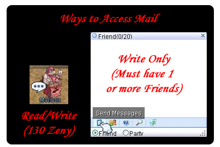
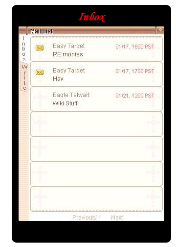
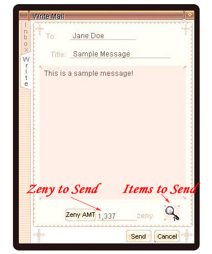
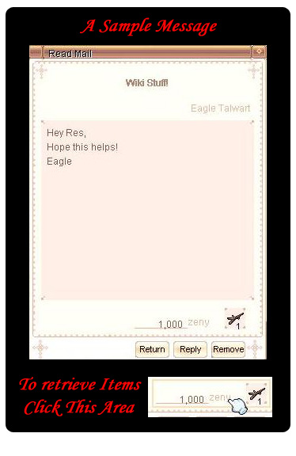

# Mail System

## Overview

The Mailing System is a feature added of the

> **Wiki** — id: Episode_10.4_Hugel Episode 10.4: Hugel

 update. It was deactivated on iRO for a time due to bugs, but returned to iRO when the

> **Wiki** — id: Interface_Renewal Interface Renewal

 update occurred. **It is currently disabled again on iRO because of a duping bug.**

*  You can send mail via your Friends List (as long as you have one friend), your Party List (as long as you are in a party), or through the Mailbox.
*  Mail will be deleted automatically once your mailbox is full, starting with the oldest messages.
*  You can send a maximum of 30 messages at once.
*  Any mail you have opened must be taken care of in order to see next one.
*  You cannot send mail to characters on the same account.
*  [Zeny](Zeny.md) and [Items](Items.md) (1 item stack per message) can be sent via the Mailing System.
*  Messages which contain foul language cannot be sent.
*  Character and Account-bound items such as Wedding Rings cannot be sent via the Mail System.
*  Your mail is accessed via a Mailbox [NPC](NPC.md) in all major towns.  There is a fee of **130** Zeny to access the mailbox.

## Menus

## Accessing and Inbox

 

## Writing and Reading Mail

 

---
**Categories:** [General Information](categories/General_Information.md)
*Source: [iRO Wiki Classic](https://irowiki.org/classic/Mail_System) — GFDL 1.3+*
