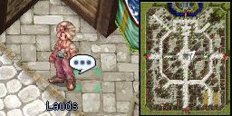
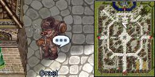
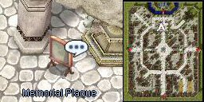

# Memorial Day Event (2008/05/20) ~ (2008/05/27)

> **Note:** Not implemented on iRO Classic.

<!-- Quest info -->
- **Level requirement:** 20
- **Item requirement:** 30 Fabric, 20 Fluff
- **Items required:** 1 Red Potion, 1 Green Potion, 1 [Awakening Potion](ASPD_Potion.md), 1 Butterfly Wing, 1 Blue Gemstone, 1 Carrot, 1 Meat, 1 Firecracker, 1 Trap, 1 Yggdrassil Leaf, 1 Crystal Mirror, 1 Poring Doll, 1 Wedding Bouquet, 1 Pet Incubator
- **Base EXP reward:** 375,000
- **Job EXP reward:** 175,000
- **Item reward:** 1 Old Purple Box -**OR**- 1 Poring Box -**OR**- 1 Large Jellopy

1.  Speak to Lauds in [Prontera](Prontera.md) at (182, 214), next to the Armor/Weapon Shop. He needs you to bring him 30 Fabric and 20 Fluff so that he can make you a towel.

1.   

1.  After making the towel, he sends you to speak to Grast.
1.  Find Grast at 150, 270. He asks you to bring 1 Red Potion, 1 Green Potion, 1 [Awakening Potion](ASPD_Potion.md), 1 Butterfly Wing.
  * Note: Players have the option of using Grast's items instead of gathering their own.  Doing so skips to step 7, with a reward of 1 Large Jellopy.

1.   

1.  After bringing those items to Grast, he now requests 1 Blue Gemstone, 1 Meat, 1 Trap, 1 Yggdrassil Leaf, 1 Crystal Mirror, 1 Carrot.
1.  After bringing those items to Grast, he now requests 1 Firecracker, 1 Poring Doll, 1 Wedding Bouquet, 1 Pet Incubator.
1.  Grast then asks you to select your reward from either his left hand or his right hand.
  * Receive either 1 Old Purple Box -**OR**- 1 Poring Box
1.  Grast sends you back to Lauds.
1.  Lauds sends you to the plaque in the 12 o clock direction of prontera (153, 286).

1.   

  * Receive Base & Job Experience
1.  Return to Lauds for further conversation.

---
**Categories:** [Base Experience Reward](categories/Base_Experience_Reward.md), [Job Experience Reward](categories/Job_Experience_Reward.md), [Temporary Event Quests](categories/Temporary_Event_Quests.md)
*Source: [iRO Wiki Classic](https://irowiki.org/classic/Memorial_Day_Event_%282008/05/20%29_~_%282008/05/27%29) — GFDL 1.3+*
