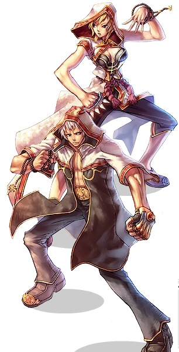

# Monk

<!-- Job info -->
- **Job base:** Acolyte
- **Job type:** 2-2
- **Changes at:** St.Capitolina Abby
- **Skills:** 15
- **Skill points:** 82
- **Quest skills:** 2
- **STR:** 8
- **AGI:** 7
- **VIT:** 6
- **INT:** 2
- **DEX:** 4
- **LUK:** 3

## Overview

Monks are a versatile class that can deal damage in several ways unique to themselves. They are most known for the powerful [Guillotine Fist](Guillotine_Fist.md) skill, which has uses in [MVP](MVP.md), [PVP](PvP~d29d2.md) and [WoE](War_of_Emperium.md) scenarios. Most builds are damage-dealers, focusing on maximizing damage via skills such as [Occult Impaction](Occult_Impaction.md) and their [Combo](Monk.md) abilities. Specialized Monk builds can be very efficient for [MVP](MVP.md) and [WoE](War_of_Emperium.md) purposes.

## Jobchange Guide

*See [Monk Job Change Guide](Monk_Job_Change_Guide.md) for detailed information.*

Changing into a Monk from an [Acolyte](Acolyte.md) requires the player to complete a number of tasks:
*  Item Collection Test
*  Memory Test
*  Mushroom Collecting *or* Marathon Running
*  Maze Test

After completing these tests, the player will be transformed into a Monk. All of this takes place at the Monk Abbey (prt_monk).

## Builds

## STR/DEX WoE

*  [STR](Stats.md): 100-120
*  [AGI](Stats.md): 1
*  [VIT](Stats.md): 40-50 (stun resist, higher health, more potion efficiency)
*  [INT](Stats.md): 20-30
*  [DEX](Stats.md): 80-100 (skills can be interrupted easily during [WoE](War_of_Emperium.md) - [Guillotine Fist](Guillotine_Fist.md) must be fast)
*  [LUK](Stats.md): 1

Weapons: [Carded](Card_System.md) [Mace](Mace.md)

A made to survive Monk build suitable for [WoE](War_of_Emperium.md) under precasts and [Dazzler](Dazzler.md) spams. With slightly lower [DEX](Stats.md) and [INT](Stats.md) (SP Issues replaced by high ranking gears) this build generally gets the job done better, and lets the user live longer overall in [WoE](War_of_Emperium.md).

Generally this build type is best supported with nicer, very expensive gears to make up for the SP shortcomings and further add to your lifespan. Because [Guillotine Fist](Guillotine_Fist.md)'s damage is reduced in [WoE](War_of_Emperium.md), players need high [STR](Stats.md) and sometimes a bit of [INT](Stats.md) to ensure their [Guillotine Fist](Guillotine_Fist.md) will kill people in one shot. With this [VIT](Stats.md), as a Monk you can use your snap skill amazingly in [WoE](War_of_Emperium.md) through and past precasts. Great for Advanced [WoE](War_of_Emperium.md) addicted players.

## STR/DEX PvP

*  [STR](Stats.md): 100-110
*  [AGI](Stats.md): 1
*  [VIT](Stats.md): 40-50
*  [INT](Stats.md): 1-20
*  [DEX](Stats.md): 100-110
*  [LUK](Stats.md): 1

Weapons: [Carded](Card_System.md) [Mace](Mace.md)

Common Monk bread and butter build. This is also usable in [WoE](War_of_Emperium.md), but there is an another build that can be used in [WoE](War_of_Emperium.md) that is made to kill those Ghostring Armor wearing players, but that's another story.

This stat build is the most flexible and dubbed superior over the other since this combination will further more exploit the flexibility of the Monk class. You won't rely on [Guillotine Fist](Guillotine_Fist.md) alone, because of the [DEX](Stats.md) amount, you can do fast cast [Throw Spirit Sphere](Throw_Spirit_Sphere.md) also or [Occult Impaction](Occult_Impaction.md). Disabling other Monk class is also possible due to the reduced cast time of [Spiritual Sphere Absorption](Spiritual_Sphere_Absorption.md).

*  Due to limitation of 49 Skill points to be allocated, maxing of Guillotine Fist, Throw Spirit Sphere and Occult Impaction might be compromised.

## STR/INT MVP

*  [STR](Stats.md): 110-120
*  [AGI](Stats.md): 1
*  [VIT](Stats.md): 1-20
*  [INT](Stats.md): 85-105
*  [DEX](Stats.md): 40-70
*  [LUK](Stats.md): 1

Weapons: [Carded](Card_System.md) [Mace](Mace.md)

There is a high preference for 120 [STR](Stats.md) in this type of build as well as a high [INT](Stats.md) score in order to deal massive amounts of damage with the [Guillotine Fist](Guillotine_Fist.md) skill.

High [INT](Stats.md) allows for a long-lasting supply of [SP](SP.md) while leveling, allowing the Monk to make up slower leveling speed due to lower [DEX](Stats.md) with the benefit of having to sit and regen [SP](SP.md) far less than other monks (and may not even need the benefit of a [Priest](Priest.md)). High [INT](Stats.md) builds will also find the have an easier time using [Guillotine Fist](Guillotine_Fist.md) continuously in Bio Labs.

MVP Monk is often overlooked, because a raw damage is better suited to [Champion](Champion.md), a Transcendental class; it has the increased [SP](SP.md) of +25% akin to all Transcendental classes, which affects [Guillotine Fist](Guillotine_Fist.md)'s damage greatly.

## STR / AGI Combo

*  [STR](Stats.md): 90-110
*  [AGI](Stats.md): 100+
*  [VIT](Stats.md): 20-30
*  [INT](Stats.md): 1-30
*  [DEX](Stats.md): 40-60
*  [LUK](Stats.md): 1

Weapons: [Knuckles](Knuckle.md)

Mostly made for solo leveling fun, this build's aim is not the [Guillotine Fist](Guillotine_Fist.md) damage, but the [ASPD](ASPD.md) and massive combo skill damages.

[AGI](Stats.md) and [STR](Stats.md) is prioritized for higher damage per second, [INT](Stats.md) is almost for [SP](SP.md) regen and count while [DEX](Stats.md) is for [Hit](Stats.md) or even [Guillotine Fist](Guillotine_Fist.md) cast time if one plans to have it.

Regardless of its [PvM](PvM~a1fb2.md) approach, this stat combination could also compete with the other builds and thus **Full Combo-Asura** builds are born which fuses the most damaging combo skills and [Guillotine Fist](Guillotine_Fist.md).

Full Combo-Asura builds are flashy due to their ability to chain almost all combos to [Guillotine Fist](Guillotine_Fist.md). Specifically, [Raging Trifecta Blow](Raging_Trifecta_Blow.md) => [Raging Quadruple Blow](Raging_Quadruple_Blow.md) => [Raging Thrust](Raging_Thrust.md) => [Guillotine Fist](Guillotine_Fist.md).

## Hybrid

*  [STR](Stats.md): 100-110
*  [AGI](Stats.md): 80-100
*  [VIT](Stats.md): 20-30
*  [INT](Stats.md): 37-45
*  [DEX](Stats.md): 70-90
*  [LUK](Stats.md): 1

Weapons: [Knuckles](Knuckle.md) and [Carded](Card_System.md) [Mace](Mace.md)

Combines both the best of both the Spirit and Combo build into one. This build aims to balance the stats so that it is more stable when situations demands a certain task. With the potential to unleash a Deadly [Guillotine Fist](Guillotine_Fist.md) and still maintain Combos and Spirit Skills, a Hybrid Monk is ready to adapt to a crisis in a matter of seconds.

Due to the fact that the status points are allocated into every Stat (with the exeption of luk). This opens the skill tree to a whole other level. [Snap](Snap.md) can be used effectivly with this build with the assumption of maxing [Occult Impaction](Occult_Impaction.md) as the Mastered Skill. Other skill builds such as maxing Buffs, [Heal](Heal.md), and Spirit Skills but ignoring Combos is also an option.

## Tactics

Important Monk skills for [PvP](PvP~d29d2.md)/[WoE](War_of_Emperium.md):

*  [Guillotine Fist](Guillotine_Fist.md)
*  [Occult Impaction](Occult_Impaction.md)
*  [Root](Root.md)
*  [Snap](Snap.md)
*  [Spiritual Sphere Absorption](Spiritual_Sphere_Absorption.md)
*  [Throw Spirit Sphere](Throw_Spirit_Sphere.md)

PvM Combo Monk skills:
All PvP & Woe skills plus the combo skills if player has the skills.

These are some tricks that can aid players in battle or make the player enjoy being a monk more. The first 3 tricks are seen / heard in-game.

*  **[Occult](Occult_Impaction.md) Step and [Throw Spirit Sphere](Throw_Spirit_Sphere.md)**
  How to Do it:
  While doing occult impaction, clicking on any unoccupied cell (preferably next to you or the enemy) right before casting ends. (With good [Dex](Stats.md), clicking right after the cast begins usually makes it work)
  Purpose: Bypass the after-skill delay. so you can do other things quicker (ex/ another occult). May require some practice.

*  **[Snap](Snap.md) Dance**
  How to Do it:
  Use snap on the cell the player is standing on. Then hotkey /doridori and /bangbang (or /bingbing) and press them alternately.
  Purpose:
  None other than the player's sprite will do awkward actions while spinning.

*  **Fight Cancel**
  How to do it:
  While fighting just use [Summon Spirit Sphere](Summon_Spirit_Sphere.md), and player will stop attacking (normal Melee attack) immediately.
  Purpose:
  When attacking a monster, it is sometimes hard to stop the attack. Especially if player accidentally [KS](Kill_Steal.md) a monster.

*  **[Mental Strength](Mental_Strength.md) and Explosion Spirits**
  How to do it:
  Cast [Fury](Fury.md) than [Mental Strength](Mental_Strength.md).
  Purpose:
  While [MvP](MVP.md)ing as a tank, when [Mental Strength](Mental_Strength.md) timed out, player can use Snap immediately without any spheres. Rinse and repeat and go back to the MvP. This trick negates the need for Fly wings or the [Teleport](Teleport.md) skill anymore because this trick is way more efficient than to teleport and find the [MvP](MVP.md) to tank it again.

*  **[Pneuma](Pneuma.md) and [Safety Wall](Safety_Wall.md) don't mix**
  How to do it:
  Cast [Pneuma](Pneuma.md) on [Guillotine Fist](Guillotine_Fist.md) target's cell (directly on the target).
  Purpose:
  Disable target's ability to cast [Safety Wall](Safety_Wall.md) on himself.

Using the skill **[Summon Spirit Sphere](Summon_Spirit_Sphere.md)**, a monk can summon a number of spirit spheres. At most one can have 5 spirits. Each of them can be used for various skils. They will also prevent it's owner's attacks from missing, as each adds 3 damage that won't miss.

The following skills utilize (consume) spirit spheres:
*  [Throw Spirit Sphere](Throw_Spirit_Sphere.md) (1 to 5 spirits)
*  [Spiritual Sphere Absorption](Spiritual_Sphere_Absorption.md) (all available)
*  [Fury](Fury.md) (5 spirits)
*  [Guillotine Fist](Guillotine_Fist.md) (5 spirits, with exceptions)
*  [Root](Root.md) (1 spirit)
*  [Snap](Snap.md) (1 spirit, unless in [Fury](Fury.md))
*  [Raging Thrust](Raging_Thrust.md) (1 spirit)
*  [Mental Strength](Mental_Strength.md) (5 spirits)
*  [Occult Impaction](Occult_Impaction.md) (1 spirit)

Remember to replenish spirit spheres when they expire. Spheres will remain even after death; however, reloging or disconnects will rob a character of their spheres, so it is needed to summon them again.

Using the quest-gained skill [Spiritual Bestowment](Spiritual_Bestowment.md), a monk can transfer his spirit spheres to another character of the same party (with the exception for Gunslinger class, who can't receive Spheres since they have "Coins" as their Spheres). The spheres will have the same effect on any job apart from Gunslinger who can't receive them. Spheres can also be obtained through the Greatest General card.

## Combo

Monks are known for their combo skills; a row of attacks that occur in a sequence.

The general pattern of combos as a Monk is the following:
[Raging Trifecta Blow](Raging_Trifecta_Blow.md) -> [Raging Quadruple Blow](Raging_Quadruple_Blow.md) -> [Raging Thrust](Raging_Thrust.md) -> [Guillotine Fist](Guillotine_Fist.md)

After each combo skill, there is a delay period. During this period, the user can trigger the next skill in the sequence. Use the following calculations to find out the delay period: 1.3 - [([AGI](Stats.md)*0.004) - ([DEX](Stats.md)*0.002)] seconds. Make sure the right hotkey is hit at the right time, and the next combo will trigger. For [Raging Quadruple Blow](Raging_Quadruple_Blow.md) and [Raging Thrust](Raging_Thrust.md), as they can't be triggered in any other method aside from a combo (or [Root](Root.md)), the user can simply spam the hotkey once the previous skill triggers.

If a monk would like to use [Guillotine Fist](Guillotine_Fist.md) at the end of a combo, he must be in a [Fury](Fury.md) condition and have 5 spirit spheres, before starting the combo sequence. While Guillotine usually needs 5 spirits, through the combo it is possible to use even with the 4 left after [Raging Thrust](Raging_Thrust.md). In this style, Guillotine Fist is used without a cast period, removing that weakness of the skill. However, since a small amount of SP is used to trigger the combo skills as well, the damage will be lower than a direct cast.

**Tip:** when chaining Guillotine Fist in a combo, it is only necessary press the hotkey *once*. Since it is usually a single-target skill, if it is pressed multiple times, the Guillotine will cancel and nothing will happen. For this reason, it is needed to concentrate and it cannot be spammed like with [Raging Quadruple Blow](Raging_Quadruple_Blow.md) and [Raging Thrust](Raging_Thrust.md). Remember, the delay starts *after* the Raging Thrust animation is complete. Try pressing the hotkey immediately after seeing the damage from Raging Thrust appear.

Later, as a [Champion](Champion.md), there will be many more possible combo sequences.

## [WoE](War_of_Emperium.md)

*  **Main Task**: [Guillotine Fist](Guillotine_Fist.md) any opponent who is making trouble for your [Guild](Guild_System.md).
*  **Class Priority**: [Sage](Sage.md)s and other Monks are capable of rendering a monk useless, via [Spiritual Sphere Absorption](Spiritual_Sphere_Absorption.md), [Dispell](Dispell.md) and [Spell Breaker](Spell_Breaker.md). For this reason, usually they are the first to deal with (or make sure an ally is dealing with them). [Assassin](Assassin.md)s, [Rogue](Rogue.md)s, or anyone who can [Hide](Hiding.md) can evade your [Guillotine Fist](Guillotine_Fist.md), so make sure [Ruwach](Ruwach.md) is applied. [Wizard](Wizard.md)s, [Priest](Priest.md)s, and [Sage](Sage.md)s are capable of [Safety Wall](Safety_Wall.md), which can be prevented with [Pneuma](Pneuma.md). For classes who usually use normal attacks (like some [Assassin](Assassin.md)s), [Root](Root.md) can be used to catch them. High [DEF](DEF.md) targets can also be dealt with using [Occult Impaction](Occult_Impaction.md).
*  **Offense**: Due to the one-shot nature of [Guillotine Fist](Guillotine_Fist.md), generally during an offensive attack, the main task of a Monk is to help take down any major threat on the way in. Most defending enemies can be handled by other classes, so a Monk will usually stand back until something difficult to kill (for example [Lord Knight](Lord_Knight.md)s) appear. A swift Guillotine can destroy them, but it is crucial to refill [SP](SP.md) by items or finding a [Scholar](Scholar.md). If a Monk falls under attack, [Pneuma](Pneuma.md) can be used for defense, or [Snap](Snap.md) to run for cover. It is also possible to use [Mental Strength](Mental_Strength.md) to draw and survive enemy fire as a diversion. However, since Monks reserve their attacks for primary targets only, many other classes will not make Monks a priority to kill.
*  **Defense**: During a defensive effort, Monks are generally limited into standing by for high-priority targets. [Guillotine Fist](Guillotine_Fist.md) is used to take out anything dangerous. [Pneuma](Pneuma.md) and [Ruwach](Ruwach.md) help protect from long-ranged and hiding characters.

## Equipment

## Guillotine Fist

*  Anything providing: +[Max SP](Max_SP.md), +[ATK](Stats.md), [STR](Stats.md), [DEX](Stats.md).

## Weapon

PvP & [WoE](War_of_Emperium.md)

Valorous Battle Fist
Brave Battle Fist
Valorous Battlefield Morning Star
Brave Battlefield Morning Star

MVP & PvM

Chain \[3\]
[Mace \[4\]](Mace.md)
Abysmal Knight Card
Minorous Card

## Headgear

Crown of Mistress
Carat Card
Incubus Card
Morpheus's Hood

## Footgear

Sohee Card
Gold Acidus Card
Verit Card
Firelock Soldier Card
Vidar's Boots

## Armor

Roda Frog Card
Picky Card
Porcellio Card
Succubus Card
Waste Stove Card
*(Waste Stove may or may not be implemented into your version of RO yet. It grants +10% to [Guillotine Fist](Guillotine_Fist.md) damage when equipped with a certain set of cards.)*
* Compounded on +3 [Str](Stats.md)/[Int](Stats.md) enchanted Armor

## Garment

Aliot Card

Morpheus's Shawl

## Accessory

| Column 1 | Column 2 | Column 3 |
| --- | --- | --- |
| Ring \[1\] | + | Mantis Card |

| Column 1 | Column 2 | Column 3 |
| --- | --- | --- |
| Glove \[1\] | + | Zerom Card |

The Sign
Morpheus's Bracelet
Morpheus's Ring

## Combo

*  Almost the same with the above but gears providing +[AGI](Stats.md) and +[STR](Stats.md) are preferred.

## Class Data

## Skills

*See [Acolyte Skills](Acolyte.md) for first class skills.*

| Skill | Description | Levels | Type |
| --- | --- | --- | --- |
| [Flee (Skill)](Flee_(Skill).md) | Adds 1–15 [Flee](Stats.md). | 10 | Passive |
| [Fury](Fury.md) | Increases [critical](Stats.md) rate of attacks by 10–20, also enables use of Guillotine Fist. | 5 | Supportive |
| [Guillotine Fist](Guillotine_Fist.md) | Deals a single attack consuming all of the caster's [SP](SP.md) to deal massive damage. | 5 | Offensive |
| [Iron Fists](Iron_Fists.md) | Increases damage done with [Knuckle](Knuckle.md) class weapons by 3–30. | 10 | Passive |
| [Mental Strength](Mental_Strength.md) | For 30–150 seconds, increases the user's [defense](Stats.md) and [magical defense](Stats.md) to 90. | 5 | Supportive |
| [Occult Impaction](Occult_Impaction.md) | Consumes a single spirit sphere to attack a single target (ATK×3.5–9.5), damage is higher based on the target's [DEF](DEF.md). | 5 | Offensive |
| [Raging Quadruple Blow](Raging_Quadruple_Blow.md) | Deals 4 hits in rapid succession to a single target at ATK×2–4, this kill is only usable in the delay after Raging Trifecta Blow. | 5 | Offensive |
| [Raging Thrust](Raging_Thrust.md) | Deals up to 3–5.4× damage to a single target, but is only usable in the delay after Raging Quadruple Blow. | 5 | Offensive |
| [Raging Trifecta Blow](Raging_Trifecta_Blow.md) | Enables regular [Melee](Melee.md) attacks to hit a target three times at ATK×1.2–3.0 instead of once by 29–20% chance. | 10 | Passive |
| [Root](Root.md) | Catch an enemy's sword mid-attack in 0.5–1.3 seconds, locking the Monk and the attacker in place for 20–60 seconds. | 5 | Active |
| [Snap](Snap.md) | Instantly transports the Monk to a targeted cell as long as a direct path to that cell exists. | 1 | Active |
| [Spiritual Cadence](Spiritual_Cadence.md) | Enables the Monk to regenerate [HP](Max_HP.md) and SP at anytime by sitting even if over 50% [weight](Weight_Limit.md). | 5 | Passive |
| [Spiritual Sphere Absorption](Spiritual_Sphere_Absorption.md) | Allows the Monk to recover SP by absorbing previously summoned spirit spheres. | 1 | Supportive |
| [Summon Spirit Sphere](Summon_Spirit_Sphere.md) | Allows the Monk to summon 1–5 spirit spheres which enable many powerful attacks. | 5 | Supportive |
| [Throw Spirit Sphere](Throw_Spirit_Sphere.md) | Throws numerous spirit spheres at a single target to deal up to 5 hits of 1.5–3.5× damage each, depending on number of spirit spheres on the character. | 5 | Offensive |

## Quest Skills

| Skill | Description | Levels | Type | Job Level Requirement | Quest |
| --- | --- | --- | --- | --- | --- |
| [Spiritual Bestowment](Spiritual_Bestowment.md) | Transfers one of the Monk's spirit spheres to another [Party](Party.md) member. | 1 | Supportive | None | [Spiritual Bestowment Quest](Monk_Skill_Quest.md) |
| [Excruciating Palm](Excruciating_Palm.md) | Hit a single target for 300% damage, all nearby targets are knocked back and may be [Stun](Status_Effects.md)ned. | 1 | Offensive | None | [Excruciating Palm Quest](Monk_Skill_Quest.md) |

## Soul Link

*See [Monk Spirit](Monk_Spirit.md).*

## Job Bonuses

The Levels in which you receive a certain bonus

| Stat\Amount | +1 | +2 | +3 | +4 | +5 | +6 | +7 | +8 |
| --- | --- | --- | --- | --- | --- | --- | --- | --- |
| [STR](Stats.md) | 1 | 2 | 12 | 13 | 26 | 27 | 49 | 50 |
| [AGI](Stats.md) | 5 | 10 | 18 | 23 | 35 | 44 |   |   |
| [VIT](Stats.md) | 7 | 20 | 25 | 33 | 41 | 46 |   |   |
| [INT](Stats.md) | 16 | 38 |   |   |   |   |   |   |
| [DEX](Stats.md) | 4 | 22 | 30 | 43 |   |   |   |   |
| [LUK](Stats.md) | 15 | 32 | 40 |   |   |   |   |   |

## ASPD

## External Links

*  [Jobinfo](http://iro.ragnarokonline.com/game/Jobmonk.asp) at the iRO Site
*  [Character Stat Calc](http://rode.doddlercon.com/db/calc/index.php) by Doddler
*  [Skilltree](http://web.hc.keio.ac.jp/~fk061999/himeyasha/skill3/mon.html) at Himeyasha's Skill Simulator
*  [Guillotine Fist Damage Calc](http://simn.de/asura/new/) by Simn (Asura damage against players in PvP or [WoE](War_of_Emperium.md))

**Related pages:**

* [Monk](Monk.md)
* [Champion](Champion.md)
* [Skills](Skills.md)
* [Excruciating Palm](Excruciating_Palm.md)
* [Flee (Skill)](Flee_(Skill).md)
* [Fury](Fury.md)
* [Guillotine Fist](Guillotine_Fist.md)
* [Iron Fists](Iron_Fists.md)
* [Mental Strength](Mental_Strength.md)
* [Occult Impaction](Occult_Impaction.md)
* [Raging Quadruple Blow](Raging_Quadruple_Blow.md)
* [Raging Thrust](Raging_Thrust.md)
* [Raging Trifecta Blow](Raging_Trifecta_Blow.md)
* [Root](Root.md)
* [Snap](Snap.md)
* [Spiritual Bestowment](Spiritual_Bestowment.md)
* [Spiritual Cadence](Spiritual_Cadence.md)
* [Spiritual Sphere Absorption](Spiritual_Sphere_Absorption.md)
* [Summon Spirit Sphere](Summon_Spirit_Sphere.md)
* [Spirit Sphere](Spirit_Sphere.md)
* [Throw Spirit Sphere](Throw_Spirit_Sphere.md)
* [Chain Crush Combo](Chain_Crush_Combo.md)
* [Glacier Fist](Glacier_Fist.md)
* [Raging Palm Strike](Raging_Palm_Strike.md)
* [Zen](Zen.md)
* [Quests](Quests.md)
* [Monk Job Change Guide](Monk_Job_Change_Guide.md)
* [Monk Skill Quest](Monk_Skill_Quest.md)
* [Rebirth Walkthrough](Rebirth_Walkthrough.md)
* [Weapons](Weapons.md)
* [Mace](Mace.md)
* [Knuckle](Knuckle.md)

**Related pages:**

* [Classes](Classes.md)
* [Novice](Novice.md)
* [High Novice](High_Novice.md)
* [Super Novice](Super_Novice.md)
* [Acolyte](Acolyte.md)
* [Archer](Archer.md)
* [High First Class](High_First_Class.md)
* [Mage](Mage.md)
* [Merchant](Merchant.md)
* [Swordman](Swordman.md)
* [Thief](Thief.md)
* [Priest](Priest.md)
* [Monk](Monk.md)
* [Hunter](Hunter.md)
* [Bard](Bard.md)
* [Dancer](Dancer.md)
* [Wizard](Wizard.md)
* [Sage](Sage.md)
* [Blacksmith](Blacksmith.md)
* [Alchemist](Alchemist.md)
* [Knight](Knight.md)
* [Crusader](Crusader.md)
* [Assassin](Assassin.md)
* [Rogue](Rogue.md)
* [Transcendent](Transcendent.md)
* [High Priest](High_Priest.md)
* [Champion](Champion.md)
* [Sniper](Sniper.md)
* [Minstrel](Minstrel.md)
* [Gypsy](Gypsy.md)
* [High Wizard](High_Wizard.md)
* [Scholar](Scholar.md)
* [Mastersmith](Mastersmith.md)
* [Biochemist](Biochemist.md)
* [Lord Knight](Lord_Knight.md)
* [Paladin](Paladin.md)
* [Assassin Cross](Assassin_Cross.md)
* [Stalker](Stalker.md)
* [Gunslinger](Gunslinger.md)
* [Ninja](Ninja.md)
* [TaeKwon Kid](TaeKwon_Kid.md)
* [TaeKwon Master](TaeKwon_Master.md)
* [Soul Linker](Soul_Linker.md)

---
**Categories:** [Classes](categories/Classes.md), [Monk](categories/Monk.md)
*Source: [iRO Wiki Classic](https://irowiki.org/classic/Monk) — GFDL 1.3+*
