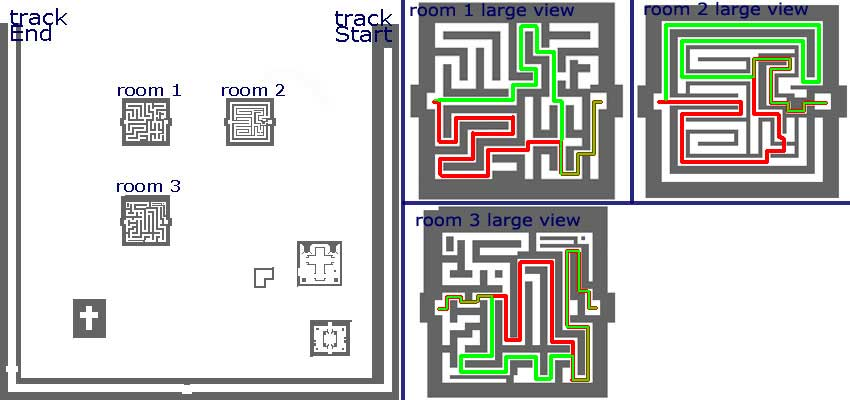

# Monk Job Change Guide

<!-- Quest info -->
- **Level requirement:** None
- **Job level requirement:** 40
- **Class requirement:** Acolyte
- **Item requirement:** Varies (See Table)
- **Item reward:** Waghnak \[3\] or Knuckle Duster \[3\]
- **Quest reward:** Jobchange to [Monk](Monk.md)
- **Window:** yes

1. Visit the Monk Abbey (prt_monk), located one map East, one map North and two maps East of [Prontera](Prontera.md).

2. Talk to Guarding Monk (58,247) then to Sensei Moohae (245,104). If you meet the qualifications, he will give you the first test, item collecting.

3. Sensei Moohae will assign you one of the following quests:

| Set | Items |
| --- | --- |
| Set 1 | 5 Cyfar, 10 Yellow Herb, 10 White Herb |
| Set 2 | 5 Solid Shell, 20 Shell, 5 Zargon |
| Set 3 | 5 Porcupine Quill, 10 Bug Leg, 20 Cobweb |
| Set 4 | 5 Sticky Mucus, 10 Earthworm Peeling, 20 Green Herb |
| Set 5 | 10 Tooth of Bat, 5 Bear Footskin, 20 Poison Spore |
| Set 6 | 30 Stem, 5 Jellopy, 10 Worm Peelings |
| Set 7 | 20 Yoyo Tail, 5 Iron Ore, 3 Blue Herb |

4. Once the items have been collected, return to Sensei Moohae. You will be directed to Elder Touha, located at (prt_monk 251, 255), in the top right area, for the memory test.

5. Elder Touha will have you remember one of the following:

*  *And sheperds we shall be, for thee my lord for thee. Power path decended forth from the hand so our feet may swiftly carry out thy command and we shall flow a river forth thee and teeming with souls shall it ever be. In nomine Patris, et Filii et Spiritus Sancti.*
*  *I seek the path of enlightenment. We monks shall hold true to what we believe and will help protect others through the teachings we learn through our lives. In nomine Patris, et Filii et Spiritus Sancti.*
*  *I commit myself to veritas and aequitas. I will follow my path to enlightenment and purity. I will protect my brothers with life. Evil shall never be victorious while I breathe. In nomine Patris, et Filii et Spiritus Sancti.*

She will read entire passage out before allowing you to recite it. There is no penalty for failing; you can simply retry the test. Once complete, you will be sent to Boohae, located at (prt_monk 57, 179), on the bottom left side of the map.

6. Boohae will give you the option of two tests: **Marathon** and **Mushroom** collecting (**This test is recommended over the Marathon, because is less risky.**). Later, the player may return to Boohae to change the test, if it is needed.

**Left**: The Marathon track for step 7a including the holes. **Right**: The Maze for Step 8. Randomly picks 1 of the 3 mazes.

7a. If you choose "Marathon": Talk to the door keeper in front of the Abby at (prt_monk 192,170). After, enter the building and find Bashu. Tell him "Marathon". He will then send you to another area.

Run around this map without falling into the pits for many laps (about 10) to complete the Marathon test. The map is shaped like a ring, with occasional holes that players can fall into. This test is easier to complete by lowering the camera angle very low (Ctrl+Shift+mouse wheel up), allowing pits far ahead to be seen easily.

Note that disconnecting will send you back to your save point. After the test is completed with the needed amount of laps,you will automatically be sent out. It takes approximately 30 minutes with [Increase Agility](Increase_AGI.md) to complete.

**Skip to Step 8.**

7b. Talk to Bashu in the bottom left building. Building door is at (prt_monk 192, 170).
Choose "Collect Mushrooms": you will be sent to another map where you must hunt two types of mushrooms (Gooey & Orange). The NPC does not tell the player that they have enough mushrooms until they have 30 of either type of mushroom. The mushrooms from the [Thief test](Thief_Job_Change_Guide.md) can also be used. While it is possible to have a prospective Thief gather the mushrooms, it should be easier to have an Acolyte with high agility and buffs to complete this test faster. It is best to do this bare-handed for maximum ASPD (since the damage is 1 even with a weapon).
The NPC to exit is located at (prt_monk 224, 180)

8. Now locate Tomoon, also found indoors within the Abbey (prt_monk 192, 170) inside what appears to be a glowing cross. He sends you to an invisible maze. Be warned that during this test, monsters will spawn, such as Zombies and Mummies. They should not be much of a challenge, but keep in mind that you don't have much maneuvering area here.

It is possible to check if a certain cell is passable by pointing the cursor at it. Walkable cells will have the usual green walk marker; if there is none, then that cell is blocked. Generally, try sticking to a straight line from the door to the exit. If there is a choice of routes, take the one that goes closer to the center line. Patience is highly required. Disconnecting in this test will send a player back to their save point.

9. Once out of the maze, talk to Tomoon again and drink the Green Potion he hands over. Then return to Moohae who, after giving a lengthy speech, job changes you into a Monk.  As a reward, he'll give you a Waghnak \[3\] or a Knuckle Duster \[3\] if your job level is 50.

**Related pages:**

* [Monk](Monk.md)
* [Champion](Champion.md)
* [Skills](Skills.md)
* [Excruciating Palm](Excruciating_Palm.md)
* [Flee (Skill)](Flee_(Skill).md)
* [Fury](Fury.md)
* [Guillotine Fist](Guillotine_Fist.md)
* [Iron Fists](Iron_Fists.md)
* [Mental Strength](Mental_Strength.md)
* [Occult Impaction](Occult_Impaction.md)
* [Raging Quadruple Blow](Raging_Quadruple_Blow.md)
* [Raging Thrust](Raging_Thrust.md)
* [Raging Trifecta Blow](Raging_Trifecta_Blow.md)
* [Root](Root.md)
* [Snap](Snap.md)
* [Spiritual Bestowment](Spiritual_Bestowment.md)
* [Spiritual Cadence](Spiritual_Cadence.md)
* [Spiritual Sphere Absorption](Spiritual_Sphere_Absorption.md)
* [Summon Spirit Sphere](Summon_Spirit_Sphere.md)
* [Spirit Sphere](Spirit_Sphere.md)
* [Throw Spirit Sphere](Throw_Spirit_Sphere.md)
* [Chain Crush Combo](Chain_Crush_Combo.md)
* [Glacier Fist](Glacier_Fist.md)
* [Raging Palm Strike](Raging_Palm_Strike.md)
* [Zen](Zen.md)
* [Quests](Quests.md)
* [Monk Job Change Guide](Monk_Job_Change_Guide.md)
* [Monk Skill Quest](Monk_Skill_Quest.md)
* [Rebirth Walkthrough](Rebirth_Walkthrough.md)
* [Weapons](Weapons.md)
* [Mace](Mace.md)
* [Knuckle](Knuckle.md)

---
**Categories:** [Acolyte](categories/Acolyte.md), [Job Change Guide](categories/Job_Change_Guide.md), [Monk](categories/Monk.md), [Quest Window Quests](categories/Quest_Window_Quests.md)
*Source: [iRO Wiki Classic](https://irowiki.org/classic/Monk_Job_Change_Guide) — GFDL 1.3+*
