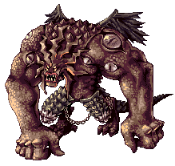
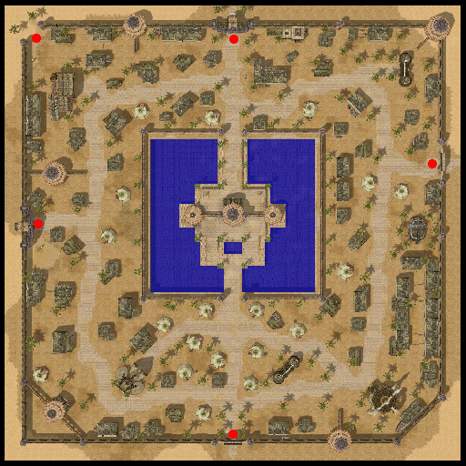
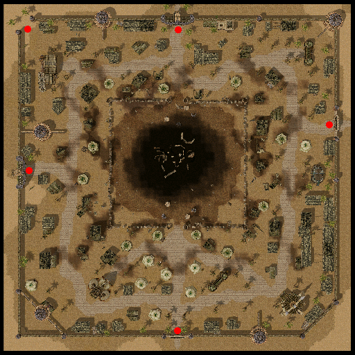
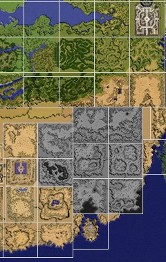

# Morroc

## About Morroc

Morroc is the desert town, located next to the Pyramids and Sphinx. It is (basically) home to the [Thief](Thief.md) and [Soul Linker](Soul_Linker.md) guilds.

## Destruction of Morroc

With the new update of Episode 12 comes the Demise of Morroc.
Morroc receives massive damage because of Satan Morroc's awakening. Due to this,
a refugee camp is set up near the Pyramids and several [NPC](NPC.md)s are displaced in the area.

## Story

Long ago, the Mage Knight Thanatos battled and sealed away the greater demon, Satan Morroc. Legend has it that the fallout from the battle destroyed the south eastern part of the Rune-Midgard Kingdom, creating what is now known as the Sograt Desert. In order to protect the seal and keep the demon locked away, the people of Rune-Midgard constructed a castle above the seal. Before long, buildings and tents were built around the castle, and this new-founded city took the name of the demon and was called "Morroc".

However, one thousand years have now passed, and Satan Morroc has awakened once again!

Morroc will never be the same again. All trace of the once great Desert-city has now disappeared, leaving only sorrow and destruction in its wake. The sacrifice of the heroes of old in sealing Midgard's most primal evil was put to waste.

The city and the desert sand around it were soaked in the blood of all living things slaughtered by its resurrection. Now freed from its evanescent bonds, all hope of shelter and refuge are lost.

The omen of destruction blooms as dark as the night in the cold desert. The evil that can twist the very fabric of reality looms across the land: the greatest peril that the Midgard Continent will ever face has arrived.

Morroc has risen.

## Quest

Quests added with the Satan Morroc update can be found [here](Quests.md).

## Morroc, the Aftermath

Following the resurrection of Satan Morocc, the city of Morroc has changed substantially. The site of the Morocc Incident, the Morroc Castle, has been completely leveled, and many of the surrounding structures destroyed or abandoned. Refugees of the Morroc Incident have set up a camp near the pyramids, with some of the services that were once provided within morroc moved to the refugee camp (moc ruins).

**The following is a list of changes you can expect to see:**

* **Kafra Service:** Teleport to Prontera added (South Kafra only).
* **Inn:** The Inn service in both the south and northeast has ended.
* **PvP:** No Change.
* **Refine NPCs:** Repairman has moved to the Refugee Camp. Others unchanged.
* **NPC Vendors:** All outdoor NPC vendors have moved to the Refugee Camp. (For example, the Tool Dealers, Jewelers, and Item Collectors have been moved while the Weapon and Armor Dealers remain in their shop in the SE corner.)
* **Dungeon Teleport Vote Service:** The Kafra/Cool Event employees running the Dungeon Teleport Voting Service have moved to the Refugee Camp.
* **Walking to Prontera:** It is still possible to walk to Prontera.  From Morroc, walk one map north (Sograt Desert 7), one map east (Dimensional Gorge).  Walk to the central northern portion of this map and you will encounter a pair of Continental Guard at the foot of a ramp just before the top of the map.  Speak to one of the guards and ask what happened.  After some dialogue, he'll give you an option to teleport to Prontera Field.  Where you are sent, however, is the southern side of Sograt Desert 1.  From here, travel two maps north to Prontera.  (Note: Due to the complication and the dangers of the Dimensional Gorge and the tendency of Dead/Bloody Branch monsters on the map south of Prontera (Prontera Field 8), Kafra Teleport from Morroc to Prontera is simpler and safer.)

 

Following the Morocc Incident, Satan Morocc retreated into the desert. Morocc used his powers in an apparent attempt to protect himself and to separate Morroc from the remainder of Rune Midgard, changing the area drastically. Entire regions the Sograt Desert simply ceased to exist, and in their place lies a twisted anomaly of Time and Space known as the Dimensional Gorge.
The following map shows which regions of the Sograt Desert have been removed:

The areas shown in grey are no longer available. All regions previously leading to those maps now bring you to the Dimensional Gorge. Because of the strange nature of the region, navigation is difficult. Members of the Continental Guard have become increasingly proficient at navigating the area, and so you should ask them for help if you need to leave. There are two other areas deeper within the crack of dimension, but because of Satan Morocc's influence within the region, only the Continental Guards are allowed to enter these areas.

## The Dimensional Gorge

*Hoarse, dark laughter echoes from the curtain of shadow cast by the crimson moon.*
*Blood is the currency of the soul," a voice whispered… The haunting whisper escorts the red moon as it descends to earth.*

*The desert sand is soaked in blood shed by the resurrected Satan.*
*As the gap of darkness rises from hell, every semblance of safety and sanctuary seems to vanish.*

*The omen of destruction blooms in the darkness of night in the cold desert.*
*The evil that can twist the delicate fabric of time and space looms across the land: the greatest peril that the* *Midgard Continent will ever face has arrived.*

...

The city in the world’s greatest desert – built on the ground over which Satan Morroc was confined – became shrouded in darkness. Although the ritual to resurrect Satan Morroc was interrupted by brave adventurers whose names are unsung, they only delayed the inevitable. Waiting for the chance to escape for ages, Satan Morroc did not miss the tiny sliver of opportunity that allowed him to break free, and he has made his reappearance in the human world.

Satan Morroc immediately started destroying all paths leading to Morroc to eliminate all possibility of him being sealed away by humans ever again. First he devastated the desert surrounding Morroc, and then he destroyed the lands to the north. No living creature in those areas survived Satan Morroc’s fury.

Adventurers and quickly spread the news of Morroc’s resurrection all around the world. Many rumors circulated as the public grew more anxious about the destruction that Satan Morroc would surely bring upon them. Adventurers have started flocking to Morroc in an organized effort to fight and confine Satan Morroc as the heroes that preceded them did. They cannot fail as Satan’s ultimate goal is not merely ruining Morroc, but destroying the entire world.

Countless warriors and allied guilds challenged Satan Morroc in hopes of saving humanity. Most of them perished in vain, and although some of them were able to defeat Morroc, Satan Morroc would immediately resurrect. Finally, a group of warriors were able to drive Morroc away to another dimension, leaving a huge time-space gap in this realm. Satan Morroc is gone for now, but no one knows how long it will take to rebuild and recover from the vast devastation that it has left behind.

## Overview

The Dimensional Gorge is an area near the town of Morroc where Satan Morroc resides added as part of Episode 12. The Dimensional Gorge is the transformed ruins of the old Sograt Desert, warped by Morrocs resurrection and home of high level monsters. Pockets of torn space riddle the desert as a result of Satan's resurrection.

Access to the Dimensional Gorge is directly out the east exit of the city of Morroc. To be allowed entrance to the Dimensional Gorge however, you must be level 80 and begin the Continental Guard quest. Within this zone, you will find many apparitions of Satan Morroc. As part of the quest, you can summon and do battle with Satan Morroc. It is recommended that you have a team of at least 20 players to properly fight him.

Upon defeat Morroc will retreat into one of the dimensional rifts. After completing the related quest, you can follow the Wounded Morroc and challenge him again as an MVP boss monster. His power here is more in line with that of a regular high end [MVP](MVP.md).

**Related pages:**

* [Towns](Towns.md)
* [Rune-Midgarts Kingdom](Rune-Midgarts_Kingdom.md)
* [Alberta](Alberta.md)
* [Al De Baran](Al_De_Baran.md)
* [Archer Village](Archer_Village.md)
* [Comodo](Comodo.md)
* [Geffen](Geffen.md)
* [Izlude](Izlude.md)
* [Morroc](Morroc.md)
* [Payon](Payon.md)
* [Prontera](Prontera.md)
* [Umbala](Umbala.md)
* [Republic of Schwartzvald](Republic_of_Schwartzvald.md)
* [Einbech](Einbech.md)
* [Einbroch](Einbroch.md)
* [Hugel](Hugel.md)
* [Juno](Juno.md)
* [Lighthalzen](Lighthalzen.md)
* [Arunafeltz States](Arunafeltz_States.md)
* [Rachel](Rachel.md)
* [Veins](Veins.md)
* [Manuk](Manuk.md)
* [Amatsu](Amatsu.md)
* [Ayothaya](Ayothaya.md)
* [Kunlun](Kunlun.md)
* [Jawaii](Jawaii.md)
* [Louyang](Louyang.md)
* [Moscovia](Moscovia.md)
* [Nifflheim](Nifflheim.md)
* [Lutie](Lutie.md)

---
*Source: [iRO Wiki Classic](https://irowiki.org/classic/Morroc) — GFDL 1.3+*
