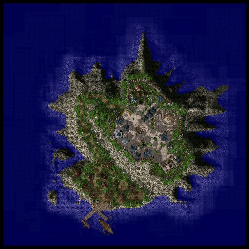

# Moscovia

## About Moscovia

Moscovia is a small rustic town located on an island off the [Rune-Midgarts](Rune-Midgarts_Kingdom.md) coast filled with unassuming people who greet you warmly.  To get to it, speak to the Moscovia PR Officer at the [Alberta](Alberta.md) docks (10,000 [Zeny](Zeny.md) fee).

## Quests

For Moscovia quests, see this page.

## Guide

## Dungeon

To access Moscovia Forest Dungeon area, you need to complete a [quest](Finding_The_Moving_Island_Quest.md) (the map with dungeon entrance can be [memo-ed](Warp_Portal.md)).

**Related pages:**

* [Towns](Towns.md)
* [Rune-Midgarts Kingdom](Rune-Midgarts_Kingdom.md)
* [Alberta](Alberta.md)
* [Al De Baran](Al_De_Baran.md)
* [Archer Village](Archer_Village.md)
* [Comodo](Comodo.md)
* [Geffen](Geffen.md)
* [Izlude](Izlude.md)
* [Morroc](Morroc.md)
* [Payon](Payon.md)
* [Prontera](Prontera.md)
* [Umbala](Umbala.md)
* [Republic of Schwartzvald](Republic_of_Schwartzvald.md)
* [Einbech](Einbech.md)
* [Einbroch](Einbroch.md)
* [Hugel](Hugel.md)
* [Juno](Juno.md)
* [Lighthalzen](Lighthalzen.md)
* [Arunafeltz States](Arunafeltz_States.md)
* [Rachel](Rachel.md)
* [Veins](Veins.md)
* [Manuk](Manuk.md)
* [Amatsu](Amatsu.md)
* [Ayothaya](Ayothaya.md)
* [Kunlun](Kunlun.md)
* [Jawaii](Jawaii.md)
* [Louyang](Louyang.md)
* [Moscovia](Moscovia.md)
* [Nifflheim](Nifflheim.md)
* [Lutie](Lutie.md)

---
*Source: [iRO Wiki Classic](https://irowiki.org/classic/Moscovia) — GFDL 1.3+*
