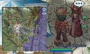
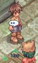
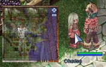
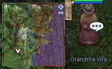

# Mother's Day Quest (2007/05/08) ~ (2007/05/15)

> **Note:** Not implemented on iRO Classic.

**Item Requirements : 10 Monster's Feed, 2 Mastela Fruit, 5 Firecracker, 3 Prize Medal.**

**Quest Rewards: Base Exp (based on level) or Yggdrasil Berries at level 99**

## Quest

1. Start at (91,144) in Hugel and speak with Mrs. Brando.

2. Tell her you will help find her family.
3. Next is the son in the tool shop.

4. He will ask for 10 monster feed and 1 prize medal.
*  Receive Base Experience.
5. After that is his sister near the fruit vender (76,163). (NW of Mrs. Brando and left of the tool shop.)

6. She wants 2 Mastela Fruit and 1 prize medal.
*  Receive Base Experience.
7. Then find Mr. Brando in the Fireworks Shop.

8. He wants 5 fireworks and... you guessed it, 1 prize medal.
*  Receive Base Experience.
9. Before you leave, talk to Mr. Brando again and he will tell you to talk to his wife.
10. Return to Mrs. Brando and tell her what her family was doing.
*  Kipp was buying "Monster's Feed"
*  Cherice was buying "Mastela Fruit"
*  Mr. Brando was buying "Firecracker"
11. Now go find Grandma Vira next to the monster races (63,63).

12. Just talk to her and she will mention she wanted to teach Mrs. Brando a lesson.
13. Return to Mrs. Brando and she will tell you what she learned.
*  Receive Base Experience.
14. Talk to Grandma Vira and type in "Love of the family".
*  Receive Base Experience.

## Reward (no job exp)

*  4 Yggdrasil Berries and 4,700 base exp at level 99 non-trans.
*  1,000,000 base exp at level 97 non-trans.
*  900,000 base exp at level 95 non-trans.
*  880,372 base exp at level 93 trans.
*  423,160 base exp at level 89 non-trans.
*  300,000 base exp at level 70 non-trans.
*  2.4% exp at level 85 trans.
*  3.0% exp at level 74 trans.

## Notes

*  Quest has been fixed for level 99 characters.

---
**Categories:** [Base Experience Reward](categories/Base_Experience_Reward.md), [Quests](categories/Quests.md), [Temporary Event Quests](categories/Temporary_Event_Quests.md)
*Source: [iRO Wiki Classic](https://irowiki.org/classic/Mother%27s_Day_Quest_%282007/05/08%29_~_%282007/05/15%29) — GFDL 1.3+*
