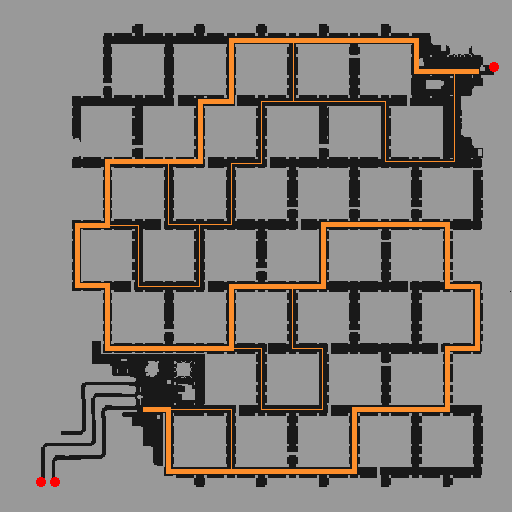

# Mt. Mjolnir Dead Pit

The Mt. Mjolnir Dead Pit is an abandoned mine dungeon located to the northeast of [Geffen](Geffen.md).  The entrance to the Dead Pit is located in the northwest corner of Mt. Mjolnir 02.  Kafra teleportation services to this dungeon are provided from [Geffen](Geffen.md) and [Al De Baran](Al_De_Baran.md) for 1,700z.

## Level Breakdown

The dungeon consists of three levels, with monster levels ranging from 8 to 56.

The first level is fairly easy to navigate through.  Monsters players will encounter here are Familiar, Martin, and Tarou.

The second level of the dungeon is a maze, and can be rather difficult to get through if not prepared.  Players should expect to see Drainliar, Giearth, Martin, and Skel Worker on this map.  Most players wishing to pass through this map will attempt to Teleport or use Fly Wings to get from one end to the other.  However, should neither of those options be available, here is a guide showing the main path and sub-paths through this level:

The third level of this dungeon is prone to mob conditions, and it is strongly recommended that low leveled players come to this level with ample amounts of supplies (healing items, fly wings, etc).  Expect to see Cramp, Giearth, Martin, Myst, and Skel Worker on this level of the dungeon.

---
**Categories:** [Dungeons](categories/Dungeons.md), [Places](categories/Places.md)
*Source: [iRO Wiki Classic](https://irowiki.org/classic/Mt._Mjolnir_Dead_Pit) — GFDL 1.3+*
