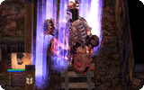

# NPC CALLSLAVE

## Description

*  Supportive skill
*  Levels: 1

The caster will teleport any slaves they have created using [Summon Slave](NPC_SUMMONSLAVE.md) back to themselves. This skill affects all slave monsters belonging to the caster on the map, regardless of their current location.

## See also

*  [NPC SUMMONSLAVE](NPC_SUMMONSLAVE.md)

---
**Categories:** [Monster Exclusive Skills](categories/Monster_Exclusive_Skills.md)
*Source: [iRO Wiki Classic](https://irowiki.org/classic/NPC_CALLSLAVE) — GFDL 1.3+*
