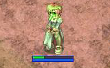

# NPC CHANGEUNDEAD

## Description

## Change Undead

* Offensive Skill
* Levels: 5
* Element: [Undead](Undead.md)
* Duration: ??

The caster changes the target's property to Undead. During this state, the player receives all the qualities of being Undead element, such as vulnerability to [Heal](Heal.md) and [Sanctuary](Sanctuary.md) (or immunity to them in a non-PvP zone), and taking extra damage from [Holy](Holy.md) and [Fire](Fire.md) attacks while being immune to Undead, [Shadow](Shadow.md), and [Poison](Poison.md) attacks.

## Notes

* The player appears in a greenish hue when afflicted by the undead status.
* Prior to the update iRO received on 16 February 2007, this status effect was visible to everyone except the player affected by this skill.
* The player can't use supportive spells such as Increase Agility and Blessing on itself or others.
* Increase Agility and Blessing do 1 damage to the player when cast by others. Despite this, they can not be copied by a Rogue class with [Intimidate](Intimidate.md).
* Increase Agility and Blessing and potentially other buffs are removed as soon as this status takes effect.
* Can be prevented by wearing Shadow or Undead elemental armor.
* Re-logging gets rid of the status.

---
**Categories:** [Monster Exclusive Skills](categories/Monster_Exclusive_Skills.md)
*Source: [iRO Wiki Classic](https://irowiki.org/classic/NPC_CHANGEUNDEAD) — GFDL 1.3+*
