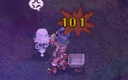

# NPC CRITICALSLASH

## Description

*  Offensive skill
*  Levels: 1
*  Element: [Neutral](Neutral.md)

Deals a [Critical Attack](Stats.md).

Monsters differ from players in that they do not normally crit; they must manually cast this skill to deal a critical hit. Cast Time is unbreakable. Damage can be reduced by wearing Ghostring Carded armor.

---
**Categories:** [Monster Exclusive Skills](categories/Monster_Exclusive_Skills.md)
*Source: [iRO Wiki Classic](https://irowiki.org/classic/NPC_CRITICALSLASH) — GFDL 1.3+*
