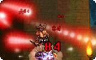

# NPC DARKSTRIKE

## Description

*  Offensive skill
*  Levels: 10
*  Element: [Shadow](Shadow.md)

A variant of the Mage class skill [Soul Strike](Soul_Strike.md). It summons reddish ghosts that damage the target.

| Skill level | Number of Strikes |
| --- | --- |
| 1 | 1 |
| 2 | 1 |
| 3 | 2 |
| 4 | 2 |
| 5 | 3 |
| 6 | 3 |
| 7 | 4 |
| 8 | 4 |
| 9 | 5 |
| 10 | 5 |

## Obtainable via

* Necromancer's Hood - Lv. 5 when being attacked

---
**Categories:** [Monster Exclusive Skills](categories/Monster_Exclusive_Skills.md)
*Source: [iRO Wiki Classic](https://irowiki.org/classic/NPC_DARKSTRIKE) — GFDL 1.3+*
