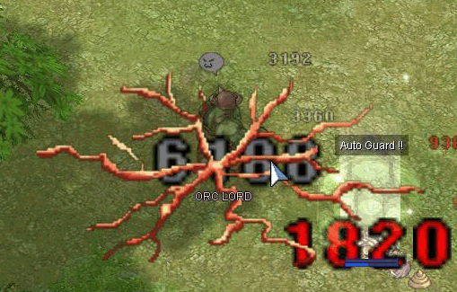

# NPC EARTHQUAKE

## Description

## Earthquake

* Magical Multi-Target Splash Attack
* Levels: 10
* Target: Self
* Element: [Neutral](Neutral.md)

Massive neutral element magical damage based on the monsters physical attack power, dealing 3 hits in rapid succession. Each hit is calculated separately, like the skill [Water Ball](Water_Ball.md).  Damage can be reduced by Raydric and Ghostring cards.  The damage dealt is split across all players hit by the skill.  Has a visual effect that looks like cracking earth.

| Level | Area | [ATK](Stats.md) Modifier |
| --- | --- | --- |
| 1 | 11x11 | 300%x3 hits |
| 2 | 15x15 | 500%x3 hits |
| 3 | 19x19 | 600%x3 hits |
| 4 | 23x23 | 800%x3 hits |
| 5 | 27x27 | 1000%x3 hits |
| 6 | 11x11 | 1200%x3 hits |
| 7 | 15x15 | 1300%x3 hits |
| 8 | 19x19 | 1500%x3 hits |
| 9 | 23x23 | 1600%x3 hits |
| 10 | 27x27 | 1800%x3 hits |

## Reducing Damage

The following skills **do not** block Earthquake:
* [Magnetic Earth](Magnetic_Earth.md)
* [Pneuma](Pneuma.md)
* [Safety Wall](Safety_Wall.md)

The following skills **can** block **one** hit of Earthquake:
* [Kaupe](Kaupe.md)
* [Tumbling](Tumbling.md)
Note that these skills can only prevent the first hit, leaving them vulnerable for the next two hits.

Cards and equipment that reduce [Neutral](Neutral.md) element or ranged damage can help reduce damage, amongst them:
* Asprika
* Deviling Card
* Ghostring Card
* Golden Theifbug Card
* Raydric Card
* Alligator Card
* Horn Card
* Racial reduction cards such as Thara Frog

## Notes

* Having the most players possible in the area is ideal, as the damage will be more spread out.
* When the monster using the skill goes into [Power Up](NPC_POWERUP.md), the Earthquake damage is also multiplied by 3x.
* Wearing a Golden Thiefbug Carded equipment will enable the user to avoid being hit.

* Damage is recalculated on each of the three hits. If characters die during the first or second hit of Earthquake, the damage of subsequent hits will no longer be divided amongst them.

## Obtainable via

* Ifrit Card - Lv. 10 when being attacked

---
**Categories:** [Monster Exclusive Skills](categories/Monster_Exclusive_Skills.md)
*Source: [iRO Wiki Classic](https://irowiki.org/classic/NPC_EARTHQUAKE) — GFDL 1.3+*
