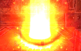

# NPC SELFDESTRUCTION

## Description

## Self Destruction

*  Offensive skill
*  Effects Levels: 1
*  Element: [Fire](Fire.md)

The caster will explode, instantly killing itself and hitting everything around it for damage equivalent to the caster's remaining HP. This damage ignores DEF, but is affected by equipment or effects that increase/reduce damage from the proper race or element. The skill will also push away anything in the blast radius.

This skill affects both players and other monsters caught in the blast. Experience and item drops are also still rewarded for the caster's death.

## See also

*  [Summon Marine Sphere](Summon_Marine_Sphere.md)
*  [Self-Destruction](Self-Destruction.md)

---
**Categories:** [Monster Exclusive Skills](categories/Monster_Exclusive_Skills.md)
*Source: [iRO Wiki Classic](https://irowiki.org/classic/NPC_SELFDESTRUCTION) — GFDL 1.3+*
