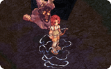

# NPC STOP

## Description

*  Offensive skill
*  Levels: 1
*  Duration: 15 seconds

Prevents both the caster and the target from moving for the duration. However, they can still attack or use skills if anybody (including each other) is within their attacking range. If either the caster or target dies or teleports away during the skill, it is automatically cancelled.

There is a glitch where if the player has the [Teleport](Teleport.md) Menu open and presses Cancel, the Stop effect will also be cancelled.

This skill works on a single timer that is reset only if the caster or target is killed, if the Teleport skill is used (including through the use of the above glitch), or if the duration runs out. If multiple Stops are casted on the target before the initial timer runs out, they will all wear off at the same time when it ends.

---
**Categories:** [Monster Exclusive Skills](categories/Monster_Exclusive_Skills.md)
*Source: [iRO Wiki Classic](https://irowiki.org/classic/NPC_STOP) — GFDL 1.3+*
