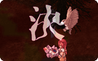

# NPC SUICIDE

## Description

*  Supportive skill
*  Levels: 1

The caster will immediately kill itself. No experience or drops are rewarded for monsters who kill themselves using this skill.

---
**Categories:** [Monster Exclusive Skills](categories/Monster_Exclusive_Skills.md)
*Source: [iRO Wiki Classic](https://irowiki.org/classic/NPC_SUICIDE) — GFDL 1.3+*
