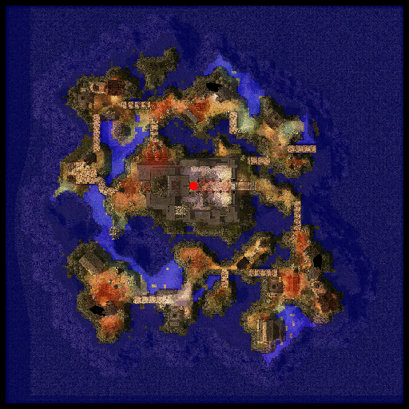

# Nameless Island

## About Nameless Island

A mysterious island off the coast of the Arunafeltz Peninsula.
The island may appear charmingly beautiful under the sunlight, but its true nature is revealed after the sun sets: eerie groans can be heard over the walls of the monastery where visiting [Monk](Monk.md)s and [Priest](Priest.md)s have inexplicably vanished. The truth and the terror of the monastery will be revealed in the darkness of the night.

## Story

*Some secrets should never be discovered...*

Legends tell the tale of tragedy and horror.

Once there was an island far off the coast of Arunafeltz . It is said that a man came across this island in hopes of running away from his past and starting a new life. Soon, a small number learned of this island and they too traveled here seeking rebirth. A community was slowly established with a few small houses here and there. Only one building stood out, the monastery at the center of the island. A place of faith and worship, a place where they could hope for Freya's divine absolution from their past sins. Time passed and the community was able to get by peacefully.

Until one fateful day…

On a stormy night, a small boat mistakenly made its way to the island. The boat lay in ruins but its passenger survived. This man was a criminal.. As this man looked around, an evil smile began to form on his face. He has found refuge – a place to escape from the hands of justice. He spread the word to his fellow criminals. They could now commit any crime they want and should they need to escape, this island would hide them until the heat has passed.

And so it began…
The criminals went about their sinful existence and sought the island for refuge. They would bring stolen goods and treasure, and even store it at the monastery itself! They mercilessly took control of the inhabitants – they looted the and killed any one who stood in their way. They would abuse all the women of the island and would torture or enslave anyone. Blood continued to spill and the island slowly became wrapped in an aura of vengeful malice. They say a blood mist started to form around the island which grew thicker and thicker. It almost seemed to choke the island itself.

One day, people from Arunafeltz claimed that they saw an eerie glow in the sea… along with it was a faint sound of what seemed like a whole village screaming. From then on, the island was said to have disappeared.

For years, the island could not be found, until recently. Now there are rumors saying that the island has reappeared once again. Many treasure hunters attempted journeying to the island in search of hidden treasures. Many disappeared forever. The few who returned, however, lost their sanity from fright. Muscled bandits turned into blabbering idiots speaking of curses and evils.

The Island has returned from the other world. Should you choose to go there? traveler, heed my words:

*“Abandon all hope if you choose to enter! What awaits is an evil beyond imagination! Can you survive the horrors of the Nameless Island?"*

## Quest

Quests added with the Nameless Island update can be found [here](Quests.md).

## Guide

 

## Dungeon

* **Cursed Monastery**

Various monsters can be found haunting the cursed abbey.
A Hellhound that is believed to be someone's beloved pet that was twisted into a demonic monster by breathing the cursed air of the monastery. They silently approach travelers before viciously attacking.
Several floating Flame Skulls which seemed to be the innocent visitors and adventurers that were beheaded by the criminals. The skulls of these disturbed spirits hover inside the empty monastery looking for their bodies in vain.
Ragged Zombies that likely was once a villager on the island, that attacks by throwing their own bones at you.
Zombie Slaughters that has the appearance of an Undead [Rachel](Rachel.md) guard. They attack you using farm utensils that they carry in their only remaining arm. And a Banshee that was once a priestess in the monastery and has returned from the dead to torment and curse adventurers who are immoral heretics in her eyes.

The Cursed Monastery is also home for the two exclusive [MVP](MVP.md)s ingame.
The Fallen Bishop Hibram: Once a respected [High Priest](High_Priest.md) of the Arunafeltz, Hibram's blind faith caused him to fall to the evil which he summoned into this world. Hibram appears in his quarters in a room near the bottom right of 2F of the Monastery. He soullessly kills all travelers who enters his territory.
The last level of the dungeon is where the "Lord of the Flies" resides: The Beelzebub.
Only few would dare to challenge this MVP because of his 6,666,666 hit points, not to mention his skills that tends to slow down the opposing team. Various status effects and wide area of attacks plus his Hell Flies making him one of the strongest MVP in the game following the Biolab MVPs and Ifrit. Battling him would be time consuming and needs a huge amount of party members with different character classes in it. But the whole thing is worthwhile because of the rare items and equipments that he drop and the amount of Experience he yields.

---
**Categories:** [Places](categories/Places.md)
*Source: [iRO Wiki Classic](https://irowiki.org/classic/Nameless_Island) — GFDL 1.3+*
