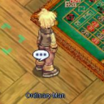
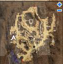
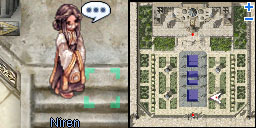
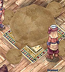
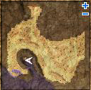
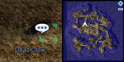
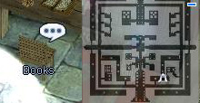
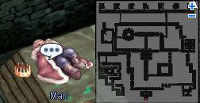

# Nameless Island Entrance Quest

<!-- Quest info -->
- **Level requirement:** 80
- **Zeny requirement:** 3,000 Zeny
- **Quests required:** [Rachel Sanctuary Quest](Rachel_Sanctuary_Quest.md), [Curse of Gaebolg (Founding of the Nation Myth Quest)](Curse_of_Gaebolg_(Founding_of_the_Nation_Myth_Quest).md), [Veins Siblings Quest](Veins_Siblings_Quest.md)
- **Base EXP reward:** 1,500,000
- **Item reward:** 4 Assorted Seafood
- **Quest reward:** Access to map nameless n, Cursed Monastery (abbey01, abbey02, abbey03)
- **Window:** yes

1. Talk to the Agent on the lower level of the International [Airship](Airship.md).  He tells you to go visit Father Bamph in the [Prontera](Prontera.md) Church.

2. Meet with Father Bamph in Prontera. He tells you to meet with a contact in the [Comodo](Comodo.md) Casino by the name of Larjes concerning a missing Midgard official.

3. On the first floor (lower level) of the Comodo Casino (comodo 140, 115) you'll see an "Ordinary Man" (cmd_in02 174, 89). After talking to him he will pull you aside to talk. Talk to him once more, and he'll ask you to return to Father Bamph.

4. Return to Father Bamph. Keep talking to him until he makes up his mind about what to do. He ask for your help, and send you to [Rachel](Rachel.md) to investigate.

5. In the Rachel Inn (rachel 115, 147), talk to the Waiter (ra_in01 308, 59) and tell him you wish to order. You will overhear a conversation concerning a famous "fish" caught near [Veins](Veins.md).  After the conversation you will spend 3000 [Zeny](Zeny.md) (if you have it) and obtain 4 Assorted Seafood.

6. Proceed to Veins and in a building on the left end of the city (veins 86, 170), talk to the Magistrate by the name of Al Hamad. Ask him if he's in trouble.  When he gives you the brushoff, talk to the guard by the door, and then come back and question Al Hamad further. He will tell you that you need a written order from a high ranking official in order to divulge information.

7. Go to High Priest Zhed in the Rachel Sanctuary. Note that you must have completed the [Veins Siblings Quest](Veins_Siblings_Quest.md) in order to advance further.

8. Outside of the sanctuary, you'll need to talk to the High Priest Niren (ra_temple 165, 57), and inquire about the smugglers. She will send you back to the Magistrate.

9. Return to the Magistrate. He will provide you with some more information regarding the smugglers.

10. Go to the Veins tavern (veins 149, 217) and speak to the first Drunkard.  He babbles about his fishing boat.

11. Talk to his son, Karyn (veins 327, 185), who you helped during the [Veins Siblings Quest](Veins_Siblings_Quest.md). He'll let you use his father's boat to access the monastery.

12. South of Veins you'll find a boat. (ve_fild07 128, 131) When you investigate it, you'll be greeted by Larjes. Talk to Larjes or use the boat to go to the Nameless Island.

13. You'll need to investigate the island. There are triggers just west of the docks and inside a house near the top center, but these are not required. To continue, click on the Dead Crow (nameless_i 125,205) and investigate it.

14.  Once you wake up, you'll find yourself inside a house with Larjes. When you attempt to leave the house, you'll be attacked by a Zombie Slaughter. The monster must be killed before the house can be exited. There is no death penalty if you die at this encounter. After you leave the house, you will be able to freely enter and leave Nameless Island night map.

* Note: *Once you leave the house, you will be on the Nameless Island (Night) map, where there are numerous aggressive monsters. You will lose experience if you die here.*
*  ''If you die inside the house while trying to kill the Zombie Slaughter, you will respawn. If this happens, just go back to Nameless Island and enter the first house on the north path. Be cautious because when you enter the Zombie Slaughter will attack you without warning this time.

15. Following up with your investigation, you will have to make your way to floor 2 of the Monastery and investigate the Books on a desk in Hibram's quarters (abbey02 223,68).

16. Continue to floor 3 of the Monastery. In the top right most corner of the map in a prison cell you will find a Man collapsed on the ground. When you investigate the body, you will be attacked by the King's Corpse. This battle is fairly easy, if you can kill the regular monsters in the monestary you should be able to kill him.

17. Once killed, you can retreive the Token of King from the body.

18. Return to Larjes at the docks on Nameless Island, and give him the Token of King. You will be rewarded with 1,000,000 Base Experience.

19. Visit Father Bamph in Prontera again, and report your findings to him.

20. Return to High Priest Niren. You will be rewarded with 500,000 Base Experience.

---
**Categories:** [Base Experience Reward](categories/Base_Experience_Reward.md), [Nameless Island Quests](categories/Nameless_Island_Quests.md), [Quest Window Quests](categories/Quest_Window_Quests.md)
*Source: [iRO Wiki Classic](https://irowiki.org/classic/Nameless_Island_Entrance_Quest) — GFDL 1.3+*
