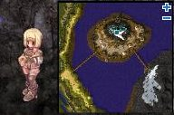
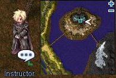
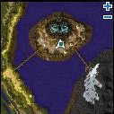
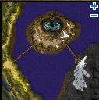
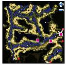
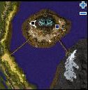
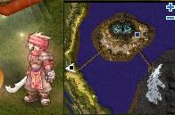
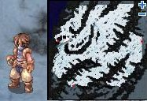
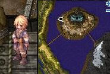

# New Surroundings

> **Note:** Not implemented on iRO Classic.

<!-- Quest info -->
- **Level requirement:** 70
- **Item requirement:** 20 Ordinary Branch, 20 Strong Vine
- **Quests required:** [Onward to the New World Quest](Onward_to_the_New_World_Quest.md)
- **Base EXP reward:** 1,000,000
- **Job EXP reward:** 100,000
- **Item reward:** 20 Chocolate Pie, 1 Old Purple Box
- **Window:** yes

1.  Talk to Marian (mid camp 222, 283), who tells you to talk to Instructor Lugen, and gives you a Chocolate Pie.

  * 

1.  Talk to Instructor Lugen (261, 284), who says you need to register with the Receptionist at the big building in the center of the camp.

  * 

1.  Enter the building (215, 247), and talk to Receptionist Brink. He registers you, gives you another Chocolate Pie, and sends you back to Lugen.

  * 

1.  Lugen gives you another Chocolate Pie, and tells you to go to the Barracks to rest for the night.
1.  At the Barracks (mid camp 264, 260), speak to Diego (mid camp 264, 263) and offer to help him.

  * 

1.  He asks you to bring him 20 Ordinary Branch and 20 Strong Vine.
  * Strong Vine is dropped by Nephentes on the first Manuk Field

1.  On the map to the west (spl fild02), click on one of the trees at (232, 143), (306, 152), or (379,197) until you have 20 Ordinary Branch

1.  Return to Diego with the parts, he asks you to fix the posts with them.
1.  Speak to one of the Posts near Diego and select *Attach the Tree Bar* then *Tie it with vines*. Repeat this til the post has been fixed and then select the option *Knot it*.
1.  Do the same to the other post, once it is repaired, talk to Diego again.
  * Recieve 5 Chocolate Pie.
1.  You will then be warped inside to your bed. Speak to Lucas.
  * Recieve 1 Chocolate Pie.
1.  Return to Instructor Lugen (mid camp 261, 284) who asks you to distribute some supplies. He directs you to Marian.
  * Receive 1 Chocolate Pie.
1.  Speak to Marien and receive 3 Supply Box and 1 Chocolate Pie.
1.  Instructor Lugen tells you to deliver the 1st box to Jan, northwest of the camp.
1.  Deliver the supplies to Jan (mid camp 162, 298)
  * Receive 1 Chocolate Pie.

  * 

1.  Return to Instructor Lugen. Your next delivery is to Gerard across the west bridge.
1.  Delivery the supplies to Gerard (mid camp 30, 168) and return to Instructor Lugen.
  * Receive 1 Chocolate Pie.

  * 

1.  The last delivery is to Alberto (man fild01 80, 248) at the entrance to the east field. He asks for your help to open the box.
  * Receive 1 Chocolate Pie.

  * 

1.  Instructor Lugen thanks you for your help.
1.  Continue talking to Lugen until he asks you to deliver a letter for him.
  * Receive 1 Letter to Otto.
1.  Deliver his letter to Otto (mid camp 123, 290). Otto has a letter for you to send back to Lugen.
  * Receive 1 Letter to Lugen.
  * Receive 1 Chocolate Pie.

  * 

1.  Deliver Otto's Letter to Lugen.
  * Receive 5 Chocolate Pie.
  * Receive 1 Old Purple Box.
  * Receive 1,000,000 [Base EXP](Base_EXP_Chart.md)
  * Receive 100,000 [Job EXP](Job_EXP_Chart.md)

---
**Categories:** [Ash Vacuum Quests](categories/Ash_Vacuum_Quests.md), [Base Experience Reward](categories/Base_Experience_Reward.md), [Job Experience Reward](categories/Job_Experience_Reward.md), [New World Quests](categories/New_World_Quests.md), [Quest Window Quests](categories/Quest_Window_Quests.md)
*Source: [iRO Wiki Classic](https://irowiki.org/classic/New_Surroundings) — GFDL 1.3+*
