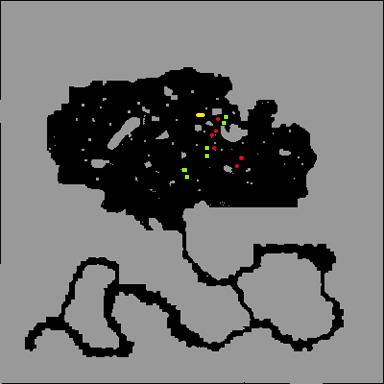

# Nidhoggur's Nest

> **Repeatable** — cooldown: three (3) day

<!-- Quest info -->
- **Level requirement:** 70
- **Party requirement:** 2+ Members
- **Quests required:** None
- **Quest reward:** Ability to fight Nidhoggur's Shadow
- **Window:** yes

1.  With 2 or more people in your [Party](Party.md), the party leader must speak with Matt Roy Shka outside the Geffen Tower at (geffen 119, 99) and "Accept Admission".
1.  After the dungeon is created, speak to the NPC again to enter the dungeon.
  * **Note:** A window will appear showing pertinent time limits for the dungeon. If it is closed, it can be opened again with with the shortcut Alt+B.
  * **Note 2**: **There is a 2.5 hour time limit for completing the quest before the instance is destroyed.**
1.  Speak to the Murdered Yggdrasilid near the center of the main room. (213,277)
1.  Kill 12 monsters named "Nidhoggur's Guardian".
  * **(Phylla Guardian: red, Rhyncho Guardian: green, yggdrasilid npc : yellow)**

  * 

1.  Go to floor 2 via the portal at the north end of the room.
  * **Note**: If you get disconnected at anytime after going to the 2nd floor, you will be unable to re-enter the instance until the cool down has expired.

1.   

1.  Work your way through a short maze.
1.  At the end of the maze, you will warp to the boss room. Once the party leader steps forward Nidhoggur's Shadow will spawn at the center of the room.
1.  Approximately every 3 min while fighting Nidhoggur's Shadow, the entire party will be warped to 1 of 4 side rooms. They will receive several [Status Effects](Status_Effects.md) that last for 30 seconds and ignore all resistances/immunities. 3 Ryncho and 2 Phylla will spawn in the side room with the party, they must be defeated before the party can leave the room.
1.   Southwest (red) room: HP-75%, [Bleeding](Status_Effects.md) Ailment (icon does not show)
1.   Northwest (blue) room: HP-50%, [Frozen](Status_Effects.md) Ailment
1.   Southeast (yellow) room: SP-50%, [Sleep](Status_Effects.md) and [Chaos](Status_Effects.md) Ailments
1.   Northeast (green) room: HP-25%(?), SP-50%, [Poison](Poison.md) Aliment
  * **Note**: ''' The monsters are able to leave the room before they party is, which makes them impossible to be killed. Be sure not to let this happen.
  * Players will not be able to enter another Nidhoggur's Nest instance until after **three days**.

**Related pages:**

* [Instance](Instance.md)
* [Endless Tower](Endless_Tower.md)
* [Nidhoggur's Nest](Nidhoggur's_Nest.md)
* [Orc Memory Dungeon](Orc_Memory_Dungeon.md)
* [Sealed Shrine Quest](Sealed_Shrine_Quest.md)

---
**Categories:** [Instances](categories/Instances.md), [Quest Window Quests](categories/Quest_Window_Quests.md)
*Source: [iRO Wiki Classic](https://irowiki.org/classic/Nidhoggur%27s_Nest) — GFDL 1.3+*
