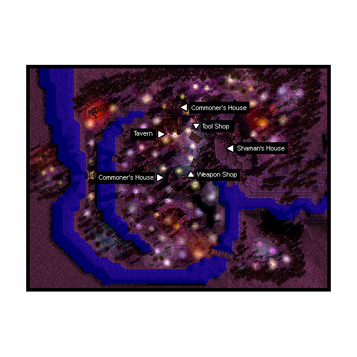

# Nifflheim

## About Nifflheim

It is known as the town of the dead. Although the town has the same accommodations as a normal town such as weapon shop, armor shop and tool shop, monsters freely wander about the town as well. Nifflheim consists of one town map and 3 fields. A creepy atmosphere envelops this town that is infamous for the disappearance of thousands of adventurers. Since so many have already failed to investigate this area, any future adventurers had better prepare themselves for the journeys in Nifflheim. To access the town, you must walk through the [Umbala](Umbala.md) dungeon, through the Yggdrasil Tree, and then through one field map. Nifflheim has two field maps and no dungeon.

**Note:** *It is also possible to reach Nifflheim by trying your luck on the Bungee Jump Tower in [Umbala](Umbala.md).*

**Note:** *If you die in town you WILL lose EXP! Be careful when idling there!*

## Story

After conducting much research, scholars have concluded that the famous Tree of Umbala might be a part of the legendary Yggdrasil Tree. They began to wonder where the tree may lead them. Rumors of an incredible fortune at the end of the tree were spread amongst the adventurers of the [Rune-Midgarts Kingdom](Rune-Midgarts_Kingdom.md). It wasn`t long before brave fortune seekers started traveling into the Umbala tree. One by one, they entered with hopes of finding a dreamland where they could find vast riches. Strangely enough, they never came back. Alarmed by the number of missing people, Tristram III, the King of Rune-Midgarts, ordered his troops to find out what happened to them.

Many [Priest](Priest.md)s, [Crusader](Crusader.md)s and [Knight](Knight.md)s ventured inside the tree of Umbala in order to investigate these mysterious disappearances. Unfortunately, the few that did return seemed traumatized and had vacant looks in their eyes as if their souls had been wrenched from them. They were asked many questions, but they always replied incoherently: "Dead...everything`s dead over there....f-freezing..."

Tristram III realized that his troops alone may not be able to investigate this matter, and started to encourage the adventurers of Rune-Midgarts to explore the Umbala tree to find answers. He sent some of his guardian knights to support the adventurers that would aid his cause. The [Prontera](Prontera.md) Sanctuary, by order of Tristram III, sent Priests and Crusaders to lend their assistance. Well experienced [Sage](Sage.md)s from Juno`s Schweicherbil Magic Academy also joined the throngs of adventurers to explore and investigate what lay beyond the tree of Umbala. The adventure to explore the legend of Yggdrasil had begun.

## Quests

Quests added with the Nifflheim update can be found [here](Quests.md).

## Guide

## Structures

## Buildings

* 1 - House #1 (167,161)
* 2 - House #2 (188,241) and (202,249)
* 3 - Pub (189,208)
* 4 - Tool Shop (218, 197)
* 5 - Weapon Shop (218,170)
* 6 - Witch's Castle (254,193)

## Billboards and Signs

* Bulletin Board (200,191) - Gives background information on Niflheim

## NPCs

## Regulars

Roaming Man - Ricael (107,156)
Egnigem (109,254)
  Shows Witch's castle, Tool Shop, Weapon Shop, Pub on minimap
Kafra Employees - Undead Kafra Employee (202,180) Dangerous NPC.
  Kafra storage (150z)

## Store NPCs

Axe Merchant (Weapon Shop)
  Axe, Battle Axe, Hammer, Buster, Two-handed Axe
Armor Dealer (Weapon Shop)
  Hood, Hood, Muffler, Muffler, Manteau, Manteau
Tool Dealer (Tool Shop)
  Pumpkin, Jack o' Pumpkin, Tree Root, Antelope Horn, Pet Food, Poisonous Powder, Single Cell

## Trade NPCs

Deviruchi (House #1)
  *Married characters who decline his offer are kicked out of the house.*
  Divorces players for 2,500,000 Zeny

## Quest NPCs

Hein (187,280)
  Nifl Level 4 weapon quest
Waltboughst (331,72)
  Nifl Level 4 weapon quest
Reyghema (99,268)
  Nifl Level 4 weapon quest
Kayron (240,193)
  Nifl Level 4 weapon quest
<South tombstone> (169,71)
  Part of [Piano Keys Quest](Piano_Keys_Quest.md)
<North tombstone> (208,103)
  Part of Piano Keys Quest
Alreg (224,243)
  Part of Piano Keys Quest. Dangerous NPC.
Feylin (153,215)
  Part of [Message Delivery Quest](Message_Delivery_Quest.md)
Cursed Spirit - Ashe Bruce (350,258)
  see Cursed Spirit section
Kuzkahina (Pub)
  Part of Piano Keys Quest
Crayu (House #2)
  Part of Piano Keys Quest
Piano (Witch's Castle)
  Part of Piano Keys Quest

## Travel NPCs

Witch (Witch's Castle)
  *Secret room can only be accessed after completing [Piano Keys Quest](Piano_Keys_Quest.md)*
  Umbala - free

## Other NPCs

* Keedz (52,147) - *talks about not letting any living person into Nifl.*
* Gigantia (195,211) - *talks about Lord of Death and death.*
* Undead Chicken (Pub) - *talks about being undead and bites you. Dangerous NPC.*
* Undead Familiar - Vatoman (Pub) - *talks about your sucking your blood and actually does so. Dangerous NPC.*
* Child - Alakina Ann (House #1) - *talks about curses, mentions the first two lines of the Cursed Spirit's chant.*

## Other

## Dangerous NPCs

Niflheim has a unique feature: several life-threatening NPCs. When you talk to them, they take away a portion of your [HP](Max_HP.md) and/or [SP](SP.md). The HP loss is not damage, and thus cannot be reduced by [Kyrie Eleison](Kyrie_Eleison.md) or similar effects. The HP loss will not kill you, even if it reduces your HP to 0. All drain percentages are rounded down to the nearest full HP/SP.

* Alreg drains 30% of max HP.
* Undead Chicken drains 5% of max HP.
* Undead Familiar drains 5% of max HP.
* The Kafra has three different drains:
  * Choosing cancel drains 25% of max SP.
  * Choosing storage drains 10% of max SP.
  * Choosing storage while unable to afford it drains 50% of max HP and max SP.

## Cursed Spirit

When you talk to the spirit, it will tell you you're cursed, like everyone else. It will also try to keep you from touching the books nearby, but who listens to threats?

* Choosing the first book summons a Rideword.
* Choosing the second book teleports you to another location on the map.
* Choosing the third book lets you recite the incantation. Getting it wrong summons a group of Orc Skeleton.

The summoned monsters yield no experience or items, and talking to the spirit again will banish them. The incantation requires you to select three words to say. If you don't already know the chant, you can learn the first two words from the Child NPC. The third is an "invisible" option (text has same color as background until you select it) at the bottom of the list. Successfully reciting the chant will result in... nothing happening.

This is a rather obvious Army of Darkness reference even without the name, featuring an evil book (rideword), armies of undead (orc skeletons), and a mystic incantation to return the speaker home. And just like in the movie, it doesn't work out at all. Whether this is intentional, or the quest simply isn't fully implemented is not know, but it is oddly appropriate.

**Related pages:**

* [Towns](Towns.md)
* [Rune-Midgarts Kingdom](Rune-Midgarts_Kingdom.md)
* [Alberta](Alberta.md)
* [Al De Baran](Al_De_Baran.md)
* [Archer Village](Archer_Village.md)
* [Comodo](Comodo.md)
* [Geffen](Geffen.md)
* [Izlude](Izlude.md)
* [Morroc](Morroc.md)
* [Payon](Payon.md)
* [Prontera](Prontera.md)
* [Umbala](Umbala.md)
* [Republic of Schwartzvald](Republic_of_Schwartzvald.md)
* [Einbech](Einbech.md)
* [Einbroch](Einbroch.md)
* [Hugel](Hugel.md)
* [Juno](Juno.md)
* [Lighthalzen](Lighthalzen.md)
* [Arunafeltz States](Arunafeltz_States.md)
* [Rachel](Rachel.md)
* [Veins](Veins.md)
* [Manuk](Manuk.md)
* [Amatsu](Amatsu.md)
* [Ayothaya](Ayothaya.md)
* [Kunlun](Kunlun.md)
* [Jawaii](Jawaii.md)
* [Louyang](Louyang.md)
* [Moscovia](Moscovia.md)
* [Nifflheim](Nifflheim.md)
* [Lutie](Lutie.md)

---
*Source: [iRO Wiki Classic](https://irowiki.org/classic/Nifflheim) — GFDL 1.3+*
