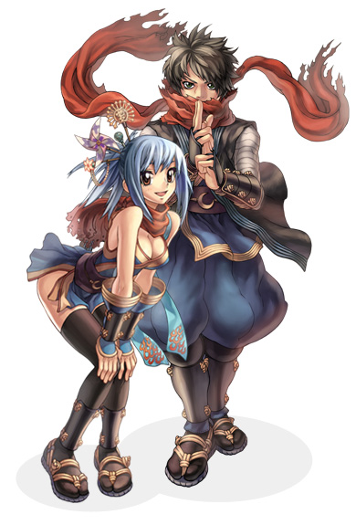

# Ninja

<!-- Job info -->
- **Job name:** Ninja
- **Job base:** Novice
- **Job type:** Extended
- **Changes at:** [Amatsu](Amatsu.md)
- **Skills:** 23
- **Skill points:** 175
- **Quest skills:** 0
- **STR:** 1
- **AGI:** 8
- **VIT:** 1
- **INT:** 5
- **DEX:** 6
- **LUK:** 4

## Overview

Ninjas have three types of attacks: magical attacks, throwing attacks , and "stealth" attacks. The main weapons are [Dagger](Dagger.md)s and [Huuma Shuriken](Huuma_Shuriken.md)s, large shurikens that can be throw using the skill [Throw Huuma Shuriken](Throw_Huuma_Shuriken.md). Ninjas can also endow themselves with several different abilities: [Cicada Skin Shed](Cicada_Skin_Shed.md) and [Mirror Image](Mirror_Image.md) prevents almost all non-magical damage from harming them. [Flip Tatami](Flip_Tatami.md) gives the same protection from ranged attacks as [Pneuma](Pneuma.md) for three seconds so long as he or she does not change position and also knocks surrounding monsters away. [Ninja Aura](Ninja_Aura.md) is a self buff that adds +5 [STR](Stats.md) and +5 [INT](Stats.md), as well as allowed [Mirror Image](Mirror_Image.md) and [Killing Strike](Killing_Stroke.md) to be used.

Ninjas and [Gunslinger](Gunslinger.md)s are expanded classes and cannot rebirth or be adopted. Because of this, Ninjas and Gunslingers are granted 69 skill points to distribute.

## Jobchange Guide

*See [Ninja Job Change Guide](First_Expanded_Job_Change_Guides.md) for information.*

## Builds

## Magic

*  STR: 1
*  AGI: 1
*  VIT: x (remaining points go here)
*  INT: 95 base or 95 total
*  DEX: 99 base
*  LUK: 9

This build is similar to a [Mage](Mage.md) or [Wizard](Wizard.md), but has its own set of unique skills to take advantage of. Magic Ninjas max out their [DEX](Stats.md) to make the best use of their skills which all have short cast time and delay, then have varying amounts of [INT](Stats.md) and [VIT](Stats.md). Their second and third tier magic skills all require catalyst stones which are sold by an NPC in [Amatsu](Amatsu.md). Their primary damage skills are [Freezing Spear](Freezing_Spear.md) and [Exploding Dragon](Exploding_Dragon.md), with [First Wind](First_Wind.md) also being an option. [Cicada Skin Shed](Cicada_Skin_Shed.md) is essential to increase survivability, while [Ninja Aura](Ninja_Aura.md) gives a boost to [INT](Stats.md).

While not the strongest damage dealers, Magic Ninjas still deal respectable damage and can easily drop unprepared opponents. [Blaze Shield](Blaze_Shield.md) is good for slowing down monsters and players, [Freezing Spear](Freezing_Spear.md) for harassing targets with its rapid hits, and [First Wind](First_Wind.md) is an [AoE](Area_of_Effect.md) spell that hits targets over [Magnetic Earth](Magnetic_Earth.md). [Cicada Skin Shed](Cicada_Skin_Shed.md) helps offset the low [HP](Max_HP.md) Modifier, but Magic Ninjas have to be careful of skills such as [Soul Destroyer](Soul_Destroyer.md) that will bypass their [Cicada Skin Shed](Cicada_Skin_Shed.md), along with status effects.

Of the different Ninja builds, the Magic Ninja is the fastest leveler.

Primary Skills : [Freezing Spear](Freezing_Spear.md), [Blaze Shield](Blaze_Shield.md), [Exploding Dragon](Exploding_Dragon.md), [Cicada Skin Shed](Cicada_Skin_Shed.md)

Complementary Skills : [Ninja Aura](Ninja_Aura.md), [First Wind](First_Wind.md)

The way the points should be distributed is as follows:

    * INT - 70
    * DEX - 60
    * INT - 95
    * DEX - 99
    * VIT - Remaining points.

## Throwing

*  STR: 9x
*  AGI: 1-8x
*  VIT: 1-8x
*  INT: 1-5x
*  DEX: 5x-8x
*  LUK: 1

Throwing builds attempt to capitalize on the Ninja's throwing skills. Throwing skills are based on [STR](Stats.md) for damage, so this is the primary stat. [DEX](Stats.md) is needed for both [Hit](Stats.md) rate and to reduce [Throw Huuma Shuriken](Throw_Huuma_Shuriken.md)'s cast time. Throw Huuma Shuriken is also [SP](SP.md) intensive, so a decent amount of [INT](Stats.md) is recommended. Remaining stat points go into either [AGI](Stats.md) or [VIT](Stats.md), depending on whether the Ninja is for PvM or [PvP](PvP~d29d2.md)/[WoE](War_of_Emperium.md).

Throwing builds are tougher to work with, as they have to spread out their stats and their skills are hard to increase the damage of. [Throw Shuriken](Throw_Shuriken.md) is a quick and cheap skil, that with enough [ASPD](ASPD.md) can be used quickly in succession to make up for its lower damage. [Throw Kunai](Throw_Kunai.md) is the middle-range skill, dealing more damage but with more delay and higher SP cost, yet is still cheap enough that it can be used as a primary leveling skill. [Throw Huuma Shuriken](Throw_Huuma_Shuriken.md) is the Throwing Ninja's burst damage skill, but performs poorly in PvP and WoE situations where opponents have more [DEF](DEF.md) and you don't have an [Element](Element.md) advantage as often.

The build is more item-reliant and expensive, needing [Shuriken](Shuriken.md), [Kunai](Kunai.md), and Huuma Shurikens. While daggers can be used to replace specially carded Huuma Shurikens, weapon switching during Throw Huuma Shuriken's cast time will also remove the weapon [Element](Element.md). If zeny is no object it's possible to build around [Throw Coins](Throw_Coins.md), but otherwise it's not recommended as the price will build up rapidly with regular use. Their leveling speed is slower then Magic Ninjas.

Primary Skills : [Throw Shuriken](Throw_Shuriken.md), [Throw Kunai](Throw_Kunai.md), [Throw Huuma Shuriken](Throw_Huuma_Shuriken.md), [Cicada Skin Shed](Cicada_Skin_Shed.md)

Complementary Skills : [Ninja Aura](Ninja_Aura.md)

## Killing Stroke

*  STR: 80-110
*  AGI: 4
*  VIT: 80-100
*  INT: 1-5x
*  DEX: 2x-5x
*  LUK: 6

This build focuses on the Ninja's skill [Killing Stroke](Killing_Stroke.md), a mini-[Guillotine Fist](Guillotine_Fist.md) of sorts. [STR](Stats.md) and [VIT](Stats.md) are the two stats driving Killing Stroke's damage and are thus the main stats for this build. [DEX](Stats.md) can be used for [Ninja Aura](Ninja_Aura.md)'s cast time, and for if the Ninja is going to need [HIT](Stats.md) to level him/herself. [INT](Stats.md) can also aid in leveling. A pure Killing Stroke Ninja may opt to discard some INT and DEX in favor of additional STR/VIT for Killing Stroke damage.

The objective of this build is to increase their [HP](Max_HP.md) substantially in order to boost Killing Stroke's damage. Gears such as the Goibne's set or [Battlegrounds](Battlegrounds.md) armors can aid in this. Due to the more linear calculation of Killing Stroke's damage and its reduction by [DEF](DEF.md), the damage will not match up with Guillotine Fist's. In PvM, targets for Killing Stroke must be chosen carefully; if the monster's HP or DEF is too high it will be harder to dispose of them, and Boss types receive reduced damage from Killing Stroke. This skill can be threatening in PvP, but loses its power in [WoE](War_of_Emperium.md) where the skill is hit rather hard by the 40% damage reduction. If taking this build into WoE, a Valorous or Glorious Huuma Shuriken can be used to boost Killing Stroke's damage to something more reasonable, but will also slow you down as you have to trigger their damage boost via attacks.

Since the build is STR-based, they can draw on the throwing skills in order to level. Without the higher DEX, [Throw Huuma Shuriken](Throw_Huuma_Shuriken.md) isn't as practical, and the lack of [ASPD](ASPD.md) does the same for Throw Shuriken. Throw Kunai requires no ASPD, and less [DEX](Stats.md), so it can be used as the build's leveling skill. However, the build's DEX can be raised somewhat to make room for Throw Huuma Shuriken. With a party it may be possible to level with Killing Stroke as well.

Primary Skills : [Ninja Aura](Ninja_Aura.md), [Killing Stroke](Killing_Stroke.md), [Cicada Skin Shed](Cicada_Skin_Shed.md)

Complementary Skills : [Throw Kunai](Throw_Kunai.md)

## Melee

*  STR: 9x
*  AGI: 1-8x
*  VIT: 1-8x
*  INT: 1-5x
*  DEX: 2x-5x
*  LUK: 1-3x

Melee ninjas tend to be the most difficult to level. This is mainly due to the high SP costs of skills. Its common for melee ninjas to pick up one or two skills from the throwing ninja skill tree, such as [Throw Shuriken](Throw_Shuriken.md), [Throw Kunai](Throw_Kunai.md), or [Throw Huuma Shuriken](Throw_Huuma_Shuriken.md), which tends to make leveling easier.

Melee ninjas get STR as their primary stat, AGI and/or VIT as a secondary stat, and the rest into DEX and INT. Due to the high SP cost of skills a decent amount of INT is recommended. Some ninjas choose to get some LUK to aid the skill [Shadow Slash](Shadow_Slash.md) which has a natural 50% chance to [CRIT](Stats.md).

## Equipment

## Weapons

* Magic Ninjas will primarily use the [Dagger](Dagger.md)s [Asura](Guillotine_Fist.md) or Bazerald, as those daggers raise their MATK. The Asura doesn't give an INT bonus like the Bazerald, but allows flexibility with its 3 card slots.
* Throwing Ninjas will primarily use the [Huuma Shuriken](Huuma_Shuriken.md)s. The Huuma Blaze Shuriken's high attack is useful for Throw Kunai, while the Huuma Calm Mind deals the best damage with Throw Huuma Shuriken. If a Ninja wants to opt for more defense, they can switch to using a Dagger and Shield instead, but cannot cast Throw Huuma Shuriken without switching back to a Huuma, and must remember the Dagger's size modifier. An [Ice Pick](Ice_Pick.md) is a useful weapon against high-DEF enemies.
* Killing Stroke Ninjas will want whichever weapon will give them the highest % modifier, those being 4 slotted Daggers or Huumas. Daggers are a better choice as they allow the Ninja to wear a shield, though against [Demi Human](Demi_Human.md) targets the [Battlegrounds](Battlegrounds.md) Huumas will deal more damage at the sacrifice of a shield.
* Melee Ninjas will primarily use various types of daggers to maximize on the damage output of their skills. Ninjas cannot wear Assassin Dagger, Counter Dagger, or Curse Dagger.

In general for all Ninja builds, a Fortune Sword is a notable weapon for using [Perfect Dodge](Perfect_Dodge.md) in combination with Cicada Skin Shed. Equipped with this and possibly other Perfect Dodge gears, a Ninja can be used to drag high-attack monsters with little risk, but must still be careful of magic and monsters' elemental attacks.

## Daggers

Aside from being able to equip most dagger type weapons, Ninja's are also able to equip Ninja-class only daggers, some of which are available through item quests.

**Ninja Class Daggers**

| Name | ATK | Element | Weapon Level | Weight | Required Level | Status | Dropped by |
| --- | --- | --- | --- | --- | --- | --- | --- |
| Asura [2], [3] | 50 | Neutral | 1 | 6 | 12 | MATK +10% | [2] from Job Change, [3] from Baby Desert Wolf |
| Murasame [1], [2] | 95 | Water | 2 | 70 | 24 | CRIT +10% vs. demi-human | [1] - Karakasa, [2] - Shinobi |
| Jitte [0], [1] | 70 | Neutral | 2 | 40 | 35 | Breaks Weapons | [1] - Kapha |
| Hakujin [0], [1] | 120 | Neutral | 3 | 80 | 42 | Chance of casting level 1 Heal | [0] - Miyabi Doll, [1] - Wanderer |
| Khukri | 150 | Shadow | 3 | 60 | 65 | Chance to Curse | Sky Petite |
| Kamaitachi | 125 | Wind | 4 | 90 | 70 | CRIT +3, ASPD +3% | The Paper |

## Armors

Ninjas wear mostly light-medium [DEF](DEF.md) armors, including the general armors such as Mantle/Coat/Formal Suit, and several of the [Thief](Thief.md) armors such as Thief Clothes and Ninja Suit. The Ninja Suit can combo with the Shinobi Sash to help reduce the Ninja's SP consumption. The Pantie + Undershirt combo can be useful for AGI Ninjas to compensate for the lack of [Flee](Stats.md) boosting skills. Being an Expanded class, Ninjas cannot wear any gears that are labeled as being only for Transcendent classes.

## Shields

* [Guard](Guard.md) [1]: The basic shield that any class can use. Good as a cheap and flexible shield, but is somewhat lacking in DEF.
* Arm Guard [1]: A special shield which only Ninjas can equip, that gives more DEF then a Guard. Obtainable through a quest. Be careful when carding these, as Ninjas are the only class that can equip them.
* Advanced Arm Guard [1]: Similar to the Arm Guard, but trades 1 DEF for 5 MDEF. The Valkyrja's Shield is a better choice if the player is worried about magic damage though.
* Valkyrja's Shield [1]: The shield preferred by most players for PvP and WoE, due to its [Element](Element.md) resistances and being usable by any class.

*See [Ninja Equipment Quests](Ninja_Equipment_Quests.md) for information on how to make Arm Guards.*

## Ammunition & Catalysts

Ninjas have two types of ammunition: [Shuriken](Shuriken.md) and [Kunai](Kunai.md). In addition, certain Ninja skills require catalysts that can only be purchased in Amatsu.

## Shuriken

Used for the skill Throw Shuriken. The bonus damage added by the skills [Dagger Throwing Practice](Dagger_Throwing_Practice.md) and [Throw Shuriken](Throw_Shuriken.md) act like mastery bonuses and therefore bypass normal defense.  It will also hit, even if the Ninja would normally miss it's target.

*See [Shuriken](Shuriken.md) for a list of available Shurikens.*

## Kunai

Used for the skill [Throw Kunai](Throw_Kunai.md). The damage done by [Kunai](Kunai.md) also bypasses most the enemies defense and will hit, even if the Ninja would normally miss. Also, Kunai have to be manufactured, unlike [Shuriken](Shuriken.md) which can be purchased from the NPC directly. Only Ninjas can make Kunai through an NPC at the Ninja Guild in Amatsu.

*See [Kunai](Kunai.md) for a list of available Kunai.*

## Catalysts

Catalyst Stones are needed to cast various magic-type Ninja skills and to manufacture [Kunai](Kunai.md).

**Catalyst Stones:**

| Name | Cost | Required for |
| --- | --- | --- |
| Flame Stone | 150z | [Blaze Shield](Blaze_Shield.md) and [Exploding Dragon](Exploding_Dragon.md) |
| Ice Stone | 150z | [Watery Evasion](Watery_Evasion.md) and [Snow Flake Draft](Snow_Flake_Draft.md) |
| Wind Stone | 150z | [Lightning Jolt](Lightning_Jolt.md) and [First Wind](First_Wind.md) |
| Shadow Orb | 200z | [Mirror Image](Mirror_Image.md) |

## Class Data

## Skills

Ninjas have three primary branches of skills: Throwing, Deception and Magic. The player can opt to master one branch, or mix elements from two branches. They also have the sub-branch with supportive skills, and an "Ultimate" skill.

Throwing skills rely on the user's [STR](Stats.md) for damage, while Magic skills use [INT](Stats.md), meaning that these two branches are rarely mixed. Deception is a mix of evasion skills and attack skills, and usually all Ninja builds will include [Cicada Skin Shed](Cicada_Skin_Shed.md) due to its usefulness in avoiding attacks.

| Skill | Description | Levels | Type |
| --- | --- | --- | --- |
| [Dagger Throwing Practice](Dagger_Throwing_Practice.md) | Gives a [Weapon Mastery](Weapon_Mastery.md)-type damage bonus to Throw Shuriken. | 10 | Passive |
| [Throw Shuriken](Throw_Shuriken.md) | Throw a Shuriken to deal a small amount of damage, but with little delay. | 10 | Offensive |
| [Throw Kunai](Throw_Kunai.md) | Throw a Kunai to deal three hits. | 5 | Offensive |
| [Throw Huuma Shuriken](Throw_Huuma_Shuriken.md) | Use a [Huuma Shuriken](Huuma_Shuriken.md) to strike all targets in a 3x3 area around the target. | 5 | Offensive |
| [Throw Coins](Throw_Coins.md) | Throw a random amount of [Zeny](Zeny.md) at the target to deal [DEF](DEF.md)-piercing damage. | 10 | Offensive |
| [Flip Tatami](Flip_Tatami.md) | Deal damage and knockback nearby enemies, and create the [Pneuma](Pneuma.md) effect on one cell of the ground. | 5 | Offensive |
| [Shadow Leap](Shadow_Leap.md) | From the [Hiding](Hiding.md) status, instantly move to a target cell. (But not through solid obstacles.) | 5 | Active |
| [Haze Slasher](Haze_Slasher.md) | Strike a target and enter the [Hiding](Hiding.md) status. | 10 | Offensive |
| [Shadow Slash](Shadow_Slash.md) | From the [Hiding](Hiding.md) status, instantly move to target enemy and strike them with a chance for a critical hit. | 5 | Offensive |
| [Cicada Skin Shed](Cicada_Skin_Shed.md) | Evade up to three physical attacks, with each trigger moving the Ninja away from the attacker. | 5 | Active |
| [Mirror Image](Mirror_Image.md) | Evade up to five physical attacks, without the pushback that Cicada Skin Shed has. | 10 | Active |
| [Flaming Petals](Flaming_Petals.md) | Attack a single target with up to 10× MATK [Fire](Fire.md)-element damage. | 10 | Offensive |
| [Blaze Shield](Blaze_Shield.md) | Create a 5x5 field of fire that stalls enemies and rapidly deals [Fire](Fire.md)-element damage. | 10 | Offensive |
| [Exploding Dragon](Exploding_Dragon.md) | Summon a flaming dragon to deal [Fire](Fire.md)-element damage to all enemies in the 5x5 area around the target. | 5 | Offensive |
| [Freezing Spear](Freezing_Spear.md) | Attack a single target with up to 12x MATK [Water](Water.md)-element damage. | 10 | Offensive |
| [Watery Evasion](Watery_Evasion.md) | Create a field of water that slows down all enemies, except for other Ninjas. | 10 | Active |
| [Snow Flake Draft](Snow_Flake_Draft.md) | Summon down a block of ice to deal [Water](Water.md)-element damage to nearby enemies, with a chance of freezing them. | 5 | Offensive |
| [Wind Blade](Wind_Blade.md) | Attack a single target with up to 6x MATK [Wind](Wind.md)-element damage. | 10 | Offensive |
| [Lightning Jolt](Lightning_Jolt.md) | Summon down a lightning bolt to strike all nearby enemies for [Wind](Wind.md)-element damage. | 10 | Offensive |
| [First Wind](First_Wind.md) | Strike all targets within a 3-cell wide path to the target with [Wind](Wind.md)-element damage. | 5 | Offensive |
| [Ninja Aura](Ninja_Aura.md) | Sacrifice a small amount of HP to increase INT and STR, and allow the casting of Mirror Image and Killing Stroke. | 5 | Active |
| [Ninja Mastery](Ninja_Mastery.md) | Passively increases SP recovery speed when not moving. | 10 | Passive |
| [Killing Stroke](Killing_Stroke.md) | Reduce the Ninja's HP to 1 in order to deal a strong blow to a single target. | 10 | Offensive |

## Job Bonuses

**Job Bonus**

| Stat\Amount | +1 | +2 | +3 | +4 | +5 | +6 | +7 | +8 |
| --- | --- | --- | --- | --- | --- | --- | --- | --- |
| STR | 59 |   |   |   |   |   |   |   |
| AGI | 1 | 2 | 12 | 21 | 31 | 41 | 51 | 61 |
| VIT | 60 |   |   |   |   |   |   |   |
| INT | 20 | 29 | 42 | 50 | 62 |   |   |   |
| DEX | 11 | 22 | 32 | 43 | 53 | 63 |   |   |
| LUK | 30 | 40 | 52 | 64 |   |   |   |   |

## ASPD

Base [ASPD](ASPD.md) Values:
* Unarmed: 160
* Dagger: 150
* Huuma: 125

Ninjas can use [Concentration](Spear_Dynamo.md) and Awakening Potions, but cannot use Berserk Potions.

## HP

| Column 1 | Column 2 |
| --- | --- |
| **Level** | **HP** |
| 1 | 40 |
| 2 | 47 |
| 3 | 54 |
| 4 | 61 |
| 5 | 69 |
| 6 | 77 |
| 7 | 85 |
| 8 | 94 |
| 9 | 103 |
| 10 | 202 |
| 11 | 212 |
| 12 | 222 |
| 13 | 232 |
| 14 | 243 |
| 15 | 254 |
| 16 | 265 |
| 17 | 277 |
| 18 | 289 |
| 19 | 301 |
| 20 | 316 |

| Column 1 | Column 2 |
| --- | --- |
| **Level** | **HP** |
| 21 | 331 |
| 22 | 346 |
| 23 | 364 |
| 24 | 382 |
| 25 | 400 |
| 26 | 420 |
| 27 | 440 |
| 28 | 460 |
| 29 | 482 |
| 30 | 504 |
| 31 | 526 |
| 32 | 548 |
| 33 | 572 |
| 34 | 596 |
| 35 | 620 |
| 36 | 646 |
| 37 | 672 |
| 38 | 698 |
| 39 | 726 |
| 40 | 754 |

| Column 1 | Column 2 |
| --- | --- |
| **Level** | **HP** |
| 41 | 784 |
| 42 | 814 |
| 43 | 844 |
| 44 | 876 |
| 45 | 908 |
| 46 | 940 |
| 47 | 975 |
| 48 | 1,010 |
| 49 | 1,100 |
| 50 | 1,140 |
| 51 | 1,180 |
| 52 | 1,220 |
| 53 | 1,260 |
| 54 | 1,300 |
| 55 | 1,340 |
| 56 | 1,385 |
| 57 | 1,430 |
| 58 | 1,475 |
| 59 | 1,520 |
| 60 | 1,565 |

| Column 1 | Column 2 |
| --- | --- |
| **Level** | **HP** |
| 61 | 1,615 |
| 62 | 1,665 |
| 63 | 1,715 |
| 64 | 1,765 |
| 65 | 1,815 |
| 66 | 1,880 |
| 67 | 1,935 |
| 68 | 1,990 |
| 69 | 2,045 |
| 70 | 2,100 |
| 71 | 2,160 |
| 72 | 2,220 |
| 73 | 2,280 |
| 74 | 2,340 |
| 75 | 2,400 |
| 76 | 2,460 |
| 77 | 2,520 |
| 78 | 2,580 |
| 79 | 2,640 |
| 80 | 2,705 |

| Column 1 | Column 2 |
| --- | --- |
| **Level** | **HP** |
| 81 | 2,770 |
| 82 | 2,835 |
| 83 | 2,900 |
| 84 | 2,965 |
| 85 | 3,030 |
| 86 | 3,100 |
| 87 | 3,170 |
| 88 | 3,240 |
| 89 | 3,310 |
| 90 | 3,380 |
| 91 | 3,455 |
| 92 | 3,530 |
| 93 | 3,605 |
| 94 | 3,680 |
| 95 | 3,760 |
| 96 | 3,840 |
| 97 | 3,920 |
| 98 | 4,000 |
| 99 | 4,080 |

## External Links

*  [Himeyasha's Skill Simulator](http://web.hc.keio.ac.jp/~fk061999/himeyasha/skill3/nnj.html)

**Related pages:**

* [Ninja](Ninja.md)
* [Skills](Skills.md)
* [Blaze Shield](Blaze_Shield.md)
* [Cicada Skin Shed](Cicada_Skin_Shed.md)
* [Dagger Throwing Practice](Dagger_Throwing_Practice.md)
* [Exploding Dragon](Exploding_Dragon.md)
* [First Wind](First_Wind.md)
* [Flaming Petals](Flaming_Petals.md)
* [Flip Tatami](Flip_Tatami.md)
* [Freezing Spear](Freezing_Spear.md)
* [Haze Slasher](Haze_Slasher.md)
* [Killing Stroke](Killing_Stroke.md)
* [Lightning Jolt](Lightning_Jolt.md)
* [Mirror Image](Mirror_Image.md)
* [Ninja Aura](Ninja_Aura.md)
* [Ninja Mastery](Ninja_Mastery.md)
* [Shadow Leap](Shadow_Leap.md)
* [Shadow Slash](Shadow_Slash.md)
* [Snow Flake Draft](Snow_Flake_Draft.md)
* [Throw Coins](Throw_Coins.md)
* [Throw Huuma Shuriken](Throw_Huuma_Shuriken.md)
* [Throw Kunai](Throw_Kunai.md)
* [Throw Shuriken](Throw_Shuriken.md)
* [Watery Evasion](Watery_Evasion.md)
* [Wind Blade](Wind_Blade.md)
* [Quests](Quests.md)
* [Ninja Equipment Quests](Ninja_Equipment_Quests.md)
* [First Expanded Job Change Guides](First_Expanded_Job_Change_Guides.md)
* [Ninja Weapon Quests](Ninja_Weapon_Quests.md)
* [Weapons](Weapons.md)
* [Kunai](Kunai.md)
* [Shuriken](Shuriken.md)
* [Huuma Shuriken](Huuma_Shuriken.md)

**Related pages:**

* [Classes](Classes.md)
* [Novice](Novice.md)
* [High Novice](High_Novice.md)
* [Super Novice](Super_Novice.md)
* [Acolyte](Acolyte.md)
* [Archer](Archer.md)
* [High First Class](High_First_Class.md)
* [Mage](Mage.md)
* [Merchant](Merchant.md)
* [Swordman](Swordman.md)
* [Thief](Thief.md)
* [Priest](Priest.md)
* [Monk](Monk.md)
* [Hunter](Hunter.md)
* [Bard](Bard.md)
* [Dancer](Dancer.md)
* [Wizard](Wizard.md)
* [Sage](Sage.md)
* [Blacksmith](Blacksmith.md)
* [Alchemist](Alchemist.md)
* [Knight](Knight.md)
* [Crusader](Crusader.md)
* [Assassin](Assassin.md)
* [Rogue](Rogue.md)
* [Transcendent](Transcendent.md)
* [High Priest](High_Priest.md)
* [Champion](Champion.md)
* [Sniper](Sniper.md)
* [Minstrel](Minstrel.md)
* [Gypsy](Gypsy.md)
* [High Wizard](High_Wizard.md)
* [Scholar](Scholar.md)
* [Mastersmith](Mastersmith.md)
* [Biochemist](Biochemist.md)
* [Lord Knight](Lord_Knight.md)
* [Paladin](Paladin.md)
* [Assassin Cross](Assassin_Cross.md)
* [Stalker](Stalker.md)
* [Gunslinger](Gunslinger.md)
* [Ninja](Ninja.md)
* [TaeKwon Kid](TaeKwon_Kid.md)
* [TaeKwon Master](TaeKwon_Master.md)
* [Soul Linker](Soul_Linker.md)

---
**Categories:** [Classes](categories/Classes.md), [Ninja](categories/Ninja.md)
*Source: [iRO Wiki Classic](https://irowiki.org/classic/Ninja) — GFDL 1.3+*
