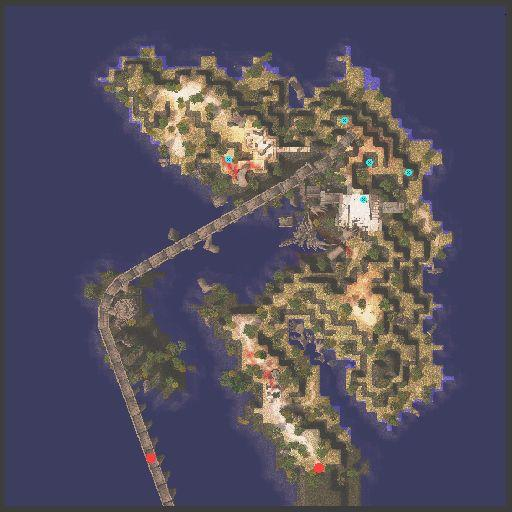

# Odin's Temple Excavation Quest

<!-- Quest info -->
- **Level requirement:** 60
- **Item requirement:** 5 Rune of Darkness
- **Zeny requirement:** 2,400
- **Base EXP reward:** 700,000
- **Item reward:** 1 Old Blue Box
- **Window:** yes

1. Talk to the signboard in the middle of Hugel advertising an expedition to Odin's Shrine/Temple (91, 152).

2. Find the house in the southwest area of town, and go in (52,95)

3. Talk to either Laura in the room to the right (13,11) or Alex in the room to the left (18, 160) to join them.

## Alex Path

1. Talk to Alex in the room to the north, who asks you to look around the Shrine first before she hires you.

2. Go to the boatman (209,109) and take the boat to Odin's Temple/Shrine (Costs 800z).

3. Go back to Hugel and talk to Alex again. She'll ask you once more if you want to join. Accept, and she'll ask you to bring 5 Rune of Darkness from the Shrine.

4. Bring them back to her, and she'll thank you and give you an Old Blue Box.
* Note: If you choose to use Runes collected beforehand, you'll still need to make a trip back to the Temple for her to accept them.

## Laura Path

1. Talk to Laura in the room to the south (hu_in01 14 11), she will ask you to check Odin's Temple.

2. Talk to the boatman in Hugel (209 109), and go to Odin's Temple.

3. Talk to Laura again, and she will ask you to collect 5 Rune of Darkness.

4. Proceed to Odin's Temple to collect the required items.
* Note: If you choose to use Runes collected beforehand, you'll still need to make a trip back to the Temple for her to accept them.

5. Return to Laura and she will reward player with 1 Old Blue Box.

## Continuing from Either Path

1. Talk to Laura in the next room, and she'll ask you to spy on Alex in order to find out what they discovered.

2. Walk over to the portal to the room Alex is in and listen in to their conversation. They discuss the Heart of Ymir as well as Shinokas from the [Einbroch Murder Quest](Einbroch_Murder_Quest.md) and something called "Giantes."

3. Laura asks you to go to the Shrine once more and visit the third map to see if you can find out what's going on.

4. Go to the third map (odin tem03) of the Shrine, and visit the following locations (one of the warps will work, but you may not need to visit them all):

*  (288,271)
*  (266,302)
*  (321,263)
*  (179,275)
*  (283,241)

One of them will warp you to an Underground Shrine. Walk down the path and you find some ruins. Walk around, and windows will pop up telling you you've walked past some object. Choose "Explore" until you find one that works, and a hammer will whack you on the head. When you come to, you'll find the ruins have vanished. Walk back up, and you'll be warped back to the island (But not necessarily the place you got warped from).

5. Head back to the Excavation HQ, and you find Alex and Laura arguing.

6. Walk back out, and just before the portal to exit, Ashe asks you to carry a file folder to [Morroc](Morroc.md).

7. Head to the map below [Morroc](Morroc.md) just south of the city. Walk up to the portal leading to [Morroc](Morroc.md), and you'll trigger a dialog box (around 161, 365).

8. You drop the file, and can ask the entity about one person. If you ask about Laura however, you'll also be told about Ashe.

*  Receive ~700,000 [Base Experience](Base_EXP_Chart.md).

9. When you return to the Excavation HQ in [Hugel](Hugel.md), you find everything is gone.

---
**Categories:** [Base Experience Reward](categories/Base_Experience_Reward.md), [Hugel Quests](categories/Hugel_Quests.md), [Quest Window Quests](categories/Quest_Window_Quests.md), [Quests](categories/Quests.md)
*Source: [iRO Wiki Classic](https://irowiki.org/classic/Odin%27s_Temple_Excavation_Quest) — GFDL 1.3+*
