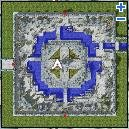
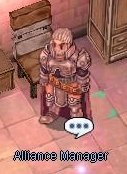

# Onward to the New World Quest

<!-- Quest info -->
- **Level requirement:** 70
- **Item requirement:** 300 Jellopy, 1 Emerald, 1 Ruby
- **Hunting:** 50 Mobster
- **Base EXP reward:** 1,320,000
- **Job EXP reward:** 420,000
- **Quest reward:** Access to the New World
- **Window:** yes

<big>**Note: This quest is not available yet on iRO Classic.**</big>

1.  Talk to the Recruiter for the Brave in the [Prontera](Prontera.md) Castle (prt_castle 83, 67) (north-west corner of first castle room when entering from within [Prontera](Prontera.md)). Tell him you're interested in his mission, which is to visit a "special place." He then asks you to visit a Promotional Staff member in [Aldebaran](Al_De_Baran.md).
  * *[image not archived: Castle.jpg‎]*
1.  Talk to the Promotional Staff member in [Aldebaran](Al_De_Baran.md) ([Aldebaran](Al_De_Baran.md) 127, 138). As a test, he asks you to bring him 300 Jellopy. After handing over the Jellopy, he asks you to visit a Promotional Staff Member in [Geffen](Geffen.md).

  * 

1.  In Geffen, talk to the staff member ([Geffen](Geffen.md) 90, 67). He asks you to bring 1 Emerald. After turning it in, he asks you to bring 1 Ruby. Bring him the Ruby, and he sends you to talk to the next staff member in [Izlude](Izlude.md).
  * *[image not archived: Geffen.jpg‎]*
1.  In [Izlude](Izlude.md), talk to the staff member ([Izlude](Izlude.md) 99, 136). If you are at least [base level](Levels.md) 70, he tells you that you've passed the tests, and to talk to the Recruiter in [Prontera](Prontera.md) Castle again.
  * *[image not archived: Izlude.jpg‎]*
1.  Return to the Recruiter, who says you are now ready to explore the "Ash-Vacuum" which is an entirely different place from Rune Midgard. He tells you go to to [Lighthalzen](Lighthalzen.md) to register for the United Midgard Alliance.
  * Receive 660,000 [Base EXP](Base_EXP_Chart.md)
  * Receive 210,000 [Job EXP](Job_EXP_Chart.md)
1.  In [Lighthalzen](Lighthalzen.md), go into Rekenber HQ ([Lighthalzen](Lighthalzen.md) 101, 246) and talk to the Guards upstairs (lhz_in01 124, 234), who let you in to register.
  * *[image not archived: Lhz.jpg‎]*
1.  Talk to Sikaiz at the front of the room, who's giving a speech.
1.  After Sikaiz is finished lecturing, speak to him again and he will tell you about the Ash Vaccum and Satan Morroc's gateway.
1.  Speak to him again and he will ask you to inform the Alliance Manager in Rune Midgards that they are ready to depart.
1.  The Alliance Manager in [Prontera](Prontera.md) Castle (prt_castle 121, 51) will discuss with you how the kingdom feels about the upcoming expedition.

  * 

1.  Go back to Sikaiz in [Lighthalzen](Lighthalzen.md), who tells you about the Three Kingdom's Alliance and his aide Munkenro. Munkenro interrupts your conversation and you're asked to deliver a message to the Alliance Manager in [Rachel](Rachel.md).
1.  Find the Arunafeltz Alliance Manager outside the temple (ra temple 119, 113) and report the status to her.
  * *[image not archived: Rachel.jpg‎]*
1.  Go back to Sikaiz, who registers you and sends you to talk to some Officers to let them know of your departure. Go downstairs to the banquet hall (147, 179) and talk to them, but first you overhear them plotting to ignore the peace and take control of things for themselves.
1.  Report back upstairs, but the guards won't let you in. Walk to (148, 257), where you're able to overhear Munkenro talking to someone.
1.  Talk to the Guard outside of the lecture hall (lhz_in01 130, 231). Ask it to teleport you immediately to the Continental Guard Quarantine (moc_fild20), and talk to the Rift Guard (moc fild20 349, 179). He takes you to the Dimensional Gorge.
  * *[image not archived: Mocfild.jpg‎]*
1.  From the middle of the right side of the map, go towards the center until you reach Munkenro (moc_fild22b 230, 197). He says Sikaiz has "retired" and that he is now the alliance leader. He also requires you to pass another test, by defeating 50 Mobsters.
  * *[image not archived: Moc22b.jpg‎]*
1.  After passing the test, talk to Munkenro again, who sends you to the Ash-Vacuum.
  * Receive 660,000 [Base EXP](Base_EXP_Chart.md)
  * Receive 210,000 [Job EXP](Job_EXP_Chart.md)

* **Note:** To ensure you can travel around in the New World, start [New Surroundings](New_Surroundings.md) and [Attitude to the New World](Attitude_to_the_New_World.md).

---
**Categories:** [Ash Vacuum Quests](categories/Ash_Vacuum_Quests.md), [Base Experience Reward](categories/Base_Experience_Reward.md), [Job Experience Reward](categories/Job_Experience_Reward.md), [New World Quests](categories/New_World_Quests.md), [Quest Window Quests](categories/Quest_Window_Quests.md)
*Source: [iRO Wiki Classic](https://irowiki.org/classic/Onward_to_the_New_World_Quest) — GFDL 1.3+*
